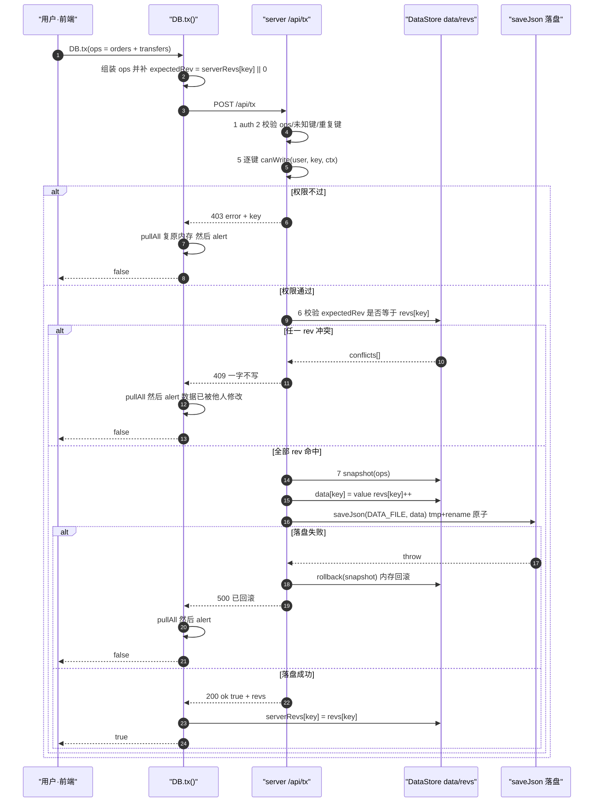
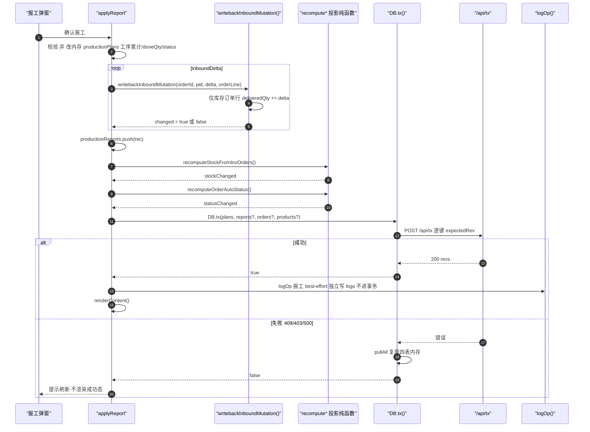
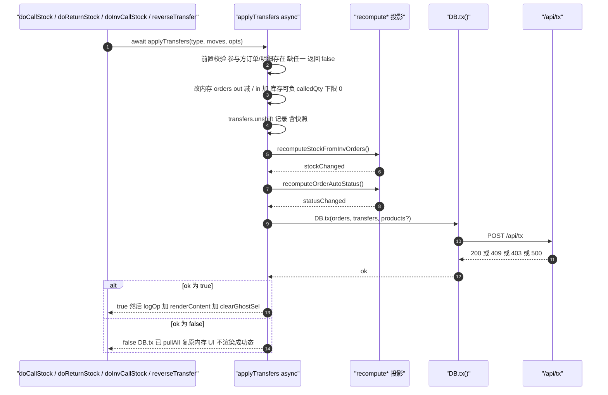
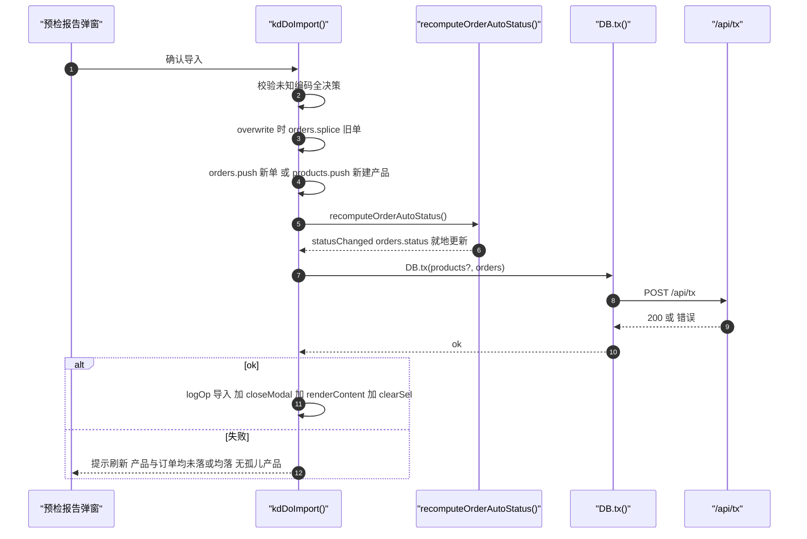
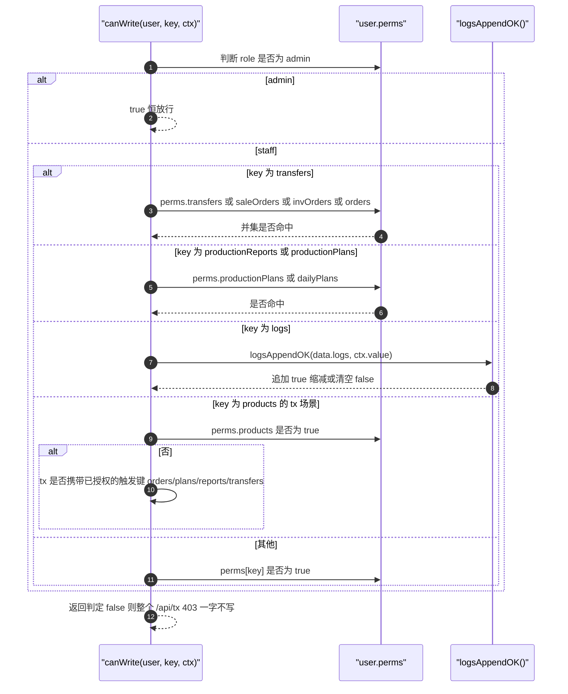
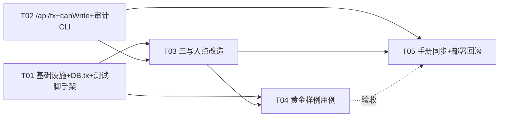

# P1 地基轮 · 增量架构设计 + 任务分解

> 系统：辰微生产排产系统（prod-scheduler） · 线上 http://111.231.167.192
> 作者：高见远（架构师） · 日期：2026-09-11 · 目标 build：`2026-09-11.124`
> 上游：主理人侦察报告（本轮范围已由用户拍板，不可扩大）
> 对齐手册：`docs/ai/`（build .122）
> 铁律：零依赖（无 package.json / 无 npm / 无构建） · 不改 `index.html` 6153 行大结构 · 存量数据变更须逐项经用户确认 · 可回滚

> ### ⚠️ 实施期勘误（2026-09-11 收尾补记，**实现以本节为准，正文对应处已过期**）
>
> 1. **§6.3 G17 字面错误**：原文写「车间 → `transfers` 403」与 §5.1 并集规则自相矛盾。线上真值 **`chejian` 持有 `transfers:true`**，故正确结果是 **200**（并集命中）。**§5.1 并集规则不动**，G17 实际实现为三断言：无调拨权账号→403 / `zongjingli`→403 / `chejian`→200。
> 2. **§5.2 `logsAppendOK` 伪代码有漏洞**：`for(p=0; p<=neu.length; p++)` 在 `p===neu.length` 时尾部为空，且 `neu.length===500` 时 `500-p=0` 使期望值也为空 → 两空数组「长度相等」直接放行。实测 `old=1 条 → neu=500 条全伪造` **★放行**，即非 admin 可整表覆盖审计日志。**修复：`p < neu.length` + 显式 `if(neu.length===0) return false`**（已实现，10 项矩阵全过）。
> 3. **§5.2 矩阵第 ⑦ 行 + §9.3-KR1 作废**：「伪造最新 1 条（触顶）」修好后**收敛为拦截**；`logOp` 只有「前插一条 + 截 500」，不存在产生该形状的合法客户端路径，关闭它零功能代价。**KR1 已消除，不再是残留。**
> 4. **新增修复（设计未覆盖，实施期发现）**：`js/logs.js` 的 `logOp` 原为 `save('logs',logs)`（未传 `silent`），而 `.123` 乐观锁会给 `logs` 做 rev 校验 → 并发时**主业务写成功却弹「本次保存未生效」假告警**。已改为 `save('logs',logs,true)`；另「清空日志」按钮对非 admin 不渲染、`clearLogs` 加 admin 闸门。
> 5. **本轮实际收敛范围**：只做 T01/T02/T03；T04 黄金样例已随 T01/T02/T03 交付（`tests/` 共 **73 个单测 + 35 项真机 HTTP 断言**）；**T05 手册同步降为收尾几行**；`saveProdPlan`/`delProdPlan` 两表非原子写 **仍未迁移**（KR2 保留，下一轮）。
>
> 修订原因：主理人在实施期用线上真实 `users.json` 与独立复现发现了上述问题。**设计于 T03 交付后冻结，不再迭代。**

---

## 〇、结论速览（TL;DR）

| 交付项 | 方案 | 关键决策 |
|---|---|---|
| 事务地基 | 新增后端 `POST /api/tx`（多键原子提交） | 快照回滚 + 单次 `saveJson`（tmp+rename）保证「一字不写 / 全部生效」 |
| 幂等 | **本轮不引入持久化 `requestId`** | 用 `expectedRev` 乐观锁天然防重复提交（第二次同 rev 必 409） |
| 三个写入点 | transfer / import / 报工族（3 个函数） | 前端内存改完 → **投影前置重算** → 一次 `/api/tx` |
| 投影时机 | **写盘前算好并入同一事务**（非写盘后触发） | 投影是纯函数，前置=后置同值，且消除第二个失败点 |
| 审计边界 | 收紧 `canWrite`，`logs` 追加白名单，`products` **字段级投影守卫（方案 α′）** | 已按线上真值验证**零误伤**；**零存量迁移、不动 users.json**；`canWrite` 单一判定点（`/api/save` 与 `/api/tx` 共用） |
| **D1 · 顺带修缺陷** | 并集 + α′ 一并修复 staff 报工/库存保存的**静默 403**（线上实测确认） | 用户已拍板**本轮必做**；见 §5.3/§5.4 |
| 测试地基 | Node 内置 `node:test` + `vm` 沙箱桩 | 零依赖、不改生产代码；DOM 渲染类明确列为不可测边界 |
| 手册同步 | 5 份 YAML + README | 更新后 `validate.py` 必须仍 PASS |
| 本轮范围（用户拍板） | **D1 修**（并集+α′）· **D2 不迁** `saveProdPlan`/`delProdPlan` · **D3 不动** `meta/tblLayout/fieldsAudit/Draft` | 残余风险登记于 §9.3 |

---

## 一、侦察纠偏（先读这段，避免工程师改错点）

> 主理人侦察基本准确，有 6 处需纠正/补充（C1–C6）；另有 **C7：线上真值反转了初版的推断**（见下），一并修订。

| # | 纠正/补充 | 证据 | 影响 |
|---|---|---|---|
| **C1** | `writebackInbound()` 有 **5 个调用点**，不止 3 个 | `index.html:3878`（编辑报工）`:3919`（删除报工）`:4266`（saveProdPlan 取消/恢复）`:4321`（delProdPlan 删除排产单）`:4643`（applyReport 报工） | 「报工族」实为 **3 个报工函数 + 2 个排产函数**共用同一回写器 |
| **C2** | **`saveProdPlan`(:4266) 与 `delProdPlan`(:4321) 也是「orders + productionPlans」两表写入**，同款非原子 | `index.html:4266`+`:4290`；`:4321`+`:4324` | 按用户「不可扩大范围」本轮**不迁**，但必须在文档标注为**残余风险（下一轮 P1）**，不能当没看见 |
| **C3** | 主理人给的行号有错位：`L3875/3876/3878` 实际属于 **`ppSaveReportEdits`（编辑报工）**，不是 `applyReport`；`applyReport` 的三表写在 `:4641/:4643/:4655` | `index.html:4613`(applyReport 定义) `:4641` `:4655`；`:3875/:3876/:3878`(ppSaveReportEdits) | 若按错行号改，会漏改 `applyReport` |
| **C4** | `save('` 全仓 **91 处出现**（index.html 86 + js 5），非 69 | `grep -oE "save\('"` → 86 / 5 | 全部须保持兼容；`DB.set` 汇聚点仅 4 处（`index.html:552` `:1195`、`js/transfer.js:348`） |
| **C5** | **报工路径的 `products` 投影写入，今天对「车间」账号很可能已 403**（`writebackInbound`→`syncStockFromInvOrders`→`save('products')` 非 silent），而车间通常无 `perms.products` | `index.html:4610`→`:3534`；`server/server.js:194` | 直接决定 `/api/tx` 里 `products` 必须用「触发键授权」而非 `perms.products`（见 §3.2） |
| **C6** | **权限键命名不一致（重大）**：前端/员工面板用 `dailyPlans`（`formToKey('prodPlan')='dailyPlans'`），但**服务端 `canWrite` 对表键 `productionPlans` 走的是 `perms['productionPlans']`**，而 `STAFF_PERMS` 里没有该键 | `index.html:504` vs `server/server.js:194` + `:81` | 实测证实：`productionPlans` 键 **4 账号全 undefined** → **staff 报工主链线上恒 403**（D1 缺陷）。并集 `dailyPlans` 修复 |
| **C7** | **线上真值反转初版推断**（主理人提供，架构师不可读 `users.json`）：① `productionPlans` 键 4 账号全无 → 初版「若 `dailyPlans=false` 属既有问题」的前提**证伪**（实为 `dailyPlans=true` 但服务端查错键）；② `zongjingli` 无 `transfers` 键却实测可 **200 覆盖 122 条台账** = 真实越权；③ `products` 键 4 账号全 false → **多表投影写（pmc 存/删库存订单、编辑排产单）线上恒 403**，且调用点**不止待迁的 3 个** | 见 §5.3 真值表与验证矩阵 | 直接促成 **D1（必须修）+ 方案 α′（字段级投影守卫）**；并明确 **零存量迁移** |

> 另：`docs/ai/README.md` 写 `index.html 6125 行`、`server.js 241 行`，实际为 **6153 / 361 行**（手册行号已漂移，属本轮手册同步待修项）。
> 另：`logOp(` 实际 **73 处**调用（非 75），`clearLogs` 在 `js/logs.js:52`。
> 另：`syncStockFromInvOrders()` 共 **6 个调用点**（`index.html:3373` 存库存订单 / `:3469` 删库存订单 / `:4610` 报工回写 / `:5949` 恢复备份[admin] / `:6062` 启动迁移[admin] + `js/transfer.js:328`），**其中 3 个本轮不迁 tx，正是它们使 `products` 必须走服务端 α′ 守卫**（初版只判 tx，是缺口）。

---

## 二、Part A · 系统设计

### 2.1 实现路径（Implementation Approach）

**核心难点**（全部来自真实代码）：

1. **无事务下单次操作跨多表整键替换** —— `server/server.js:263-286` 的 `/api/save` 是「整键替换 + `saveJson`」。语义上能保证**单键**原子（`:38-42` tmp+rename），但前端一次业务动作发**多次**独立 `/api/save`，中间失败即永久不一致（`INV-020`，`flows.yaml#transfer.apply / productionReport.complete`）。
2. **投影（库存/订单状态）与事实表耦合在一次 save 链里** —— `syncStockFromInvOrders()`(`:3521`)、`syncOrderAutoStatus()`(`:2293`) 既算又写。要原子，就得把「算」和「写」拆开。
3. **数据层是 fire-and-forget** —— `save(k,v)`(`:551`) 调 `DB.set` 不 await，调用方拿不到成败；`applyTransfers` 甚至用 `DB.set(...).then(alert)`(`js/transfer.js:348-349`)。
4. **权限双体系（权限键 ↔ 表单键 ↔ 表键）历史上多次对不齐**（`INV-025`、commit `064528c`、`server.js:81` 注释）。
5. **零依赖**：不能用 jest/vitest/mocha/任何 npm 包；测试用 `node --test` + 内置 `vm`。

**框架/库选择**（全部为 Node 内置，零新增依赖）：

| 需求 | 选型 | 理由 |
|---|---|---|
| 事务端点 | 原生 `http` handler（扩展 `server.js`） | 已有单进程 + `saveJson` 原子写，天然可做「内存快照回滚 + 单次落盘」 |
| 乐观锁 | 复用已有 `revs[key]` + `expectedRev`（`server.js:277`） | `.123` 已落地，零成本复用 |
| 测试 | `node:test` + `node:assert` + `node:vm` | Node 内置，零依赖；`vm` 可在不改生产代码前提下给单文件脚本注入全局桩 |
| 前端事务客户端 | 扩展 `DB` 对象新增 `DB.tx()` | 与 `DB.get/DB.set` 同层，不触渲染引擎 |

**架构模式**：仍是「单进程同步 JSON 持久化 + 乐观锁」；本轮在 `/api/save` 旁**增列**一条 `/api/tx` 通道，把「多表一次提交」建模为**单请求内的事务**。不引入 DB、不引入连接池、不引入消息队列。

---

### 2.2 文件清单（File List）

> 标注 `[新增]` / `[修改]`。所有路径相对仓库根。

| # | 文件 | 动作 | 说明 |
|---|---|---|---|
| 1 | `server/server.js` | 修改 | 新增 `POST /api/tx`；重写 `canWrite`（+ `logsAppendOK`）；新增 `--audit-perms` 只读 CLI |
| 2 | `index.html` | 修改 | DB 层新增 `DB.tx()`/`saveMulti()`；拆分投影函数（`recomputeStockFromInvOrders`/`recomputeOrderAutoStatus`）；`writebackInbound` 拆出纯变更器；改造 `applyReport`/`ppSaveReportEdits`/`ppDelReport`；`clearLogs` 按钮按 admin 收敛 |
| 3 | `js/transfer.js` | 修改 | `applyTransfers` 改 `async` + 一次 `DB.tx`；4 个调用点改 `await` |
| 4 | `js/import.js` | 修改 | `kdDoImport` 收尾改 `await DB.tx([products?, orders])` |
| 5 | `js/logs.js` | 修改 | `logOp` 不变（保持独立 best-effort 写）；`clearLogs` 增加 admin 前置判断 |
| 6 | `tests/README.md` | 新增 | 测试跑法、桩边界与局限说明 |
| 7 | `tests/harness/sandbox.js` | 新增 | `vm` 沙箱：加载 `js/*.js` + `index.html` 主内联脚本（去尾 `bootstrap()`），注入全局桩 |
| 8 | `tests/harness/dom-stub.js` | 新增 | 最小 `document`/`window`/`localStorage`/`sessionStorage`/`alert`/`confirm` 桩 |
| 9 | `tests/harness/recorder.js` | 新增 | `save`/`DB.set`/`DB.tx` 记录器（断言写集与顺序） |
| 10 | `tests/server.tx.test.js` | 新增 | `/api/tx`：happy / 409 / 403 / 400 / 500 回滚 / 原子性 |
| 11 | `tests/server.canwrite.test.js` | 新增 | `canWrite` 规则表 + `logsAppendOK` 边界 |
| 12 | `tests/transfer.apply.test.js` | 新增 | `applyTransfers` 5 类方向 + 库存可负 / calledQty 下限 0 |
| 13 | `tests/projection.sync.test.js` | 新增 | 库存全量对齐 + 订单状态机 |
| 14 | `tests/import.idempotent.test.js` | 新增 | `kdDoImport` 幂等/覆盖/跳过/新建产品 |
| 15 | `tests/transfer.helpers.test.js` | 新增 | `trRevType` / `trSide` 纯函数 |
| 16 | `docs/ai/dependency-map.yaml` | 修改 | 新增 `/api/tx` 与权限边；`reverse_index` 补登 |
| 17 | `docs/ai/flows.yaml` | 修改 | 新增 `api.tx` 流程；改写 3 个 flow 的 `write_set` 与 `failure_behavior` |
| 18 | `docs/ai/invariants.yaml` | 修改 | `INV-020` 由 `gap` 降级描述；新增日志追加不变量 |
| 19 | `docs/ai/change-log.yaml` | 修改 | 本轮 structural + data-migration 条目 |
| 20 | `docs/ai/README.md` | 修改 | 锚点行号修正（6125→6153 / 241→361 等）+ Top 风险表更新 |
| 21 | `scripts/backup-p1.sh` | 新增 | 改动前备份（沿用 `backups/*.bak-YYYYMMDD_HHMM-pre-<用途>` 约定） |

> 注：`_*.js` 被 `.gitignore` 忽略（见 `.gitignore`），故审计脚本以 `node server.js --audit-perms` CLI 形式内置于 `server.js`，不新增大文件。测试目录 `tests/` 不在 `.gitignore` 中，会入库。

---

### 2.3 数据结构与接口（Class Diagram）

独立文件：`docs/class-diagram.mermaid`（完整可渲染）。核心类速览：

```
┌── 服务端 ────────────────────────────────────────────────┐
│ TxHandler        : POST /api/tx 处理（校验→快照→提交→回滚）│
│ CanWritePolicy   : canWrite(user,key,ctx) / logsAppendOK() │
│ DataStore        : data{} / revs{} / saveJson()（已存在）   │
├── 前端数据层 ────────────────────────────────────────────┤
│ DBClient(DB)     : get/set + tx(ops)  ← 本轮新增           │
│ Recorder(测试)   : 记录 save/DB.set/DB.tx 调用             │
├── 前端业务（改造） ──────────────────────────────────────┤
│ TransferExecutor : applyTransfers(async) → DB.tx           │
│ ReportWriter     : applyReport/ppSaveReportEdits/ppDelReport│
│ ImportWriter     : kdDoImport → DB.tx                      │
│ Projection       : recomputeStockFromInvOrders()           │
│                    recomputeOrderAutoStatus()              │
│ InboundMutator   : writebackInboundMutation()（纯内存）      │
├── 协议 DTO ──────────────────────────────────────────────┤
│ TxRequest{ops:TxOp[],requestId?}                          │
│ TxOp{key,value,expectedRev}                              │
│ TxResponse{ok,revs{}} / TxConflictResponse{error,conflicts}│
└──────────────────────────────────────────────────────────┘
```

**实体表（引用 `domain-map.yaml`）**：`products` `orders`(items[].deliveredQty/calledQty) `transfers` `productionPlans` `productionReports` `logs` `deliveries` `processTemplates` `fields`。

---

### 2.4 程序调用流程（Sequence Diagram）

主图见独立文件 `docs/sequence-diagram.mermaid`（`/api/tx` 正常 + rev 冲突）。完整 5 段内嵌如下，要点随后在 §4/§5 以编号步骤展开。

**① `/api/tx` 正常路径与 rev 冲突（与独立文件同源）**



**② 报工三表 + 库存投影（`applyReport`）**



**③ 调拨（`applyTransfers` async）**



**④ 金蝶导入（`kdDoImport`）**



**⑤ `canWrite` 判定**



---

### 2.5 Anything UNCLEAR（修订后）

> 主理人已提供线上真实 perms 并验证，初版的 4 项不确定性**已闭合 3 项**。

1. ~~线上 4 账号 `perms` 的真实键值~~ → **已闭合**（§5.3 真值表；`productionReports` 用并集 `productionPlans||dailyPlans`、`products` 用 α′ 守卫，均**无需迁移**）。
2. ~~`saveProdPlan`/`delProdPlan` 两表写入本轮是否纳入~~ → **已拍板 D2：不纳入**（登记为 §9.3-KR2，下一轮）。
3. ~~`logs` 是否允许触顶滑窗覆盖~~ → **已决：放行**，伪造最新 1 条登记为 §9.3-KR1。
4. `requestId` 是否本轮引入 → **仍待定（建议否）**，见 §9.2-Q4。
5. **新增待定**：部署窗口与回滚演练时间（§9.2-Q7）。

---

## 三、`/api/tx` 协议设计（最重要）

### 3.1 请求 / 响应 Schema

**请求** `POST /api/tx`，`Content-Type: application/json`，鉴权沿用 `Authorization: Bearer <token>`（`server.js:173-187`）。

```jsonc
{
  "ops": [                         // 必填，1..20 条
    { "key": "orders",    "value": [ /* 整表数组 */ ], "expectedRev": 12 },
    { "key": "transfers", "value": [ /* 整表数组 */ ], "expectedRev": 5  }
  ],
  "requestId": "可选字符串（本轮预留，服务端忽略）"
}
```

约束：
- `ops` 必须是非空数组，长度 `1..MAX_OPS(=20)`；超出 → 400。
- 每个 `op.key` 必须是 `DEFAULT_DATA` 已注册的键（`server.js:23-28`）；未知 → 400。
- 同一请求内 `key` **不得重复**（歧义）→ 400。
- `expectedRev` 可为 `undefined`（视为 0，向后兼容：仅当客户端无 rev 信息时）；否则须为数字。
- `value` 无 schema 校验（与 `/api/save` 一致，整键替换语义不变）。
- **`key='logs'` 被拒绝（400）**：日志是 append-only，强制走专用端点 `POST /api/log`（§5.2.0 方案 L1），杜绝客户端整表覆盖审计流。

**成功响应** `200`：

```jsonc
{ "ok": true, "revs": { "orders": 13, "transfers": 6 } }   // 各键新 rev
```

**失败响应**：

```jsonc
409 { "error": "数据已被他人修改", "conflicts": [ { "key":"orders", "expectedRev":12, "curRev":13 } ] }
403 { "error": "无该表单的编辑权限", "key": "transfers" }
400 { "error": "未知数据表: xxx" } | { "error": "参数缺失" } | { "error": "重复的表键: orders" }
500 { "error": "持久化失败，已回滚" }
```

> 语义铁律：**409 / 403 / 400 / 500 一律「一字不写」**（既不落盘，也不改内存 `data`）。

### 3.2 服务端执行顺序与原子性保证

```pseudo
POST /api/tx:
  1. user = auth(req);  if(!user) → 401
  2. b = readBody();    if(!b || !Array.isArray(b.ops) || b.ops.length===0) → 400 '参数缺失'
  3. if(b.ops.length > 20) → 400
  4. seen = {};  for op in b.ops:
        if(!(op.key in data)):            # 未注册键
            if(hasOwnProperty(DEFAULT_DATA, op.key)):   # 与 /api/save 一致：自动补键
                data[op.key]=clone(DEFAULT_DATA[op.key]); revs[op.key]=0
            else: → 400 '未知数据表'
        if(seen[op.key]) → 400 '重复的表键'
        seen[op.key]=true
  5. # 权限：逐键过 canWrite（带 tx 上下文，供 products 触发键判定）
     for op in b.ops:
        if(!canWrite(user, op.key, {value:op.value, txOps:b.ops})) → 403 {key:op.key}
  6. # rev 校验：任一冲突即整体拒绝
     conflicts=[]
     for op in b.ops:
        cur = revs[op.key]||0
        if(op.expectedRev!=null && Number(op.expectedRev)!==cur) conflicts.push({key,expectedRev,curRev:cur})
     if(conflicts.length) → 409 {conflicts}     # 未写任何东西
  7. # 应用（原子区）：Node 单线程 → 本段同步执行，无并发交错
     snapshot = b.ops.map(op => ({key:op.key, old:data[op.key], oldRev:revs[op.key]}))
     try:
        for op in b.ops: data[op.key]=op.value; revs[op.key]=(revs[op.key]||0)+1
        saveJson(DATA_FILE, data)          # 单次 tmp 写入 + renameSync → 落盘原子
     catch(e):
        for s in snapshot: data[s.key]=s.old; revs[s.key]=s.oldRev   # 内存回滚
        → 500 '持久化失败，已回滚'
  8. → 200 { ok:true, revs: {每键新rev} }
```

**原子性论证（三条）**：
- **A. 校验全在应用之前**：步骤 5/6 任一失败都在步骤 7 之前返回 → 未触内存、未触盘 → 天然「一字不写」。
- **B. 应用段无并发交错**：`http` 回调从步骤 7 进入到 `res.end` 全部是**同步代码**（`saveJson` 为同步 `fs`）。Node 单线程下，另一个 `/api/tx` 或 `/api/save` 无法在中间插入 → 每个请求的提交段**串行化**。这是「复用 `saveJson` 做一次性提交」能成立的根本前提。
- **C. 落盘失败可回滚内存**：`saveJson` 抛错时用 snapshot 还原 `data`/`revs`，使**内存与盘保持一致**（要么都是旧值，要么都是新值）。rename 本身原子（`server.js:38-42`），不会出现半写文件。

> 与 `/api/save` 的关系：`/api/tx` 是**增量通道**，`/api/save` 行为完全不变（含 `.123` 的 `expectedRev` 语义），69/91 处旧调用点零改动即兼容。

### 3.3 幂等性设计（本轮不引入持久化 requestId）

**结论：本轮不引入 `requestId` 去重表**，理由（证据充分）：

1. 前端 `DB.set`/新 `DB.tx` 明确**不做自动重试**（`.123` 口径：宁可让用户重做，不自动合并重试，`index.html:398-400`）。
2. `expectedRev` 已提供**天然防重**：双提交/重放场景中，第一次成功 → `revs[key]` 前进；第二个请求携带**同一** `expectedRev` → 步骤 6 必冲突 → 409 且不写。用户侧表现为「提示刷新」，内存经 `pullAll()` 复原。
3. 零依赖 + JSON 单文件存储下，持久化去重表会引入**清理策略**（TTL/容量）与**损坏面**，收益仅为覆盖「客户端未收到响应且自行重试」这一**当前不存在**的场景。

**预留**：请求 schema 保留 `requestId` 字段（服务端本轮忽略）。若未来开放自动重试，再以「进程内 LRU Map（`requestId` → 响应体，容量 256，TTL 60s，内存-only）」实现，**不落盘**（重启失效可接受，因为重试窗口远小于进程寿命）。

### 3.4 失败模式表

| 失败模式 | 触发条件 | HTTP | 服务端动作 | 前端行为（`DB.tx`） |
|---|---|---|---|---|
| **rev 冲突** | 任一 `expectedRev !== revs[key]` | **409** | 一字不写 | `await pullAll()` 复原内存 → 非 silent 时 `alert('数据已被他人修改，请刷新后重新操作。')` → 返回 `false` |
| **权限不足** | 任一 key `canWrite` 不过 | **403** | 一字不写 | `pullAll()` → `alert('无该表单的编辑权限')` → `false` |
| **未知表** | key 不在 `DEFAULT_DATA` | **400** | 一字不写 | `alert('保存失败(400)：未知数据表')` → `false` |
| **参数/重复键/超长** | `ops` 非法 | **400** | 一字不写 | 同上（属编码错误，测试期暴露） |
| **写盘失败** | `saveJson` 抛错（磁盘满/权限） | **500** | **内存回滚**后返回 | `pullAll()` → `alert('保存失败(500)：持久化失败')` → `false` |
| **未登录** | token 失效 | **401** | — | `apiReq` 已内置 `showLogin()`（`index.html:380`） |
| **网络中断** | fetch 抛错 | — | — | `catch` → `alert('保存失败（网络异常）')` → `false` |

---

## 四、三个写入点的改造设计

**统一改造范式**（三个点共用）：

```
① 内存态前置校验（原有，保留）
② 内存态改事实表（原有，保留）
③ 内存态重算投影（新：纯函数，不 save）        ← 投影前置
④ 组装 ops = [事实表..., 变更了的投影表...]
⑤ await DB.tx(ops, silent)                     ← 一次原子提交
⑥ 成功后 logOp(...)（best-effort，独立写 logs） ← 不并入事务
```

> 第⑥条为何不并入 tx：见 §6.3「logs 为什么出事务」。

### 4.1 调拨写入点（`js/transfer.js`）

**改前时序**（`js/transfer.js:308-352`）：
```
doCallStock → applyTransfers('call', moves)
  改内存 orders            :322-325
  save('orders', orders)   :327   ← ①网络写(未await)
  syncStockFromInvOrders() :328   ← 可能再 save('products') ②
  syncOrderAutoStatus()    :329   ← 可能再 save('orders')   ③
  transfers.unshift(...)   :337-346
  DB.set('transfers',...,true).then(alert) :348-349 ← ④(异步)
  返回 true（同步）          :351
```
失败后果：①②③ 成功 + ④ 失败 → 订单/库存已改、台账无记录（`js/transfer.js:349` 已自认）。

**改后时序（async）**：
```
doCallStock → await applyTransfers('call', moves)
  ① 改内存 orders                                   （原 :317-326）
  ② writebackMutation 无关；改内存后：
     stockChanged = recomputeStockFromInvOrders()   （纯函数，改 products.stock）
     statusChanged = recomputeOrderAutoStatus()     （纯函数，改 orders.status）
  ③ transfers.unshift(...)                          （原 :332-347）
  ④ ops = [{key:'orders',value:orders},{key:'transfers',value:transfers}]
     if(stockChanged) ops.push({key:'products',value:products})
  ⑤ ok = await DB.tx(ops, true)      // silent：由调用方决定提示
  ⑥ caller: if(ok){ logOp('调用库存',...); renderContent(); clearGhostSel(...) }
     若 ok===false → DB.tx 已 pullAll 复原内存 → 调用方 alert 提示、不渲染成功态
  返回 ok（boolean，语义同旧 true/false）
```

**改造后 `writes 集`（完整清单）**：

| 顺序 | 键 | 条件 | 说明 |
|---|---|---|---|
| 1 | `orders` | 总是 | 事实表（明细行 deliveredQty/calledQty） |
| 2 | `transfers` | 总是 | 事实表（台账记录，非派生） |
| 3 | `products` | 仅 `stockChanged` | 派生投影（可自愈） |

**4 个调用点改 `await`**：`doCallStock`(:206) / `doReturnStock`(:275) / `doInvCallStock`(:569) / `reverseTransfer`(:360)。均为 `onclick` 处理器，改成 `async` 无副作用。

### 4.2 金蝶导入写入点（`js/import.js`）

**改前**（`js/import.js:483-486`）：
```
orders.push.apply(orders,newOrders)                                  :483
if(newProducts.length){products.push.apply(...);save('products')}    :484 ←①
save('orders',orders)                                                :485 ←②
syncOrderAutoStatus()                                                :486 ←③(可能再save orders)
```
失败后果：产品已建、订单未落 → 孤儿产品（`flows.yaml#jindie.import`）。

**改后**：
```
① orders.push.apply(orders,newOrders)                （原 :483）
② if(newProducts.length) products.push.apply(...)    （原 :484，去掉 save）
③ statusChanged = recomputeOrderAutoStatus()         （纯函数）
④ ops=[]; if(newProducts.length) ops.push({key:'products',value:products});
   ops.push({key:'orders',value:orders});
   // products 是「新建成品主数据」= 事实，导入者须有 perms.products。
   // α′ 守卫下：含「新增 id」的 products 写入不满足 isPureStockProjection → 仍要求 perms.products（与今日一致，无放宽）。
   // 真实导入者=经理/admin（持 products 或不适用）；若某账号无 products 权限却触发新建产品，行为与今天相同（403）。
⑤ ok = await DB.tx(ops, false)
⑥ if(ok) logOp('导入',...); closeModal(); renderContent(); clearSel(...)
```

**改造后 `writes 集`**：

| 顺序 | 键 | 条件 | 类别 |
|---|---|---|---|
| 1 | `products` | 仅 `newProducts.length>0` | **事实**（新建产品主数据） |
| 2 | `orders` | 总是 | **事实** |

> `syncOrderAutoStatus()` 展开为 `recomputeOrderAutoStatus()`（纯），其产生的 `orders.status` 变化已包含在 `orders` 值里；若它单独只想写 orders 也无妨（同键已存在）。

### 4.3 报工族写入点（`index.html`，风险最高）

**涉及 3 个函数**（纠正后的确切行号）：

| 函数 | 定义 | 三表写入锚点 |
|---|---|---|
| `applyReport`（报工） | `:4613` | `productionPlans :4641`、`writebackInbound :4643`、`productionReports :4655` |
| `ppSaveReportEdits`（编辑报工） | `:3791` | `productionPlans :3875`、`productionReports :3876`、`writebackInbound :3878` |
| `ppDelReport`（删除报工） | `:3887` | `productionPlans :3914`、`productionReports :3917`、`writebackInbound :3919` |

**改前**（以 `applyReport` 为例）：3 次独立网络写 + 内部 `writebackInbound` 再 2 次（orders/products）→ 至少 5 次独立写（`flows.yaml#productionReport.complete`）。失败：报工累计、台账明细、订单已交付三者不一致。

**改造核心 A：拆 `writebackInbound`（5 个调用点共享）**

```pseudo
// 新：纯内存变更器，不写盘、不投影
function writebackInboundMutation(orderId,productId,delta,orderLine) → boolean(changed)
    ...（原 :4596-4608 的查找与 it.deliveredQty += delta 逻辑）...
    if(订单非库存订单) return false
    it.deliveredQty = num(it.deliveredQty)+delta
    return true

// 旧名保留为兼容包装（供本轮不迁移的 saveProdPlan:4266 / delProdPlan:4321 继续用）
function writebackInbound(orderId,productId,delta,orderLine){
    if(writebackInboundMutation(...)){ save('orders',orders); syncStockFromInvOrders(); }
    logOp('系统','库存打通',...)     // 原 :4611
}
```

**改造核心 B：拆两个投影函数**（`index.html`）

```pseudo
function recomputeStockFromInvOrders() → boolean(changed)   // 纯：原 :3521-3533 去掉 save
function syncStockFromInvOrders(){ if(recomputeStockFromInvOrders()) save('products',products); }  // 兼容包装

function recomputeOrderAutoStatus(silent) → number(changedCount)  // 纯：原 :2293-2299 去掉 save
function syncOrderAutoStatus(silent){ const n=recomputeOrderAutoStatus(silent); if(n) save('orders',orders); ... }
    // 注意：原函数内的「自动状态变更」logOp 保留在 recompute 里（仅日志，不是表写）
```

**改造核心 C：三个函数收尾改一次 tx**

```pseudo
// applyReport 收尾
inboundChanged = false
inboundDelta.forEach(r => { if(r.qty && writebackInboundMutation(p.orderId,r.productId,r.qty,r.orderLine)) inboundChanged=true })
... productionReports.push(rec)（原 :4654） ...
stockChanged = recomputeStockFromInvOrders()
statusChanged = recomputeOrderAutoStatus()
ops = [{key:'productionPlans',value:productionPlans}]
if(repItems.length>0) ops.push({key:'productionReports',value:productionReports})
if(inboundChanged)    ops.push({key:'orders',value:orders})
if(stockChanged)      ops.push({key:'products',value:products})
ok = await DB.tx(ops, false)     // 失败则 pullAll 复原，alert，return
if(ok) logOp('报工','排产计划',...)
… allDone && p.status!=='已完成' → confirm → { p.status='已完成'; await DB.tx([{key:'productionPlans',value:productionPlans}]); logOp(...) }
```

**改造后 `writes 集`（applyReport）**：

| 顺序 | 键 | 条件 | 类别 |
|---|---|---|---|
| 1 | `productionPlans` | 总是 | 事实（工序累计/doneQty/status） |
| 2 | `productionReports` | `repItems.length>0` | 事实（报工明细） |
| 3 | `orders` | `inboundChanged`（库存订单） | 事实（deliveredQty） |
| 4 | `products` | `stockChanged` | 派生投影 |
| — | `logs` | 成功之后 | best-effort（独立） |

`ppSaveReportEdits` / `ppDelReport` 同构（`ppDelReport` 的 `productionReports` 为删行后的数组）。

### 4.4 投影「前置 vs 后置」——决策与理由（主理人特别要求）

**决策：投影一律【写盘前】内存重算，并入同一 `/api/tx`。**

**理由（3 条）**：
1. **纯函数等价**：`recomputeStockFromInvOrders` 只依赖 `orders` 内存态，`recomputeOrderAutoStatus` 只依赖 `orders`。在同一批次内「写盘前算」与「写盘后算」结果**逐字节相同**——前置不改变语义。
2. **消除第二个失败点**：后置触发 = 再发一次 `/api/save{products}`；该请求失败 → `orders` 已改、`products` 陈旧（又一个不一致窗口）。并入 tx 后，`products` 与 `orders` 同生共死。
3. **与乐观锁协同，关闭并发窗口**：tx 内 `orders` 带 `expectedRev`。若有他端并发改了 `orders`，步骤 6 直接 409、整批拒绝 → 我们预计算的 `products` 绝不会基于陈旧 `orders` 落盘。这正是 `.123` 乐观锁与事务的叠加收益。

**风险与残留**：
- `products` 若被**他端独立**改动（rev 前进）→ 整批 409（**fail-safe**：宁可拒绝，用户刷新重做）。这是可接受的保守行为。
- `products.stock` 本身是**幂等可自愈**投影（`inventory.rebuild` 是系统唯一自愈函数，`flows.yaml#inventory.rebuild`）。即便极少数情况下 `products` 落盘失败，下一次任意 `orders` 变更或页面重载（`initApp→syncStockFromInvOrders`，`:6062`）都会纠正。
- **对比**：`transfers` / `productionReports` 是**事实表**（不可从其他表重算），所以它们**必须**在事务内——这是把「投影」与「事实」分开对待的核心理由。

### 4.5 报工三表 + 库存投影的完整一致性方案（汇总）

```
一次「报工」= 一个 HTTP 请求 POST /api/tx
  ops = [productionPlans, productionReports?, orders?, products?]
  ├─ 全成功 → 四表同时前进，revs 同时 +1，一次落盘
  └─ 任一失败（409/403/400/500）→ 一字不写；前端 pullAll 复原内存
日志（logs）在事务成功后再 best-effort 追加（丢了日志≠数据不一致）
```
不变式（改造后应成立，登记进 `invariants.yaml`）：
- **INV-NEW-1**：`productionPlans` / `productionReports` / `orders` / `products` 在一次报工中**同事务**（全成功或全不变）。
- **INV-NEW-2**：任何多表写入命令的 `write_set` 必须**恰好一个** `/api/tx`（或单一 `/api/save`），禁止再出现「多次独立 save」。

---

## 五、审计边界收紧设计（`canWrite` 改造）

### 5.1 新权限判定规则表

> 现状 `canWrite`（`server.js:188-195`）：admin 全放行；`SYSTEM_KEYS` 全放行（含 `transfers`/`productionReports`/`logs`）→ **任意登录用户可整表覆盖**。
> 改造目标：**只拦「越权的直接 API 写」，不拦任何「前端合法的业务动作」**。

| 表键 key | 所需权限（新规则） | 依据（前端等价门） | 平滑期并集（防误伤） |
|---|---|---|---|
| （任意） | `role==='admin'` 恒真 | `index.html:509` | — |
| `orders` | `perms.saleOrders \|\| invOrders \|\| orders` | `formToKey` order_frame/order_inv（`:504`） | 保留 `orders` 旧键（`:512` 已有兼容） |
| `deliveries` | `perms.deliveries` | formToKey('delivery')（`:504`） | — |
| `processTemplates` | `perms.processTemplates` | formToKey('processTpl') | — |
| `fields` | `perms.fields` | formToKey('fields') | — |
| **`transfers`** | `perms.transfers \|\| perms.saleOrders \|\| perms.invOrders \|\| perms.orders` | 写入方 = applyTransfers 的 4 个执行器（order_frame/order_inv 写权）+ 冲销（`perms.transfers`，`transfer.js:361`） | 并集**且**已按线上真值验证：pmc/chejian 有 `transfers:true`✅；**zongjingli 无任何相关键 → 敞口关闭**（见 §5.3） |
| **`productionReports`** | **与 `productionPlans` 同判**：`perms.productionPlans \|\| perms.dailyPlans` | 写入方 = 报工族（`ensureWrite('prodPlan')`→`dailyPlans`） | 线上 `productionPlans` 键**4 账号全 undefined**；并集的 `dailyPlans` 项正是修复 D1 的关键（pmc/chejian `dailyPlans:true`） |
| **`productionPlans`** | `perms.productionPlans \|\| perms.dailyPlans`（**新增 `dailyPlans` OR 项**） | 同上 | 现状 `server.js:194` 走 `perms.productionPlans` → 线上 pmc/chejian **恒 403**（D1 缺陷）；加 `dailyPlans` 修复 |
| **`logs`** | **改走专用追加端点 `POST /api/log`**（任意登录用户，服务端自己构造数组）；**`/api/save{logs}` 收为 admin-only**（供清空/恢复） | `logOp`（`js/logs.js:5-11`）全系统 73 处；`clearLogs`（`:52`） | 方案 **L1**（§5.2.0）：从根上消除假 409 + 并发丢条目 + 伪造/清空面；形状校验 `logsAppendOK` 退为纵深防御 |
| **`products`**（`/api/save` 与 `/api/tx` **同一判定**） | `perms.products===true` 时放行；否则**仅当** `(invOrders\|\|saleOrders\|\|orders\|\|dailyPlans)` **且** 本次写入满足 `isPureStockProjection(old,new)`（**仅 `stock` 字段变化**，不得增删产品或改其他字段）时放行（**方案 α′**，见下） | 前端产品主数据页由 `perms.products` 门控；投影 `stock` 由库存订单/调拨/报工派生（`syncStockFromInvOrders` 6 个调用点，`index.html:3373/3469/4610/5949/6062`、`js/transfer.js:328`） | 线上 4 账号 `products:false`；**不放宽则 pmc 存/删库存订单、pmc 编辑排产单时 `products` 投影恒 403**（D1 修不干净） |
| `meta` / `tblLayout` / `fieldsAudit` / `fieldsDraft` | **本轮不变（放行）**（用户拍板 **D3**） | 低风险偏好/管理态数据 | — |

**伪代码**：

```pseudo
function canWrite(user, key, ctx){
  if(!user) return false
  if(user.role==='admin') return true
  const p = user.perms||{}
  switch(key){
    case 'orders':           return !!(p.saleOrders||p.invOrders||p.orders)
    case 'transfers':        return !!(p.transfers||p.saleOrders||p.invOrders||p.orders)
    case 'productionPlans':  return !!(p.productionPlans||p.dailyPlans)
    case 'productionReports':return !!(p.productionPlans||p.dailyPlans)   // 与 productionPlans 同判
    case 'logs':             return logsAppendOK(data.logs||[], ctx&&ctx.value)
    case 'products':
      // 方案 α′：有产品权限=可写全字段；无产品权限=仅允许「纯库存投影写」（只 stock 变）
      if(p.products===true) return true
      if(!(p.invOrders||p.saleOrders||p.orders||p.dailyPlans)) return false   // 零相关权限者不得碰 products
      return isPureStockProjection(data.products||[], ctx&&ctx.value)
    default:
      return !!(p[key]===true)   // deliveries / processTemplates / fields
  }
}

// 纯库存投影判定：新旧 products 数组必须「同一批 id」且「除 stock 外逐字段相等」，仅 stock 允许变化
function isPureStockProjection(oldArr, neu){
  if(!Array.isArray(neu)) return false
  const byId = arr => { const m={}; (arr||[]).forEach(p=>{ if(p&&p.id!=null) m[p.id]=p }); return m }
  const o=byId(oldArr), n=byId(neu)
  const oi=Object.keys(o), ni=Object.keys(n)
  if(oi.length!==ni.length) return false                          // 增删产品 → 拒
  for(const id of ni){
    if(!(id in o)) return false                                   // 新增 id → 拒
    const a=o[id], b=n[id]
    for(const k in a){ if(k==='stock') continue
      if(JSON.stringify(a[k])!==JSON.stringify(b[k])) return false }   // 除 stock 外任一字段变化 → 拒
    for(const k in b){ if(k==='stock') continue
      if(!(k in a)) return false }                                // 新增字段 → 拒
  }
  return true
}
```

> **方案 α′ 说明与选型理由（替代初版「触发键授权」）**：
> 初版对 `products` 用「tx 携带触发键」判定，存在两个缺陷：① 只覆盖 `/api/tx`，未覆盖仍走 `/api/save` 的投影调用点（`index.html:3373/3469/4266/4321`）；② 留下「构造触发键走私伪造产品主数据」的残留面。
> α′ 改为**字段级守卫**，一处判定同时覆盖 `/api/save` 与 `/api/tx`：无产品权限者**只能写 `stock`**。收益：D1 一次修干净（所有非 admin 投影调用点不再 403）+ **不放大产品主数据写面**（比主理人给的方案 α 更严格，因为 α 下 chejian 可整表覆盖产品主数据，α′ 下不能）。
> 残留（显式声明，低危）：持 `invOrders/dailyPlans` 者可通过 API 把 `stock` 置为任意值 → 但 `stock` 是**派生投影**，任何后续库存订单/调拨/报工变更或页面重载（`initApp→syncStockFromInvOrders`，`index.html:6062`）都会**全量对齐覆盖**它，且 `stock` 不参与任何鉴权。`/api/save` 带 `expectedRev` 亦会先拦下并发陈旧写（409）。

**决策对照（回应主理人三选一）**：

| 方案 | 能否完整修 D1 | 是否放大 `products` 写面 | 改动面 | 结论 |
|---|---|---|---|---|
| α（products 经 `/api/save` 用并集） | ✅ | ⚠️ 是（持 invOrders/dailyPlans 者可整表覆盖产品主数据） | 最小 | 可行但不最优 |
| β（把 `:3373/:3469` 也迁 tx） | ❌ **不足**（`saveProdPlan:4266`/`delProdPlan:4321` 走 `writebackInbound` 仍会 403，且 D2 明确不迁） | 否 | 中（5 点） | 排除 |
| γ（新增 `/api/projection` 或 `derived:true`） | ✅ | 否 | 最大（新概念） | 过度 |
| **α′（字段级纯投影守卫）** | ✅ | **否** | 小（~25 行 + 测例） | **采用** |

### 5.2 `logs` 收口（追加可、缩减/清空不可）+ 修复「假 409 告警」

`logOp`（`js/logs.js:5-11`）语义：`unshift` 一条后 `slice(0,500)`。`logs` 是 **append-only 审计流**。

#### 5.2.0 新发现问题：`logs` 写入会弹**假 409 告警**（`.123` 引入的 UX 回归）

**证据链**：`logOp` → `save('logs',logs)`（**未传 silent**，`js/logs.js:10`）→ `save(k,v){DB.set(k,v)}`（**silent 未透传**，`index.html:551-558`）→ `DB.set` 409 分支 `if(!silent) alert('数据已被他人修改…本次保存未生效…')`（`index.html:405-409`）。`logOp` 被 **73 处**调用，几乎每次业务操作都写一次 `logs`。`.123` 的乐观锁把 `logs` 也纳入 rev 校验 → 并发时 **B 的主业务写成功、`logs` 写 409 → B 看到「本次保存未生效」的假告警**。

**根因**：`logs` 是 append-only 表，却用了「单键整表替换 + 乐观锁」模型 —— 模型错配。

**方案对比与选型**：

| 方案 | 做法 | 假 409 | 并发丢条目 | 伪造/清空 | 改动面 | 结论 |
|---|---|---|---|---|---|---|
| **L1（首选）服务端追加** | 新增 `POST /api/log {entry}`：服务端 `data.logs.unshift(entry); slice(0,500)`；`/api/save{logs}` 收为 **admin-only** | ✅ 消除 | ✅ 消除（服务端串行追加，无整表竞争） | ✅ **不可能**（客户端不再提交数组） | 新端点 + `js/logs.js` 改写 | **采用** |
| L3（最小备选）静默 + 一次重试 | `logOp` 改 `save('logs',logs,true)`（静默）+ 保存**不带 `expectedRev`**；409/403 时 `pullAll` 后用新基底**重试一次** | ✅ 消除 | ⚠️ 极端窗口可能丢 1 条 | ⚠️ 依赖 §5.2.2 形状校验（仍有效） | 仅 `js/logs.js` | 备选（若不加端点） |
| L2（仅静默） | 只 `save('logs',logs,true)` | ✅ 消除 | ❌ **不解决**：409 时 `serverRevs['logs']` 不更新 → 后续 `logOp` 持续 409，条目静默丢至 `pollRevs`(5s) 自愈 | ⚠️ 同上 | 更小 | **不充分，排除** |

**关键判断（逐条回应主理人第四问）**：
1. **静默化 vs 退出乐观锁**：**静默化单独不够**（L2）——409 分支在更新 `serverRevs` 之前就 `return`（`index.html:405-410`），静默后 409 仍会持续直到 `pollRevs` 拉取，期间条目**静默丢失**。必须叠加「退出乐观锁（不带 `expectedRev`）」或「重试一次」。**L1 则是从根上不产生 409**。
2. **5 秒窗口丢条目是否可接受**：作为审计流，静默丢 ≤5s 条目**可接受但不应发生**；L1/L3 都能避免，故不选择 L2。
3. **`.123`「不自动重试」是否为例外**：**是，logs 可例外**——该口径针对**业务数据**（自动合并/重试可能算出错误数值，如库存/状态）；`logs` 是**追加型**，409 已保证「上次未生效」，重试只是把同一 entry 再追加一次（不会算错、不破坏不变量）。**L1 下更无需重试**（无竞争）。**结论：若走 L3，logs 允许最多一次自动重试，并在设计文档显式标注该例外及理由。**
4. **不带 `expectedRev` 时，§5.2.2 形状校验是否仍挡清空/伪造**：**能**——该校验只比较「服务端 old 数组 vs 客户端 neu 数组」，与 rev 无关；清空（`neu.length===0`）与伪造（无 p 命中）均被拒（见 5.2.2 矩阵 ④⑤⑥⑦★）。**但 L1 下客户端不再提交数组，形状校验对正常路径变为不必要**，仅作为 `/api/save{logs}`（已收为 admin-only）的纵深防御保留或删除。

**L1 契约（若采用）**：
```
POST /api/log   body: {entry:{time,action,target,detail,field?,oldv?,newv?}}   鉴权：任意登录用户
  服务端： if(!entry||typeof entry!=='object') → 400
          data.logs.unshift(entry); if(data.logs.length>500) data.logs=data.logs.slice(0,500)
          revs.logs=(revs.logs||0)+1; saveJson(DATA_FILE,data)      // 复用单次原子落盘
          → 200 {ok:true, rev:revs.logs}
POST /api/save {key:'logs'}  → 仅 admin（供 clearLogs / 恢复），不带 expectedRev（清空为刻意破坏，无需 CAS）
/api/tx 的 ops 中 **拒绝 key='logs'**（400）：强制日志走 /api/log，杜绝整表覆盖
前端 logOp：本地 logs.unshift(entry)（乐观，UI 立即显示）→ apiReq('/log',{POST,entry})（fire-and-forget）
           → 成功回填 serverRevs.logs=rev；失败不弹窗（静默，日志为 best-effort）
```

#### 5.2.2 追加形状校验（修正版伪代码；L1 下为纵深防御）

> ⚠️ **修订记录（v2）**：初版 `for(let p=0; p<=neu.length; p++)` 存在**空对空漏洞**——当 `p===neu.length` 时 `tail=[]`，且 `neu.length===500` 时 `500-p===0 → expect=[]`，两空数组长度相等 → 内层不执行 → **直接 return true**。后果：非 admin 提交**任意长度恰为 500** 的数组可整表覆盖审计日志。**已由主理人与架构师双向独立复现**（原版 `old=1 → neu=500 伪造` 放行；修正版拦截）。修正 2 处：`p<=neu.length` → **`p<neu.length`**，并新增 **`if(neu.length===0) return false`**。

```pseudo
function sameLog(a,b){ return a&&b && a.time===b.time && a.action===b.action && a.target===b.target
                              && a.detail===b.detail && (a.field||'')===(b.field||'') }

function logsAppendOK(oldArr, neu){
  if(!Array.isArray(neu)) return false
  if(neu.length > 500) return false          // 上限约束（与 logs.js slice(0,500) 对齐）
  if(neu.length === 0) return false          // ★v2 显式：任何清空都拒（含 old 非空）
  const old = Array.isArray(oldArr)?oldArr:[]
  if(old.length === 0) return true           // 首写（仅初始空表）
  // 禁止净缩减：未触顶时新数组不得比旧数组短
  if(neu.length < old.length && old.length < 500) return false
  // 允许「前插 p 条」（触顶时旧尾被截）：要求 neu 去前 p 条 == old 的前缀
  for(let p=0; p<neu.length; p++){           // ★v2：<= 改为 <，消除 tail=[]/expect=[] 空对空漏洞
    const tail = neu.slice(p)
    const expect = old.slice(0, Math.min(old.length, 500-p))
    if(tail.length !== expect.length) continue
    let ok=true
    for(let i=0;i<tail.length;i++){ if(!sameLog(tail[i],expect[i])){ ok=false; break } }
    if(ok) return true
  }
  return false
}
```

**覆盖矩阵（修正版，10 项经独立实跑验证）**：

| # | 场景 | old → neu | 初版 | **修正版** |
|---|---|---|---|---|
| ① | 正常追加 `[a,b,c]→[d,a,b,c]` | 3→4 | 放行 | ✅ 放行 |
| ② | 触顶滑窗 `500→[新]+前499` | 500→500 | 放行 | ✅ 放行 |
| ③ | 无操作等长同容 `[a,b]→[a,b]` | 2→2 | 放行 | ✅ 放行 |
| ④ | 清空 `[a,b,c]→[]` | 3→0 | 拦截 | ⛔ 拦截 |
| ⑤ | 伪值覆盖 `[a,b,c]→[x,y,z]` | 3→3 | 拦截 | ⛔ 拦截 |
| ⑥ | 截断头部 `[a,b,c]→[a]` | 3→1 | 拦截 | ⛔ 拦截 |
| ⑦ | **伪造最新 1 条（触顶，等长原地改）** | 500→500 | ⚠️ **放行（漏洞）** | ⛔ **拦截（已修）** |
| ★ | `old=1 → neu=500 伪造` | 1→500 | ⚠️ **放行（漏洞）** | ⛔ **拦截（已修）** |
| ★ | `old=1 → neu=499 伪造` | 1→499 | 拦截 | ⛔ 拦截 |
| ★ | `old=500 → neu=500 合法追加` | 500→500 | 放行 | ✅ 放行 |

**对第 ⑦ 行的处置（回应主理人第三问）**：**收敛为 ⛔ 拦截，并删除原 §9.3-KR1**。理由：`logOp` 只有 `unshift 1 + slice(0,500)` 一种写法，**不存在任何产生「等长原地改最新 1 条」形状的合法客户端路径**——合法触顶追加的形状是「前插 1、丢最旧（`old[499]`）」，即 `neu[1..499] === old[0..498]`，被判为 p=1 命中而**放行**；而「原地改最新、保留 `old[1..499]`」形状与之不同，被正确**拦截**。因此关闭 ⑦ 零功能代价。**KR1 由「已知残留」改写为「原伪代码漏洞，已修复（v2）」**。

**配套**：`clearLogs()`（`js/logs.js:52`）与 `renderLogs` 的「清空日志」按钮（`js/logs.js:14`）对非 admin **隐藏/禁用**；且 `/api/save{logs}` 服务端已收为 **admin-only**（双重保护）。

### 5.3 存量迁移清单（**结论：零迁移、不动 users.json**）

> 主理人已于隔离环境读到线上真实 `users.json`（该文件不入库，架构师不可读），**实测 perms 取代初版推断**。实测值与决定性验证矩阵如下（主理人提供）。

**线上真实 perms（原样）**：

| 账号 | role | perms |
|---|---|---|
| admin | admin | `{}`（全放行） |
| pmc | staff | `{products:false, saleOrders:true, invOrders:true, dailyPlans:true, deliveries:true, processTemplates:true, transfers:true}` |
| chejian | staff | `{products:false, dailyPlans:true, deliveries:true, processTemplates:true, transfers:true}` |
| zongjingli | staff | `{products:false, dailyPlans:false, deliveries:true, fields:true}` |

**决定性验证矩阵（直打 `/api/save`，隔离环境）**：

| 账号 | key | 实测 | 初版规则下 | **新规则（本设计）下** |
|---|---|---|---|---|
| pmc | productionPlans | **403** ❌ | 403（误拦） | **200 ✅**（并集 `dailyPlans`）→ **修复 D1** |
| chejian | productionPlans | **403** ❌ | 403（误拦） | **200 ✅** → **修复 D1** |
| pmc / chejian | products | **403** ❌ | 403（误拦投影） | **200 ✅**（纯 stock 投影守卫 α′）→ **修复 D1** |
| chejian | orders | 403 ✅正确 | 403 | 403（不变，`invOrders/saleOrders` 均无） |
| pmc / chejian | productionReports | **200** ⚠️敞口 | 200（未收） | **收口**（按 `dailyPlans`；pmc/chejian 合法可写，zongjingli 被拒） |
| **zongjingli** | **transfers** | **200** ⚠️**越权** | **403**（并集不含其键） | **403 ✅ 关闭越权** |

**before → after 迁移表（已按真值确定，**无需任何迁移**）**：

| # | 账号 | 动作 | before（实测） | after | 判断依据 |
|---|---|---|---|---|---|
| M1 | admin | 全部 | role=admin | **不变** | admin 恒放行 |
| M2 | pmc | 写 transfers | `transfers:true` | **不变（允许）** | 并集直接命中 `transfers` |
| M3 | chejian | 报工（productionReports） | 键从未配置 | **不变（允许）** | 并集命中 `dailyPlans:true` |
| M4 | pmc/chejian | 报工/存删库存订单（写 productionPlans / products 投影） | **现状 403（缺陷）** | **变为 200（修复 D1）** | `dailyPlans` + α′ 守卫 |
| M5 | 任意非 admin | 清空/缩减日志 | 全放行（缺陷） | **行为变更：403** | 本轮收紧目标 |
| M6 | — | （初版建议补 `perms.productionPlans`） | — | **取消**（主理人第五.1 问，用户偏好不动存量） | 并集 `dailyPlans` 已覆盖，**无需改 users.json** |

**结论：本次改动 `users.json` 零变更**——所有合法动作靠并集/守卫规则自动恢复或保持；M5 为**预期行为变更**（收紧），非误伤。主理人第五.1 问 → **确认取消 M6，收敛为「零迁移、不动 users.json」**。

> 仍建议保留 `node server.js --audit-perms` 只读 CLI（T02 交付物）：它是**回归护栏**——日后新增表键或调整 perms 前先跑一遍，避免重演本轮「staff 报工被 403 却无人发现」的静默缺陷。

### 5.4 误伤风险分析（逐账号 × 逐动作，基于线上真值）

> **更正初版前提**：初版 §5.4 写「若车间 `dailyPlans=false` 则今天本就用不了报工，属既有问题」——**实测证伪**：pmc/chejian 的 `dailyPlans:true`（前端放行报工按钮）但服务端 `canWrite('productionPlans')` 走缺失的 `perms.productionPlans` → **staff 报工/库存订单保存的 products 投影在线上是坏的（静默 403）**，正是 commit 2475066 遗留的「staff 存 productionPlans 可能 403 待验证」。本设计的并集 + α′ 守卫**恰好修好它（D1）**。这是本轮**除事务外的第二项实质收益**。
>
> 下表 `✅保持` = 规则变更后仍可用且与今日一致；`✅修复` = 今日 403，本设计后恢复；`⛔收紧` = 有意关闭的越权；`➖无入口` = 该账号前端本无此按钮。

| 账号 | 调用库存 | 退回库存 | 冲销 | 报工 | 编辑报工 | 删除报工 | 保存/删除库存订单 | 编辑/删除排产单 | 金蝶导入(新建产品) | 清空日志 |
|---|---|---|---|---|---|---|---|---|---|---|
| admin | ✅保持 | ✅保持 | ✅保持 | ✅保持 | ✅保持 | ✅保持 | ✅保持 | ✅保持 | ✅保持 | ✅（唯一） |
| pmc | ✅保持(invCall) | ✅保持 | ✅保持(transfers) | ✅**修复** | ✅**修复** | ✅**修复** | ✅**修复** | ✅(D2 不迁，但投影仍修复) | ➖无入口 | ⛔收紧 |
| chejian | ➖无入口 | ➖无入口 | ➖无入口(有 transfers 权限但无入口) | ✅**修复** | ✅**修复** | ✅**修复** | ➖无入口 | ➖(ppReport/ppLaunch/ppShift，不含编辑/删除单) | ➖无入口 | ⛔收紧 |
| zongjingli | ➖ | ➖ | ⛔**收紧越权**（今日 200 可覆盖 122 条台账） | ➖ | ➖ | ➖ | ➖ | ➖ | ➖ | ⛔收紧 |

**关键结论**：
1. **零合法动作丢失**——上表无任何 `✅保持 → ⛔` 的合法动作退步；`⛔收紧` 仅 2 类：`zongjingli` 的 transfers 越权（今日实测可 200 覆盖台账）与非 admin 清空/缩减日志。
2. **修复 2 条线上缺陷（D1）**：① staff（pmc/chejian）报工主链（productionPlans/productionReports）；② 所有非 admin 的 `products.stock` 投影写（pmc 存/删库存订单、pmc 编辑排产单、报工回写）。
3. **`zongjingli` 敞口关闭**：其实测 `transfers` 200 覆盖台账 = 真实越权（连订单权限都没有），并集规则下 `perms` 无 `transfers/saleOrders/invOrders/orders` → 403，关闭。
4. **D2/D3 已按用户拍板**：`saveProdPlan:4266`/`delProdPlan:4321` 两表非原子写**不纳入**（登记为下一轮残余风险）；`meta/tblLayout/fieldsAudit/fieldsDraft` **不动**。
   > 注意：D2 不迁 ≠ 投影仍坏——这两处经 `writebackInbound→syncStockFromInvOrders→save('products')`，在 α′ 守卫下**投影写入已不再 403**（修好），只是它们的「orders+productionPlans」**原子性**留待下一轮。

---

## 六、测试地基设计（零依赖）

### 6.1 目录结构与运行方式

```
prod-scheduler/
├── tests/
│   ├── README.md                    # 跑法 + 桩边界说明
│   ├── harness/
│   │   ├── sandbox.js               # vm 沙箱装载器（核心）
│   │   ├── dom-stub.js              # 最小浏览器全局桩
│   │   └── recorder.js              # save/DB.set/DB.tx 调用记录器
│   ├── server.tx.test.js
│   ├── server.canwrite.test.js
│   ├── transfer.apply.test.js
│   ├── transfer.helpers.test.js
│   ├── projection.sync.test.js
│   └── import.idempotent.test.js
```

运行（**无 package.json、无 npm**）：

```bash
node --test                         # 跑 tests/ 下全部 *.test.js（Node 内置 test runner）
node --test tests/transfer.apply.test.js   # 单文件
```

> Node v24.14.0 内置 `node:test`，`node --test` 会自动发现 `tests/**/*.test.js`（Node ≥ 20 的默认发现规则：文件名含 `.test.js`）。**不新增任何依赖、不建 package.json**。

### 6.2 关键难点与解法：如何把「强依赖全局 + DOM」的纯逻辑纳入测试

**难点**：`js/transfer.js` / `js/import.js` / `index.html` 内联脚本在顶层直接引用 `orders`/`products`/`transfers`/`currentUser`/`save`/`DB.set`/`renderContent`/`document` 等全局；`index.html` 末尾还有 `bootstrap();` 自动执行（`:6080`）。

**解法：`node:vm` 沙箱 + 全局桩（零依赖、不改生产代码）**。

```pseudo
// tests/harness/sandbox.js
const vm=require('node:vm'), fs=require('node:fs'), path=require('node:path')
function createApp(){
  const store = {}                      // 内存"服务器"：key→value
  const calls = []                      // 写调用记录
  const sandbox = Object.assign(makeDomStub(), {
    console,
    // 数据全局（业务代码按此名引用）
    products:[], orders:[], deliveries:[], productionPlans:[], productionReports:[],
    processTemplates:[], logs:[], transfers:[], fields:{}, meta:{seq:0},
    currentUser:{username:'t',name:'t',role:'admin',perms:{}},
    // 写层桩
    save:(k,v)=>{ store[k]=v; calls.push({op:'save',key:k}); return v },
    load:()=>null,
    DB:{ get:async(k,d)=>(k in store?store[k]:d), set:async(k,v)=>{store[k]=v;calls.push({op:'set',key:k});return true},
         tx:async(ops)=>{ ops.forEach(o=>{store[o.key]=o.value;calls.push({op:'tx',key:o.key})}); return true } },
    alert:(m)=>{ /* 收集到 alerts */ }, confirm:()=>true,
    renderContent:()=>{}, renderAll:()=>{}, renderTransfers:()=>{},
    esc:s=>String(s==null?'':s), num:v=>{const n=parseFloat(v);return isNaN(n)?0:n},
    logOp:()=>{}, closeModal:()=>{}, showModal:()=>{}, clearSel:()=>{}, selSet:()=>new Set(),
    orderTypeOf:o=>(o&&o.orderType)||'销售订单',
    scheduleAutoBackup:()=>{}, logFieldDiffs:()=>{}
  })
  const ctx = vm.createContext(sandbox)
  // ① 先装载 4 个脚本（它们在 index.html 里的引入顺序：logs, import, prodplan-core, transfer）
  for(const f of ['js/logs.js','js/import.js','js/prodplan-core.js','js/transfer.js'])
     vm.runInContext(fs.readFileSync(path.join(ROOT,f),'utf8'), ctx, {filename:f})
  // ② 装载 index.html 主内联脚本，剥掉末尾的 bootstrap() 自动执行
  let main = extractFirstInlineScript('index.html')
  main = main.replace(/\nbootstrap\(\);\s*$/, '\n')      // 只去掉自动启动
  vm.runInContext(main, ctx, {filename:'index.html#main'})
  return {ctx, store, calls, sandbox}
}
```

**为什么可行**：
- Node `vm` 中，顶层 `function` 声明会成为上下文全局对象属性；`let/const` 进入共享全局词法环境 → 后续 `vm.runInContext('applyTransfers')` 可取到。
- 生产脚本顶层**无副作用**（仅声明函数/常量），唯一自动执行点 `bootstrap();`（`:6080`）被剥离 → 装载即安全。（第二个内联脚本是 `document.createElement` 的 IIFE，`makeDomStub` 提供 `createElement` 后亦可忽略；测试**不装载**它。）
- 覆盖 `save`/`DB.set`/`DB.tx` 为记录器 → 断言「写了哪些表、什么顺序」，等价于断言 `write_set`。

**桩的边界与局限（明确声明，不硬凑）**：
- 桩是**内存**、**无 DOM 布局**、**无真实网络**。它验证「逻辑与写集」，**不验证**渲染、样式、事件绑定。
- `document.getElementById` 一律返回 `null`、`querySelectorAll` 返回 `[]` → **任何以读取 DOM 输入为前提的函数不可测**（见 §6.4）。
- `index.html` 的第二/第三个内联 `<script>`（悬浮提示事件委托、`bootstrap` 启动器）**不纳入测试**。
- `XLSX` 为外部库（`import.js` 依赖），测试**不解析真实 xlsx**；`kdDoImport` 通过**预置 `kdReport`/`kdState`** 直接测其落库逻辑。

### 6.3 黄金样例清单（输入 → 期望输出 断言要点）

| # | 主题 | 函数 | 输入 | 期望输出（断言要点） |
|---|---|---|---|---|
| G1 | 调用库存（库存可负） | `applyTransfers('call',moves)` | out=库存订单行 deliveredQty=10，qty=15 | out.deliveredQty === **-5**；in（销售行）calledQty += 15；`calls` 含 tx[orders,transfers] |
| G2 | 调用库存（销售下限 0） | `applyTransfers('call')` | out=销售行 calledQty=3，qty=5 | out.calledQty === **0**（不为 -2）；in=库存行 deliveredQty += 5 |
| G3 | 退回库存 | `applyTransfers('return')` | out=销售行 calledQty=8，qty=3；in=库存行 dq=2 | 销售 calledQty=5；库存 dq=5 |
| G4 | 冲销类型翻转 | `trRevType(t)` | 'call','return','conv','conv_back','move','move_back','?' | → 'return','call','conv_back','conv','move_back','move',null |
| G5 | 调拨方向读取 | `trSide(t,'out'/'in')` | 新结构（outOrderId/outOrderType…） | 直读四元组；**旧结构**（salesOrderId/invOrderId,type='call'/'return'）按 type 推导（call: 库存在 out、销售在 in） |
| G6 | 冲销生成 | `reverseTransfer(id)` | 一条未冲销 call 记录 | 新记录 reverseOf=原 id、type='return'、out/in 对调；原记录 `reversed===true` |
| G7 | 订单状态机 | `recomputeOrderAutoStatus()` | 订单 undelTotal≤0 / >0 / '已取消'/'已暂停' | → '已完成' / '执行中' / **跳过不变**；返回 changedCount |
| G8 | 库存全量对齐 | `recomputeStockFromInvOrders()` | 库存订单行 dq 合计=7 的 p，及无库存订单的 q | p.stock=7；q.stock=**0**；only-if-changed 语义 |
| G9 | 报工回写（库存订单） | `writebackInboundMutation(...)` | orderType='库存订单'，delta=+5 | it.deliveredQty += 5；返回 true |
| G10 | 报工回写（销售订单） | 同上 | orderType='销售订单' | **不改动**，返回 false（`.97` 口径） |
| G11 | 报工回写（行级） | 同上 | 同产品两行 + orderLine | 命中 `items[orderLine]`（非首行） |
| G12 | 金蝶导入幂等-覆盖 | `kdDoImport()` | 预置 kdReport：1 冲突单选 overwrite | 旧单 splice + 新单 push；无重复 id；`calls` 含 tx[orders] |
| G13 | 金蝶导入-新建产品 | 同上 | 预置 2 行未知编码选 `__NEW__` | `products` 新增 2 条（stock=0）；**不重复新建**；tx 含 [products,orders] |
| G14 | 金蝶导入-跳过 | 同上 | 预置已取消单选覆盖 | blockedCancel 记录，不覆盖；skipCount 计数 |
| G15 | tx 原子-正常 | `POST /api/tx` | 2 个合法 op，rev 正确 | 200；`data`/`revs` 均前进；**1 次** `saveJson` |
| G16 | tx 原子-冲突 | `POST /api/tx` | op2 的 expectedRev 过期 | **409**；`data` **完全未变**（含 op1）；`revs` 未变 |
| G17 | tx 原子-权限（**三断言**） | `POST /api/tx` | ① 无调拨权账号（真值 chejian **去掉 `transfers` 键**）+ op{key:'transfers'}；② `zongjingli` + op{key:'transfers'}；③ `chejian`（**含 `transfers:true`**）+ op{key:'transfers'} | ① **403** 一字不写；② **403**（越权关闭）；③ **200**（并集命中 `transfers`，证明未误伤） |
| G18 | tx 原子-未知表 | `POST /api/tx` | op{key:'nope'} | **400**；一字不写 |
| G19 | tx 原子-落盘失败 | `POST /api/tx` | 打桩令 `saveJson` 抛错 | **500**；内存 `data`/`revs` **回滚**到提交前 |
| G20 | logs 追加形状校验（**v2**，L1 下为纵深防御） | `logsAppendOK(old,neu)` | §5.2.2 的 **10 项**矩阵（含 ⑦ 与两个 ★ 漏洞用例） | ①②③ ✅放行；④⑤⑥⑦ ⛔拦截；★`old=1→neu=500 伪造` ⛔；★`old=1→neu=499 伪造` ⛔；★`old=500→neu=500 合法` ✅ |
| G23 | 日志专用端点（**方案 L1**） | `POST /api/log` / `/api/save{logs}` / `/api/tx` | ① 任意登录用户 `POST /api/log {entry}`；② 非 admin `POST /api/save{logs}`；③ admin `POST /api/save{logs}`（清空）；④ tx `op{key:'logs'}` | ① **200**，`data.logs` 前插 1 条并截 500，`revs.logs+1`；② **403**；③ **200**（清空）；④ **400**（拒绝 logs 入 tx） |
| G21 | **products 纯投影守卫（α′）** | `canWrite(user,'products',ctx)` | perms.products=false + invOrders=true。① 仅 `stock` 变；② `name` 变；③ 增/删产品行 | ① **200**（投影放行）；② **403**；③ **403** |
| G22 | D1 修复回归（真值镜像） | `canWrite` | pmc/chejian 打 productionPlans / products 投影 | 均为 **200**（原 403）；zongjingli 打 transfers **403**（原 200 越权） |

> **G17 修订说明（v2）**：初版 G17 写「车间 + op{transfers} → 403」与 §5.1 并集、§5.3 真值、§5.4 误伤表**三处不自洽**——真值 `chejian` **含 `transfers:true`**，按并集必 200。**错的是 G17 字面，不是规则**（并集规则保持不动）。已改为三断言（见上）。
> **G20 修订说明（v2）**：初版 G20 只写「追加✅ 清空⛔ 伪值⛔ 滑窗✅」，未覆盖已发现的空对空漏洞（§5.2.2）。已扩展为 10 项矩阵，**强制断言 ⑦ 与 ★漏洞用例被拦截**（防回归）。

**G19 实现提示**：测试通过 `require` 加载改造后的 `server.js` 逻辑有难度（含 `listen`）。方案：将 `/api/tx` 的**纯核心**抽为一个可导出函数 `handleTx(data, revs, user, body, canWriteFn, saveJsonFn)`（`server.js` 内部使用，可用 `module.exports` 条件导出——**不破坏** `node server.js` 运行），测试直接调用该函数并注入一个会抛错的 `saveJsonFn`。这是**为可测性做的最小抽取**，不改变运行时行为。`logsAppendOK` 与 `/api/log` 的核心同样抽为可导出纯函数，供 G20/G23 直调。

### 6.4 不可测边界（明确标注，不硬凑）

| 函数/模块 | 为何不可测 | 处理 |
|---|---|---|
| `renderContent/renderAll/renderTransfers/renderProdPlan/renderUsers/renderLogs` | 返回 HTML 字符串、依赖 DOM/CSS/事件 | **不测**；靠人工冒烟 |
| `productPickerModal` / `showModal` / `closeModal` | 纯 DOM 弹窗 | **不测** |
| `csSetInv/csWarn/csAutoFill/ivSet/ivWarn` | 读写 `.cs-inv-box`/`.iv-qty` 等 DOM 节点 | **不测** |
| `ppSaveReportEdits` 的「读取输入值」段（`:3798-3807` 读 `rp_q_*`/`rp_w_*`） | 依赖真实表单输入 | **该段不测**；其**纯计算**（agg/超量校验 `:3819-3849`）建议抽为 `computeReportEditAgg()` 后**可测**（列为 T03 可选重构） |
| `kdShowReport`（预检报告弹窗） | 生成大段 HTML + `showModal` | **不测** |
| `bootstrap/initApp` 迁移链 | 依赖 DOM + 大量迁移函数 | **不测**（但 `INV-031 顺序`可通过「源码静态断言」守护：断言 `initApp` 中 `backfill` 行号 < `syncStock` 行号，属轻量文本测试，可加） |

---

## 七、任务列表（给工程师，有序、含依赖、标注可并行）

> 硬约束：≤5 个任务；每任务 ≥3 文件；T01 为项目基础设施；其余尽量仅依赖 T01/T02。
> 优先级：P0 阻断上线；P1 本轮应做；P2 可延后。

### T01 · 项目基础设施 + 前端事务客户端 + 测试脚手架 【P0】
- **目标**：建立零依赖测试地基，并冻结前端调用协议（`DB.tx`/`saveMulti`）。
- **涉及文件**：
  - `tests/harness/sandbox.js`、`tests/harness/dom-stub.js`、`tests/harness/recorder.js`、`tests/README.md`（新增）
  - `index.html`（DB 层新增 `DB.tx(ops,silent)` 与 `saveMulti(pairs,silent)`；不改其余逻辑）
  - `scripts/backup-p1.sh`（新增，改动前备份）
- **完成判据**：
  1. `node --test` 能发现并运行空测试不报错；
  2. 沙箱能成功装载 `js/*.js` + `index.html` 主内联脚本（剥 `bootstrap()`）且不抛错；
  3. `DB.tx` 单测：正常→更新 `serverRevs`；409→`pullAll`+返回 false。
- **依赖**：无。

### T02 · 后端 `/api/tx` 事务端点 + `canWrite` 审计收紧（含 D1 修复）+ 权限审计 CLI 【P0】
- **目标**：实现 §3 协议与 §5 权限规则（**含用户拍板的 D1：修好 staff 报工/库存保存的 403**）。
- **涉及文件**：
  - `server/server.js`（`/api/tx` + `canWrite`/`logsAppendOK`/`isPureStockProjection` + `--audit-perms` + 抽出可测核心 `handleTx`）
  - `tests/server.tx.test.js`、`tests/server.canwrite.test.js`（新增）
- **完成判据**：
  1. G15–G19 全绿（含内存回滚）；
  2. G20（logs 追加白名单）+ **G21（products 纯投影守卫）** 全绿；
  3. `/api/save` 现有行为**零回归**（单键保存、`expectedRev` 409 语义不变）；
  4. **D1 回归矩阵**（用线上真值镜像：pmc/chejian 的 perms）逐一断言：
     - `productionPlans` @pmc/chejian → **200**（原 403）；
     - `products` 纯 stock 变更 @pmc/chejian → **200**（原 403）；
     - `products` 改 name/spec/增删行 @pmc/chejian → **403**（不得放宽产品主数据）；
     - `transfers` @zongjingli → **403**（原 200 越权，关闭）；
     - `productionReports` @zongjingli → **403**；@pmc/chejian → **200**；
  5. `node server.js --audit-perms` 只读打印各账号 perms（不启服、不改数据）。
- **依赖**：无（协议已在本文档冻结，可与 T01 并行）。
- **注意**：`canWrite` 必须**同时**被 `/api/save` 与 `/api/tx` 复用（单一判定点），否则 `/api/save` 路径的投影调用点仍 403（这正是初版的缺口）。

### T03 · 三个写入点改造（transfer / import / 报工族）【P0】
- **目标**：见 §4。含投影拆分与 `writebackInbound` 拆分。
- **涉及文件**：
  - `index.html`（拆 `recomputeStockFromInvOrders`/`recomputeOrderAutoStatus`；拆 `writebackInboundMutation`；改造 `applyReport`/`ppSaveReportEdits`/`ppDelReport` 为 `await DB.tx(...)`）
  - `js/transfer.js`（`applyTransfers` 改 async + 一次 tx；4 调用点 `await`）
  - `js/import.js`（`kdDoImport` 收尾一次 tx）
  - `js/logs.js`（`clearLogs` admin 门 + 按钮收敛）
- **完成判据**：
  1. 三个写入点各自**只剩一次** `/api/tx`（用 `recorder` 断言 `calls` 中 tx 次数=1）；
  2. 事实表（transfers/productionReports/orders）**必然在** tx 内；投影（products）仅在变化时伴随；
  3. `writebackInbound` 旧名兼容保留（`saveProdPlan:4266`/`delProdPlan:4321` 不改仍可用）。
- **依赖**：T01（DB.tx）、T02（/api/tx）。
- **可并行**：与 T04 的**用例编写**可并行（用例先按协议写）。

### T04 · 黄金样例测试用例 【P0】
- **目标**：见 §6.3，覆盖 G1–G14。
- **涉及文件**：
  - `tests/transfer.apply.test.js`、`tests/transfer.helpers.test.js`、`tests/projection.sync.test.js`、`tests/import.idempotent.test.js`（新增；`tests/server.*.test.js` 归 T02）
- **完成判据**：G1–G14 全绿；明确跳过 §6.4 不可测项（测试文件顶部注释标注边界）。
- **依赖**：T01、T03。

### T05 · 手册同步 + 部署/回滚校验 【P1】
- **目标**：见 §7.2 的 `docs/ai/` 更新清单；确保 `validate.py` PASS。
- **涉及文件**：
  - `docs/ai/flows.yaml`（新增 `api.tx`；改 3 个 flow 的 `write_set`/`failure_behavior`）
  - `docs/ai/dependency-map.yaml`（新增命令/权限边 + `reverse_index` 补登 + `high_risk_chains` 更新）
  - `docs/ai/invariants.yaml`（`INV-020` 更新；新增日志追加不变量、tx 原子不变量）
  - `docs/ai/change-log.yaml`（structural + data-migration 条目）
  - `docs/ai/README.md`（锚点行号修正 + Top 风险表）
- **完成判据**：
  1. `python docs/ai/_tools/validate.py` **PASS**（5 YAML 可 `safe_load`；60+ 新边无悬空引用；`reverse_index` 覆盖 100%）；
  2. `flows.yaml` 每条新 `write_set` 与 T03 实际写集一致；
  3. `bash deploy.sh` 版本水印校验通过；`bash rollback.sh` 可回退（演练一次）。
- **依赖**：T02、T03（写集确定后）。

### 任务依赖图



**关键路径**：T01/T02（并行）→ T03 → T04 → T05。

---

### 7.2 `docs/ai/` 同步条目清单（T05 明细）

| 文件 | 需新增/修改的条目 | 证据锚点（改造后） |
|---|---|---|
| `flows.yaml` | **新增 flow `api.tx`**：`entry: POST /api/tx`、`write_set`（逐 op）、`failure_behavior`（409/403/500 一字不写 + 回滚）、`idempotency`（expectedRev 防重） | `server/server.js`（tx handler 行号） |
| `flows.yaml` | 改 `transfer.apply`：`write_set` 6 步 → **一次 `/api/tx`**；`failure_behavior` 改为「任一失败全回滚」 | `js/transfer.js`（applyTransfers） |
| `flows.yaml` | 改 `productionReport.complete` / `.edit` / `.delete`：写集与失败语义 | `index.html`（三函数） |
| `flows.yaml` | 改 `jindie.import`：`write_set` 改一次 tx | `js/import.js`（kdDoImport） |
| `dependency-map.yaml` | 新增节点：`paths.api.tx`；新增边：`tx.writes → 各表`、`canWrite.guards → transfers/productionReports/productionPlans/logs/products(纯投影)`；`reverse_index` 逐键补登；`high_risk_chains` 增 `HR-005 api.tx` | 同 T02/T03 |
| `invariants.yaml` | `INV-020`（多表无事务）：`status gap → partial`（单进程内 tx 覆盖三写入点，其余单表命令仍无 CAS）；新增 `INV-0xx`（tx 原子：多表同事务）、`INV-0xx`（logs 只追加）、`INV-0xx`（products 无产品权限仅可写 stock）；**`INV-025`（权限双层次粒度不一致）证据更新**：补记线上 staff 报工 403 与 zongjingli transfers 越权 | tx handler / logsAppendOK / isPureStockProjection |
| `change-log.yaml` | 新增 `structural`（/api/tx + canWrite 收紧 + α′ 投影守卫）；**`migration: none`（零存量迁移、不动 users.json，附线上 perms 真值表）**；补记「修复 staff 报工/库存保存 403」为 `rule` 变更 | 本文档 §5.3 |
| `README.md` | 修正锚点行号（`index.html 6153`、`server.js 361`、`DB.get/set` 新行号、`applyTransfers` async）；Top7 风险表更新（#1/#2 降级） | 改造后重定位 |
| `domain-map.yaml` | `commands` 增 `api.tx`；`projections` 补 `recompute*` 纯函数为 `recompute` 实现 | 同 T02/T03 |

> 注意 `validate.py` 的两条硬规则：① 每条 `edge` 必须带 `file:行号` 证据；② `reverse_index` 必须覆盖**全部**边（`validate.py:209-212` 会把漏登记当 ERROR）。新增边**务必同时**登记 `reverse_index`。

---

## 八、共享知识 / 跨文件约定

```
【错误码 / HTTP 语义】
200 ok{ok,revs} · 400 bad_request · 401 unauthorized · 403 forbidden · 409 conflict · 500 internal(已回滚)
前端 DB.tx 失败一律先 pullAll() 再提示（保证内存=服务器真值），不做自动重试/自动合并。

【命名】
- 服务端事务端点：POST /api/tx
- 前端 API：DB.tx(ops, silent) / saveMulti(pairs, silent) / DB.set(k,v,silent)、save(k,v)
- 纯投影函数：recomputeStockFromInvOrders()、recomputeOrderAutoStatus()（返回 changed）
- 纯变更器：writebackInboundMutation(...)（返回 changed）；writebackInbound(...) 保留为兼容包装
- logs 追加校验：logsAppendOK(oldArr,neu)
- products 投影守卫：isPureStockProjection(oldArr,neu)（仅 stock 变化才放行）

【常量放置】
- MAX_OPS = 20、LOG_MAX = 500 → 服务端 server.js 顶部（与前端 logs.js slice(0,500) 对齐）
- products 投影触发权限集合 ['invOrders','saleOrders','orders','dailyPlans'] → server.js canWrite 内（单一来源）

【权限判定单一入口（重要）】
- canWrite(user,key,ctx) 是唯一判定点，**`/api/save` 与 `/api/tx` 必须复用同一函数**；
  否则 `/api/save` 路径的投影调用点（index.html:3373/3469/4266/4321）仍会 403（初版缺口）。

【前端如何调用 tx（改造后标准写法）】
  // 单表（旧代码不变）
  save('orders', orders)
  // 多表（新代码：一次原子提交）
  const ok = await DB.tx([{key:'orders',value:orders},{key:'transfers',value:transfers}])
  if(!ok) return            // DB.tx 已 pullAll 复原内存并提示；调用方只需中止成功态渲染

【事务边界原则（写进 invariants）】
- 事实表（transfers/productionReports/orders/products 主数据）→ 必须同事务，全成功或全不变
- 派生投影（products.stock、orders.status）→ 前置内存重算后并入同事务；因幂等可自愈，允许其为整批否决的牺牲品
- logs → 永不进事务；事务成功后 best-effort 追加

【兼容性红线】
- /api/save 行为不变；旧 91 处 save(' 调用点零迁移
- writebackInbound / syncStockFromInvOrders / syncOrderAutoStatus 旧名与旧签名保留（包装）
- 不改 index.html 渲染引擎与业务口径（库存同步/状态机/调拨方向模型）
```

---

## 九、待明确事项 / 已决事项 / 已知残留

### 9.1 用户已拍板（已落入设计，无需再议）

| # | 决策 | 落点 |
|---|---|---|
| **D1** | **本轮一并修复** staff 报工/库存订单保存被 403 误拦的缺陷 → 并集 + α′ 守卫**必做**（非可选） | §5.1 规则表、§5.3 矩阵、§5.4 |
| **D2** | **不纳入本轮** `saveProdPlan(:4266)`/`delProdPlan(:4321)` 两表非原子写 → 登记为**下一轮残余风险** | §5.1、§5.4、§9.3 |
| **D3** | **本轮不动** `meta`/`tblLayout`/`fieldsAudit`/`fieldsDraft` | §5.1 规则表末行 |

### 9.2 仍需用户/团队拍板

| # | 事项 | 建议 | 状态 |
|---|---|---|---|
| Q4 | **`requestId` 是否本轮引入** | **否**（expectedRev 已防重，字段预留） | 待确认 |
| Q7 | 部署窗口与回滚演练时间 | 低峰期 + 先跑 `backup-p1.sh` | 待确认 |
| — | ~~Q1 存量 perms 迁移~~ | — | **已决：零迁移、不动 users.json**（主理人真值验证，§5.3） |
| — | ~~Q3 productionReports 权限键~~ | — | **已决：并集 `productionPlans\|\|dailyPlans`**（D1 需要） |
| — | ~~Q6 meta/tblLayout/… 收紧~~ | — | **已决：不动**（D3） |
| — | ~~Q5 logs 触顶滑窗~~ | — | **已决：放行**，残留登记为 §9.3-KR1 |

### 9.3 已知残留风险（登记并接受，非缺陷遗漏）

| # | 残留 | 边界与影响 | 处置 |
|---|---|---|---|
| ~~KR1~~ | ~~`logs` 触顶后非 admin 可替换「最新 1 条」~~ | **已消除**：经 §5.2.2 v2 修正（`p<neu.length` + `neu.length===0` 显式拦截）与 §5.2.0 方案 L1（服务端追加，客户端不再提交数组）双重关闭 | **删除**（原为伪代码漏洞，已修复并加回归用例 G20） |
| **KR2** | `saveProdPlan`/`delProdPlan` 的「orders+productionPlans」仍非原子（D2） | 失败 → 排产单与订单交付不一致（投影已修不再 403） | 下一轮 P1（纳入 tx，与 D2 一致地延后） |
| **KR3** | `products.stock` 可被持 `invOrders/dailyPlans` 者经 API 置任意值 | `stock` 为派生投影，下次库存操作/重载即全量对齐；不参与鉴权 | 接受；如需彻底消除需服务端重算投影（γ，本轮不做） |
| **KR4** | `syncOrderAutoStatus` 对全部订单重算（O(N)），写入 `orders` 全表 | 与本轮无关；仅在 batch 中作为 `orders` 值的一部分 | 不作为本轮目标 |
| **KR5（若选 L3 而非 L1）** | `logs` 追加在极端并发窗口可能丢 1 条（409 后重试一次仍冲突） | 仅当不采用 L1 服务端追加时存在；`logs` 不参与鉴权/投影 | 首选 L1 消除；L3 下接受（best-effort 审计） |

---

## 十、可回滚 / 备份策略

1. **改动前**：`bash scripts/backup-p1.sh`（沿用约定 `backups/index.html.bak-YYYYMMDD_HHMM-pre-p1tx`、`backups/server.js.bak-…`、`backups/js/<f>.bak-…`）。
2. **部署**：`bash deploy.sh`（已有版本水印校验，失败即退出）。
3. **回退**：`bash rollback.sh`（已有；回退 `index.html`）。**后端回退**需另存 `server.js` 备份并 `systemctl restart prod-server`（deploy.sh 已含后端单独 scp + restart 流程）。
4. **数据回滚**：`/api/tx` 的 500 已做内存回滚；落盘失败不产生半写文件（`renameSync` 原子）。极端情况用 `server/data.json` 备份恢复。
5. **不执行** `git push`（本轮仅本地改，`.gitignore` 已排除敏感文件）。

---

### 附：独立图表文件

- 类图：`docs/class-diagram.mermaid`
- 时序图：`docs/sequence-diagram.mermaid`
