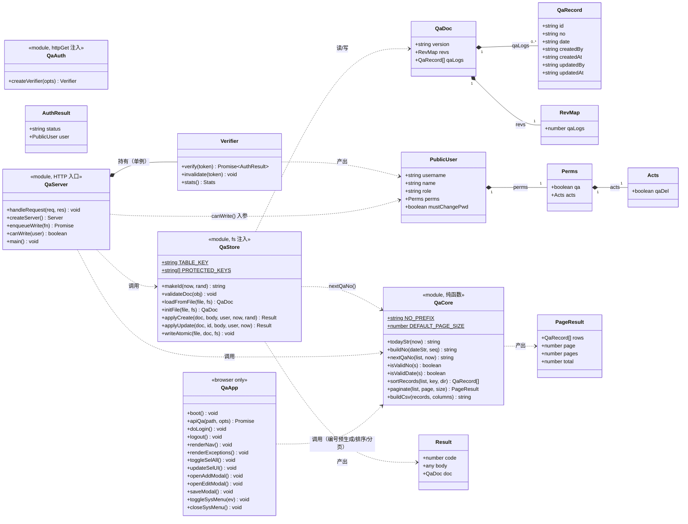
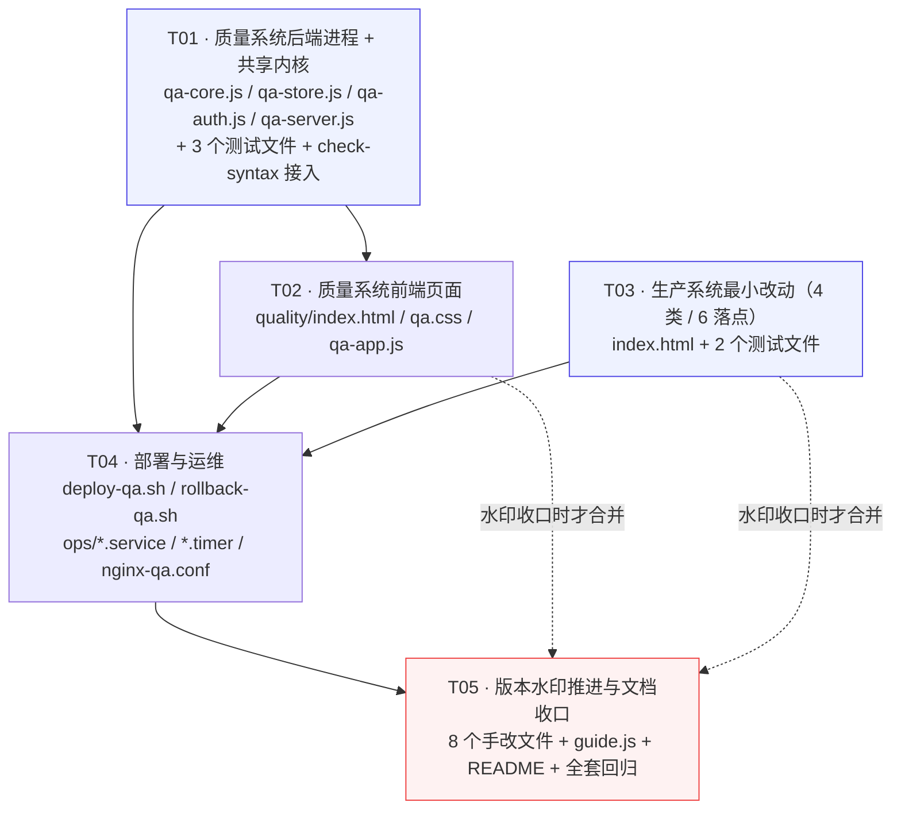

# 质量系统模块 · 系统设计与任务分解

> 文档版本：v1.0 · 2026-11-23
> 撰写：架构师 高见远
> 上游输入：`docs/质量模块-PRD-2026-11-23.md`（v1.0 · 产品经理 许清楚）
> 基线版本：生产 `build 2026-11-20.162` → 目标 `build 2026-11-23.163`；质量系统独立水印 `build 2026-11-23.001`
> 文档性质：设计 + 任务分解（**不含实现代码**，只给接口签名 / JSON 结构 / 配置原文 / 命令行片段）

---

## 0. 本文档的核实基础（凡未读过的不写）

本文档中每一处行号、类名、行为断言，均经**实际读取源码**确认。核实清单：

| # | 核实对象 | 结论 | 证据 |
|---|---|---|---|
| V1 | `.sidebar` 是否 `overflow:hidden` | **无任何 overflow 属性 ⇒ 默认 `visible`，`position:absolute` 可逃逸** | `index.html:21` `.sidebar{width:210px;…display:flex;flex-direction:column;position:fixed;top:0;left:0;bottom:0;z-index:100;transition:transform .25s}` —— 全行无 overflow |
| V2 | `.sidebar-header` 是否建立定位上下文 | **否**（无 `position`）⇒ 需自行加 `position:relative` 容器 | `index.html:22` |
| V3 | 折叠态隐藏规则 | `.sidebar.collapsed .sidebar-header h1 span,…{display:none}` —— **隐藏 h1 内所有 span**（标题文字与 `▾` 一起消失，只剩 svg） | `index.html:38` |
| V4 | 移动端是否反覆盖折叠规则 | **是**：`@media(max-width:768px)` 内 `.sidebar.collapsed .sidebar-header h1 span{display:inline}` | `index.html:62` |
| V5 | `.sidebar` 移动端形态 | `transform:translateX(-100%)` ⇒ 成为绝对定位后代的包含块 | `index.html:59-60` |
| V6 | `<h1>` 现状 | `<h1><svg …/><span>生产排单系统</span></h1>`，位于 `index.html:300`（PRD 写 301，差 1 行） | 实测 |
| V7 | 侧边栏层级 | `.sidebar` z-index **100** > `.mobile-header` 60 > `.topbar` 50；`.overlay` 99 | 实测 |
| V8 | `PERM_FORMS` 位置与内容 | `index.html:7846`，8 个键，**无 `qa`** | 实测 |
| V9 | 加一个 `PERM_FORMS` 键是否够 | **够，无需改任何函数**。`userModal` 左栏 `Object.keys(PERM_FORMS).map` 渲染 `input[data-perm]`；`saveUser` 用 `querySelectorAll('#modal input[data-perm]')` 收集；`renderUsers` 用 `Object.keys(PERM_FORMS).filter` 生成"表单写权限"列文本 | `index.html:7861`（列文本）/ `7930-7945`（左栏）/ `7975-7980`（收集） |
| V10 | `permFormKeyOf` 反查行为 | 遍历 `Object.keys(FORM_ACTS)`，`formToKey(k)===permKey` 则返回 `k`。**不加 `FORM_ACTS.qa` ⇒ 返回 `null` ⇒ 右栏显示"该表单无独立业务动作按钮"，且 `permTriToggle`/`recomputePermTri` 均有 `if(!fm)` 守卫，不崩** | `index.html:7893-7899`、`7901`、`7916` |
| V11 | `formToKey('qa')` | 映射表 `m` 无 `qa` 键 ⇒ 原样返回 `'qa'` ⇒ `canWriteKey('qa')` 直接查 `perms.qa===true` | `index.html:623-636` |
| V12 | `canAct` 宽松期口径的反面 | `if(!acts)return true;` 但 `acts` **存在且无该键** ⇒ `!!acts[key]` = **false**。⇒ 将来加 `qa.del` 时，**已固化 acts 的员工默认无删除权**（需管理员重勾）。这是安全默认，但必须写进文档 | `index.html:655-664` |
| V13 | 既有测试对 `PERM_FORMS` 的断言强度 | 仅 `assert.match(/PERM_FORMS=\{[^}]*parts:'零部件数据'/)` 与 `app.run("PERM_FORMS['parts']")` ⇒ **在尾部追加 `qa` 不影响**（`[^}]*` 内无嵌套花括号） | `tests/parts.158.test.js:559`、`tests/qa.parts-ledger.independent.test.js:1217` |
| V14 | `SYSTEMS` 等新全局名是否冲突 | `index.html` 内 `SYSTEMS` / `QA_` / `qaLogs` / `nextQaNo` **零命中** | `grep` 实测 |
| V15 | 沙箱如何识别"主内联脚本块" | `findMainScript` 取**含 `bootstrap();` 的块**、按 `code.length` 降序取第一个；`stripBootstrap` 要求 `bootstrap();` 是该块**最后一条非空语句** | `tests/harness/sandbox.js` |
| V16 | ⇒ 新增独立内联 `<script>` 块是否安全 | **安全**，只要新块内**不含 `bootstrap();`**。`check-syntax.js` §2 会自动遍历并语法校验新块 | 推论 + `tests/check-syntax.js:44-53` |
| V17 | `check-syntax.js` 的文件清单 | **硬编码** `['js/logs.js','js/import.js','js/transfer.js','js/guide.js','js/prodplan-core.js']`，新增后端/前端 JS 必须手工加入 | `tests/check-syntax.js:21` |
| V18 | `server.js` `saveJson` 原子性 | `writeFileSync(tmp)` + `renameSync` → 同目录 rename 原子 | `server/server.js:68-72` |
| V19 | `server.js` `require.main` 守卫 + 导出 | `if (require.main === module) { listen… }`；`module.exports` 导出 13 个纯函数。**这是 qa-server 从第一天就要照抄的可测性范式** | `server/server.js:791-812` |
| V20 | `readBody` 实现 | `req.on('data'/'end')` 回调式，**异步**；`JSON.parse` 失败回调 `null` | `server/server.js:207-211` |
| V21 | `/api/me` 响应体 | `publicUser(u)` = `{username,name,role,status,perms,mustChangePwd}`；`auth()` 对 `status!=='active'` 返回 null ⇒ 已停用账号得 401 | `server/server.js:549-553`、`213-231`、`653` |
| V22 | token 存续 | 进程内 `Map`（`tokens`），TTL 7 天由 `setInterval` 每小时清理；**无强制过期校验**（`tokens.get` 命中即有效） | `server/server.js:201-202`、`797` |
| V23 | `/api/users` PUT 对 perms | `if (b.perms !== undefined && typeof b.perms === 'object') u.perms = b.perms;` —— **整体替换、无白名单** ⇒ 加 `qa` 键不需改后端 | `server/server.js:764` 附近 |
| V24 | `STAFF_PERMS` | `{products,saleOrders,invOrders,dailyPlans,deliveries,processTemplates,fields,acts}` —— **无 `qa`** ⇒ 新员工默认只读，符合口径 | `server/server.js:124` |
| V25 | `deploy.sh` 结构 | 5 步：提取水印 → 备份+scp 后端+断言 md5 → restart+断言 active → 备份+scp 前端 → nginx reload + 断言 `>VER<` 恰 1 处 | `deploy.sh` 全文 |
| V26 | 仓库内是否有 nginx 配置副本 | **没有**。仅 `deploy_tencent/`（旧前端部署包）与 `.workbuddy/memory/MEMORY.md:17` 的文字描述 | `grep -rn 'server_name\|location /api'` 实测 |
| V27 | 登录卡片无 CSS 类 | 生产登录卡片是 `showLogin()` 里 `createElement` + `cssText` 内联样式，**没有 `.login` 类可复制** | `index.html:569-588` |
| V28 | 表格视觉 CSS 可复制清单 | `.card`(76) `.card-title`(77) `.btn`/`.btn-primary`/`.btn-sm`(86-93) `label`(100) `.form-row`(101) `table`/`th`/`td`(103-105) `.sel-col`(112-114) `.table-wrap tbody tr:hover`(149) `row-sel`(151-152) `.bulk-bar`(160-161) `.table-wrap`(162) `.tag*`(181-186) `.modal-bg`/`.modal*`(188-196) `.empty`(236) | 逐行实测 |
| V29 | `esc()` / `showModal` / `closeModal` | `index.html:976` / `8034` / `8045` —— 质量系统**不复用**，自行实现精简版 | 实测 |
| V30 | 版本字面量守卫 §D3 的真实判据 | 只拦「等于当前 `BUILD` 或 `PREV`」的字面量，**不是**拦所有形如 `YYYY-MM-DD.NNN` 的串 ⇒ 质量系统水印（`.001` 起点）不会被误拦 | `tests/qa.parts-ledger.validate.159.test.js:797-846` |
| V31 | git 主题反查断言 | `tests/invfilt.161.test.js §G4` 要求提交主题**以 `build <PREV>` 开头**（`indexOf('build '+PREV)===0`）⇒ **本次提交主题必须以 `build 2026-11-20.162` 起头**，否则下一版推进时该用例失效 | `tests/invfilt.161.test.js:735-742` |
| V32 | `index.html` 短令牌存量 | `build .162` **4 处**（1018/1332/1501/1523）、`build .161` **9 处** ⇒ 满足 §F6 的"PREV_NO ≥ 3"与"historic ≥ 10 / 版本多样性 ≥ 5" | `grep -o` 实测 |

---

# 第一部分 · 系统设计

## 1. 实现方案与选型理由

### 1.1 架构总览

```
                        ┌─────────────────────── nginx :80 ───────────────────────┐
                        │  location = /quality    → 301 /quality/                 │
   浏览器（同源、同标签页）│  location /quality/     → /var/www/html/quality/  (静态) │
        │               │  location /api/qa/      → 127.0.0.1:3001  (qa-server)   │
        │               │  location /api          → 127.0.0.1:3000  (prod-server) │
        │               └───────────┬──────────────────────┬────────────────────┘
        │                           │                      │
        │  ┌────────────────────────▼───────┐   ┌──────────▼───────────────────┐
        └─▶│ prod-server (3000) 零改动       │   │ qa-server (3001) 全新         │
           │  · /api/login  /api/me         │◀──│  · 鉴权 = 代理 GET /api/me    │
           │  · /api/users  /api/change-pwd │代理│    + 60s 进程内缓存 + 写穿透   │
           │  · /api/data  /api/save  /api/tx│   │  · GET/POST /api/qa/exceptions│
           │  · tokens: Map（进程内存）      │   │  · PUT /api/qa/exceptions/:id │
           │  · /opt/prod-server/data.json  │   │  · /opt/qa-server/data-qa.json│
           │  · users.json（salt/hash）      │   │  · systemd timer 每日备份×30  │
           └────────────────────────────────┘   └───────────────────────────────┘
                     ▲                                        ▲
                     │ 生产 index.html（改 3 处 + 新增 1 个内联块 + 追加 CSS）
                     │ SYSTEMS 常量 / <h1> 下拉 / PERM_FORMS.qa
```

**核心架构原则：三个"物理独立" + 一个"逻辑共用"。**

- 前端独立：`quality/` 目录，**不加载 `js/*.js`、不调用 `index.html` 任何函数**（PRD 5.3 明令）。
- 进程独立：`qa-server` 独立 systemd unit、独立端口、独立崩溃域。质量系统挂掉不影响排单。
- 数据独立：`/opt/qa-server/data-qa.json`，与 `/opt/prod-server/data.json` 无任何交集。
- 逻辑共用（唯一一处）：**编号生成 `nextQaNo` 与权限判定语义**。共用方式见 1.2.6 —— 一个文件 `quality/qa-core.js`，前端 `<script src>` 加载、后端 `require` 加载，**同一份字节**（部署时 md5 断言相等）。

### 1.2 六个关键决策（逐个钉死）

#### 1.2.1 跨进程鉴权（最高危项）—— 结论：**单来源代理 + 60s 读缓存 + 写穿透 + fail-closed**

**问题本质**：token 存在 `prod-server` 的**进程内存 Map**（V22），`qa-server` 无从本地校验。而 `server.js` 一行都不能改。

**方案对比**：

| 方案 | 可行性 | 判定 |
|---|---|---|
| A. 共享 token 存储（Redis / 文件） | 需改 `server.js` 写入侧 | ❌ 违反硬约束 1 |
| B. `qa-server` 自签 token / 自建登录 | 用户要登录两次 | ❌ 违反 PRD "只登录一次" |
| C. 读 `server/users.json` 自行判权 | 文件里**只有 salt/hash，没有 token→username 映射**，无法把 Bearer 换成身份 | ❌ 根本解不了"你是谁" |
| D. 代理 `GET /api/me`（`Authorization: Bearer` 原样转发） | 端点已存在（V21），返回完整 `publicUser`（含 `perms.qa`） | ✅ **采纳** |
| E. D + 同时读 `users.json` 做第二权限源 | 见下方"双来源"分析 | ❌ 不采纳 |

**（a）为什么"双读源"是错的** —— 不只是"有不一致窗口"，而是**逻辑上不可能更优**：

1. **决定性理由**：`users.json` 解决不了 token 校验。token→username 的映射**只存在于生产进程内存**。所以无论如何都必须打一次 `/api/me`。既然打了，它一次性给出 `username + name + role + perms`（含 `perms.acts`），**第二个权限源没有任何增量信息**。
2. 文件是"最终一致"的：生产后端 `users` 是模块级内存副本，只有 `PUT /api/users` 时才 `saveJson(USERS_FILE, users)`。所以文件的权限快照 = **上一次保存时刻**。若 `qa-server` 以文件为源、`/api/me` 为身份源，会产生**真实的撕裂**：管理员刚把张三的 `qa` 勾掉并保存 → 生产内存已生效、文件也刚写完，但 `qa-server` 若在上一次读文件后缓存了文件内容（或文件被别的运维操作回滚），就会出现"身份是张三（来自 me）、权限是旧值（来自文件）"，而两份数据**谁新谁旧无法判定**。这种不一致在生产侧毫无对应物，纯属自造故障面。
3. 读文件引入额外的故障面：`saveJson` 走 `writeFileSync(tmp)+renameSync`（V18）虽原子，但 `qa-server` 仍要处理 ENOENT / EACCES / 半行 JSON / 编码；相比之下 `http.get('http://127.0.0.1:3000/api/me')` 只有三种结果（200 / 401 / 连不上），判定清晰。
4. 唯一收益"省一次代理调用"在 60s 缓存下 ≈ **每人每分钟 1 次 loopback HTTP**，可忽略不计。

**⇒ 结论：单一来源 = `GET /api/me` 代理。`qa-server` 代码中不出现 `users.json` 路径、不 `require('fs')` 读它。** `users.json` 仅作为运维排查时的旁证材料写在 runbook 里。

**（b）缓存策略（精确定义）**

| 项 | 取值 | 理由 |
|---|---|---|
| Key | `Authorization: Bearer` 后的原始 token 串 | 与生产同口径；不做 hash（token 本身 48 hex + 时间戳，非密码） |
| Value | `{ user: {username,name,role,perms}, exp: number(ms) }` | 只缓存 `publicUser` 白名单字段，**不缓存响应原始 JSON**（防止意外透传 `mustChangePwd` 等） |
| TTL | **60 000 ms** | PRD P0-6 指定；且远小于 token TTL（7 天） |
| 内存上限 | **500 条** | 10 人系统，最多 10~20 个活 token；500 是防御性上限（防被刷） |
| 淘汰 | 超上限时按 `Map` 插入序淘汰最旧（`cache.keys().next().value`） | 一行代码，无需 LRU 实现 |
| 失效条件 ① | `exp` 到期 | — |
| 失效条件 ② | `/api/me` 返回 401 ⇒ **立即 `delete(token)`** 并透传 401 | 权限被收回 / 账号停用后最快收敛 |
| 失效条件 ③ | **写请求（POST/PUT/DELETE）强制穿透，不读缓存** | 见下方"生效延迟" |
| 失效条件 ④ | 进程重启 ⇒ 缓存自然清空 | — |
| 观测 | `/api/qa/health` 暴露 `{size, hits, misses}` | 排障时判断"是不是缓存害的" |

**（c）`/api/me` 不可达时：fail-closed（拒绝）**

**结论：fail-closed。** 返回 **503** + `Retry-After: 3`，body `{error:'鉴权服务暂不可用，请稍后重试'}`。**绝不 fail-open。**

理由（四条，按重要性排序）：

1. **fail-open 的收益为零，风险为正。** fail-open（"视为已登录但无写权限"）只省下"生产后端重启那 2~3 秒"。而生产后端重启的时间窗是 `deploy.sh` 的 `systemctl restart + sleep 2`（V25），**每次部署都会发生**，但那 2~3 秒里前端正在整页刷新，本来就没有并发请求。反过来，生产后端"长时间挂掉"（磁盘满、`data.json` 损坏导致起不来）**恰恰是最可能发生的长时间故障**，此时 fail-open 会让质量台账在**无需登录**的状态下对任何能访问该 IP 的人开放读。这是安全审计必拦的场景。
2. 项目既有安全基线是"宁严不宽"：`token` 不进 URL（P0③）、弱口令治理（P0②）、`canWrite` 单一入口（P1·T02）。在鉴权链上引入 fail-open，与这三条的口径直接矛盾。
3. 判定"身份未知"时给出数据的**代价不可逆**（数据一旦被读走无法收回），而拒绝的代价是可逆的（用户点一下重试）。
4. 前端体验成本极低：一次 `503` 只需在质量系统顶部显示一条"鉴权服务暂不可用，3 秒后自动重试"，用 `setTimeout` 自动重取一次即可，用户几乎无感。

**超时：`connectTimeout=800ms` + 总超时 `1500ms`。** 本机 loopback，正常响应 < 10ms；800ms 够覆盖生产后端 GC/JIT 抖动。1500ms 总超时是为了保证 nginx `proxy_read_timeout 30s` 内一定先返回，避免请求堆积。

**（d）权限变更生效延迟 —— 可接受，且必须写进发版说明**

| 变更动作 | 读请求生效延迟 | 写请求生效延迟 |
|---|---|---|
| 管理员勾上/勾掉「质量管理」 | ≤ 60s（缓存 TTL） | **立即**（穿透） |
| 管理员把员工改成"停用" | ≤ 60s（期间仍可读，`/api/me` 会 401 后清缓存） | **立即**（穿透 → 401） |
| 管理员把员工提为"管理员" | ≤ 60s | **立即** |
| 管理员改密码 | 不影响（token 不失效） | 不影响 |

**关键点：唯一有安全含义的收权（写权限）是立即生效的。** 读权限对全公司开放（PRD 7.2：所有人可查看），所以"读延迟 60s"没有安全影响。⇒ **接受这个折中，不引入"权限变更推送"这种过度设计。** 发版说明需写明："取消某人编辑权限后，该员工最多 60 秒内仍能看到列表，但写入会立即被拒绝。"

#### 1.2.2 `index.html` 的下拉栏改造（改动面最小化）

**（a）CSS 定位方式：`position:absolute` + `.sidebar` 无 overflow ⇒ 无需 `position:fixed`**

V1 已实测 `.sidebar` **没有 `overflow` 属性**（默认 `visible`）。因此下拉面板用 `position:absolute` 即可逃逸侧边栏边界，**不需要 `position:fixed`**。

用 `absolute` 而非 `fixed` 的额外收益：
- `fixed` 的包含块是视口，滚动/缩放时需手工重算坐标；
- 移动端 `.sidebar` 有 `transform:translateX(-100%)`（V5），**`transform` 会成为 `fixed` 子元素的包含块**，导致 `fixed` 反而被"锁"在 240px 抽屉里 —— 行为与预期相反。`absolute` 在两种形态下都是"相对 `.sidebar`"，语义统一。

**（b）DOM 结构（`index.html:300` 原地替换 `<h1>` 一整行，块级前后不增删）**

```html
<div class="sidebar-header">
  <div class="sys-switch" id="sysSwitch">
    <h1 class="sys-switch-trigger" id="sysSwitchBtn" title="切换系统" onclick="toggleSysMenu(event)">
      <svg …原有 svg 逐字节不动…></svg><span>生产排单系统</span><span class="sys-switch-caret">▾</span>
    </h1>
    <div class="sys-menu" id="sysMenu"></div>
  </div>
  <div class="sub">智能断路器 · 辰微</div>
</div>
```

要点：
- `<h1>` 仍是 `<h1>` ⇒ `.sidebar-header h1`（V：`font-size:16px;font-weight:700;display:flex;align-items:center;gap:8px`）与 `.sidebar.collapsed .sidebar-header h1{justify-content:center}` **全部继续生效，一行不动**。
- 面板 `.sys-menu` 是 `<h1>` 的**兄弟**、`.sys-switch` 的子 ⇒ **不受** `.sidebar.collapsed .sidebar-header h1 span{display:none}` 影响（该规则只作用于 h1 内的 span）。
- `▾` 包在 `<span class="sys-switch-caret">` 内 ⇒ 折叠态**自动一起隐藏**（V3），无需额外写"折叠时隐藏箭头"的规则。
- 折叠态命中区：h1 只剩 20px 的 svg，命中区太小 ⇒ 追加一条**新**规则 `.sidebar.collapsed .sys-switch-trigger{padding:8px;border-radius:8px}` + hover 底色 → 36×36 命中区（与 `.hamburger` 同尺寸）。**新增规则，不改既有规则。**

**（c）折叠态面板浮出方向**

```css
.sys-menu{display:none;position:absolute;left:8px;top:calc(100% + 6px);
  min-width:180px;max-width:calc(100vw - 32px);background:var(--card);
  border:1px solid var(--border);border-radius:10px;
  box-shadow:0 8px 24px rgba(0,0,0,.12);padding:6px;z-index:120}
.sys-menu.show{display:block}
.sidebar.collapsed .sys-menu{left:calc(100% + 6px);top:8px}   /* 56px 侧边栏右侧浮出 */
@media(max-width:768px){.sidebar.collapsed .sys-menu{left:8px;top:calc(100% + 6px)}}  /* 移动端抽屉内向下展开 */
```

- `left:calc(100% + 6px)` 的 `100%` = `.sys-switch` 宽度 = 56px（折叠态） ⇒ 面板起点在侧边栏右缘外 6px，**不会被 56px 裁切**（因为根本无 overflow 裁切，见 V1）。
- `z-index:120` > `.sidebar` 的 100 是同一堆叠上下文内的相对值；`.sidebar` 本身 z-index:100 已高于 `.topbar`(50)/`.mobile-header`(60)/`.overlay`(99)（V7），面板随之在最上层。**不引入新的层叠层。**
- 移动端媒体查询覆盖回来，保证抽屉内向下展开（PRD 5.1 要求）。

**（d）`SYSTEMS` 常量的落位 —— 结论：新建独立内联 `<script>` 块，放在 `</body>` 之前**

这是本设计对 PRD 的一处**有意偏离**，必须说明理由：

| 方案 | 风险 | 判定 |
|---|---|---|
| 放进主内联脚本（第 2 块）顶部 | 要动主脚本；且 `stripBootstrap` 要求 `bootstrap();` 是块内最后一条非空语句（V15），插在顶部不影响，但仍属"改主脚本" | ⚠️ 可接受但非最优 |
| 新建块插入到 `<aside>` 之后 | `findMainScript` 按"含 `bootstrap();`"选中，新块不含 ⇒ **索引漂移无影响**（V15/V16）；但块在 `<body>` 中部，语义上"靠前"符合 PRD | ⚠️ 可行 |
| **新建块放在 `</body>` 之前** | ① `findMainScript` 完全不受影响；② DOM 已就绪，`getElementById` 必然成功；③ 与既有代码零耦合，将来可以整块删除 | ✅ **采纳** |

- 用 `var SYSTEMS = [...]`（**不用 `const`**）：单文件全局作用域下，若将来有人误在别处也写 `var SYSTEMS`，是覆盖（可察觉）；若用 `const` 则是 **SyntaxError 导致整页白屏**（不可接受）。`var` 是这条路的最小爆炸半径选择。
- 块内其余函数（`renderSysMenu` / `toggleSysMenu` / `closeSysMenu` / `initSysSwitch`）全部包在 **IIFE** 内，只把 `toggleSysMenu` 挂到 `window`（供 HTML 的 `onclick` 调用），其余不外泄。
- 命名冲突已实测为零（V14）。**工程师落地前必须再跑一次** `grep -n 'SYSTEMS\|renderSysMenu\|toggleSysMenu\|sys-switch' index.html` 确认为空。
- 在块首写醒目注释：`/* 新增系统：只在下方 SYSTEMS 数组加一行，其余不动 */`。同时 PRD 要求的"`SYSTEMS` 在顶部"以**指针注释**满足：允许在 `index.html` 顶部注释区（第 7 行 `<style>` 上方）加**一行**注释 `<!-- 系统清单 SYSTEMS 见文件末尾「系统切换下拉」script 块 -->`。这一行是纯 HTML 注释，**不参与任何断言**（已确认无测试匹配该区域）。

**（e）关闭行为与键盘可达性（按 PRD 要求，不做过度设计）**

| 行为 | 实现 | 说明 |
|---|---|---|
| 点触发区 | `toggleSysMenu(event)` + `event.stopPropagation()` | 防被 document 的"点外部关闭"立即吃掉 |
| 点面板外任意处 | `document.addEventListener('click', closeSysMenu)` | 面板内点击也在 `document` 上冒泡，故面板项点击需自行 `stopPropagation` 或先执行动作再关 |
| ESC | `document.addEventListener('keydown', e=>{if(e.key==='Escape')closeSysMenu();})` | **不**加焦点陷阱、不 `aria-modal`、不做 `role="menu"` 键盘上下键 —— PRD 明确"不要过度设计" |
| 点当前项 | 只 `closeSysMenu()`，不跳转 | PRD 5.1 |
| 点其他项 | `location.href = SYSTEMS[i].url` | **同标签页**，禁 `window.open` / `target=_blank`（sessionStorage 按标签页隔离，V：PRD F1） |
| 切换前确认框 | **不做** | PRD 5.1 明确 |
| 记住上次选择 | **不做** | PRD 5.1 明确，URL 是唯一状态源 |

**（f）明确不接入 `activeTab` / `renderContent()`**

`activeTab` / `renderContent()` 是同页内 12 个 tab 的切换机制（`.main` 内 `#content` 重绘）。系统切换是**跨页面整页跳转**（`location.href`），两者语义正交。**禁止**把 `'qa'` 加进 `TABS`/`NAV` 数组、禁止给 `renderContent` 加 `if(activeTab==='qa')` 分支 —— 那会把质量系统拖进生产单页，直接违反隔离边界。这一条要写进 T03 的"完成判据"。

#### 1.2.3 `qa-server` 的 API 契约

**（a）为什么不用生产那套 `/api/save` + `/api/tx` 的 ops 批量协议**

| 维度 | `/api/tx`（生产） | 本设计 `/api/qa/exceptions`（REST） |
|---|---|---|
| 语义 | **整表 set**（`ops:[{key,value}]`，多表原子事务） | **单资源操作**（建一条 / 改一条） |
| 编号生成 | 服务端在"整表替换"里**无法区分新增与被替换**，终检形同虚设 | 服务端在 `POST` 中天然持有"这次是新增"语义 ⇒ 编号生成 + 唯一性终检**必须在服务端**，用 REST 才落得下 |
| 乐观锁 | 表级 `expectedRev`，任何写都推 rev | 本轮不需要（见下） |
| 前端复杂度 | 要拼 ops 数组、跟踪 revs、处理 409 表冲突 | 一个 `fetch` 一行 JSON |
| 结论 | 适合"多表联动 + 强一致"的生产业务 | **不适合一条台账记录的增改** |

⇒ **采纳资源式 REST**。但刻意**继承生产系统的响应形状**：成功 `{ok:true, …}`，失败 `{error:'中文消息'}` —— 让两套前端的错误处理心智一致。

**（b）路由表（精确）**

| # | Method | Path | 鉴权 | 说明 |
|---|---|---|---|---|
| 1 | GET | `/api/qa/health` | **无** | 探活，供 `deploy-qa.sh` curl 断言与运维排障。**不泄露业务数据** |
| 2 | GET | `/api/qa/me` | 需 token | 代理 `/api/me` 并**附加派生字段** `canWrite`（唯一实现权限规则的地方） |
| 3 | GET | `/api/qa/exceptions` | 需 token | 全量列表 |
| 4 | GET | `/api/qa/next-no` | 需 token + `canWrite` | 预生成编号（弹窗打开时调） |
| 5 | POST | `/api/qa/exceptions` | 需 token + `canWrite` | 新增 |
| 6 | PUT | `/api/qa/exceptions/:id` | 需 token + `canWrite` | 编辑（只改 `date`） |
| 7 | DELETE | `/api/qa/exceptions/:id` | — | **本轮不实现**，返回 **405** + `{error:'本轮未开放删除功能'}`。P1 上线时把 405 换成 200，前端加一个按钮即可，**路由结构零改动** |
| — | * | 其他 | — | 404 `{error:'not found'}` |

**关于 URL 名与数据键名不一致（必须钉死，防工程师困惑）**：

| 层 | 名称 | 依据 |
|---|---|---|
| URL 资源名 | `exceptions` | 主理人指定的接口命名，语义直白 |
| `data-qa.json` 顶层数据键 | **`qaLogs`** | PRD 6.4 明写的数据契约，不可改 |
| 前端 `localStorage` 分页键 | `wb_cb_qa_pageSize_qaLog` | PRD 5.3 明写 |

⇒ 代码里**只允许一处**映射：`qa-server.js` 顶部 `const TABLE_KEY = 'qaLogs';`，其余位置一律引用该常量。**不得**把 `exceptions` 写进数据文件，**不得**把 `qaLogs` 写进 URL。

**（c）请求 / 响应体（精确到字段）**

`GET /api/qa/me` → 200
```json
{ "ok": true, "user": { "username": "zhangsan", "name": "张三", "role": "staff",
                        "perms": { "qa": true, "acts": {} } },
  "canWrite": true, "canDel": false }
```
> `canWrite` = `role==='admin' || perms.qa===true`（**服务端唯一实现**，前端只读这个布尔，不自己判）
> `canDel` 本轮恒为 `false`（占位，P1 接 `perms.acts['qa.del']`）

`GET /api/qa/exceptions` → 200
```json
{ "ok": true, "records": [ { "id":"…","no":"YC-20261123-00001","date":"2026-11-23",
                             "createdBy":"zhangsan","createdAt":"…","updatedBy":"zhangsan","updatedAt":"…" } ],
  "total": 1, "rev": 3, "version": "qa-2026-11-23.1" }
```
> **全量返回，服务端不分页。** 理由：1~3 人、每天几条、一年数百条，全量 JSON 只有几十 KB；分页会引入 offset/limit 边界 bug 而收益为零。前端自行排序分页（与生产系统 `pullAll` 全量拉取同口径）。
> `rev` 每次写 +1，本轮不用作锁，**为将来加轮询同步预留**（生产前端就是 5s 轮询 `revs`）。

`GET /api/qa/next-no` → 200
```json
{ "ok": true, "no": "YC-20261123-00004" }
```

`POST /api/qa/exceptions` 请求
```json
{ "date": "2026-11-23", "no": "YC-20261123-00004" }
```
- `date` **必填**：`/^\d{4}-\d{2}-\d{2}$/` 且必须是真实日历日（往返 `new Date` 校验，拦 `2026-02-31`）。**允许未来日期**（PRD Q5）。
- `no` **可选**：前端预生成后提交（PRD 要求弹窗里先看到号）。
  - 缺省 ⇒ 服务端自行发号后直接落库（**不可能冲突**）
  - 提供 ⇒ 先校验格式 `/^YC-\d{8}-\d{5}$/`，再在写队列内终检唯一性
  - 冲突 ⇒ **409** `{error:'编号已被占用', conflict:true, suggest:'YC-20261123-00005'}`
- 未知顶层**标量**键（string/number/boolean/null）**原样落库**（为 P2 加字段留路，见 1.2.4）；对象/数组类型的未知键 ⇒ **400**（禁止塞嵌套结构）。

`POST` → **201**
```json
{ "ok": true, "rev": 4,
  "record": { "id":"…","no":"…","date":"…","createdBy":"…","createdAt":"…","updatedBy":"…","updatedAt":"…" } }
```

`PUT /api/qa/exceptions/:id` 请求
```json
{ "date": "2026-11-22" }
```
- 只处理 `date`。若 body 中出现 `no` 且 **不等于原值** ⇒ **400** `{error:'编号不可修改'}`（防前端 bug 静默改号）；等于原值 ⇒ 忽略放行（幂等）。
- `id` / `createdBy` / `createdAt` 出现在 body 中 ⇒ **静默忽略**（服务端权威），不报错。
- `id` 不存在 ⇒ **404** `{error:'记录不存在'}`

`PUT` → **200** `{ "ok": true, "rev": 5, "record": {…} }`

**（d）错误码总表**

| code | 触发条件 | body 关键字段 | 前端处理 |
|---|---|---|---|
| 200 / 201 | 成功 | `ok:true` | 正常渲染 |
| 400 | `date` 缺失/格式错/非真实日期；`no` 格式错；试图改 `no`；未知键为对象/数组；body 非法 JSON | `{error:'…'}` | `alert(error)`，保留弹窗 |
| 401 | 无 `Authorization` 头 / token 不在生产内存 Map / 账号已停用 | `{error:'未登录或登录已过期'}` | 清 `sessionStorage` → 回落登录卡片 |
| 403 | 已登录但 `canWrite=false` 的写请求 | `{error:'无「质量管理」编辑权限，请联系管理员在「员工管理 → 表单写权限」中授权'}` | `alert` + 刷新 `canWrite` |
| 404 | `id` 不存在 / 路由不存在 | `{error:'记录不存在'}` / `{error:'not found'}` | 刷新列表 |
| 405 | `DELETE`（本轮未开放） | `{error:'本轮未开放删除功能'}` | 不渲染删除按钮，理论上不会命中 |
| 409 | 编号唯一性终检失败 | `{error:'编号已被占用', conflict:true, suggest:'…'}` | **静默**用 `suggest` 重提交一次（用户无感，PRD P0-10） |
| 413 | body > 64KB | `{error:'请求体过大'}` | — |
| 500 | 落盘失败（磁盘满/权限） | `{error:'保存失败：…'}` | `alert`，**不关闭弹窗**（保数据） |
| 503 | `/api/me` 不可达（fail-closed） | `{error:'鉴权服务暂不可用，请稍后重试'}` + `Retry-After: 3` | 顶部提示 + `setTimeout` 3s 自动重试一次 |

**（e）乐观锁 `expectedRev` —— 结论：不做**

| 考量 | 分析 |
|---|---|
| 生产为什么做 | `/api/save` 是**整表 set**。两个管理员同时保存整张产品表 ⇒ 后写覆盖前写 = **别人几十行改动凭空消失**。这是真事故 |
| 本模块的写形态 | `POST` 追加一条；`PUT` 只改**一条记录的一个字段**（`date`）。冲突面 = "两人同时编辑同一条记录的日期" |
| 撞上时会发生什么 | 后写覆盖前写 ⇒ 日期最终是"最后点保存的人填的"。这**恰恰是用户期望的语义**（不是丢失更新，是最后写赢） |
| 收益/成本 | 收益趋近 0；成本 = 服务端 `expectedRev` 比对 + 前端一套"409 冲突 → 提示刷新 → 用户手动重试"的 UI。本轮前端要求"不做过度设计" |
| **⇒ 结论** | **不做记录级乐观锁。** |
| 与生产 `expectedRev` 的关系 | **绝不能共用**（不同的数据文件、不同的 rev 语义、不同的表）。若 P1 需要，用**记录级** `ifUnmodifiedSince=<updatedAt>` 形式，复用记录里已有的 `updatedAt` 字段，**不需要改数据结构** |
| 但必须有 | 文件级的**写串行化**（下面 f 项），那才是真正会丢数据的地方 |

**（f）并发写入的原子性 —— "readBody 异步"导致的丢更新风险与解法**

**风险（真实存在，必须处理）**：

```
t0  请求A POST 到达 → readBody 开始读 body（异步）
t1  请求B POST 到达 → readBody 开始读 body（异步）
t2  A 的 end 事件 → 处理体执行：读 data.qaLogs（1 条）→ 算 no = YC-…-00002
t3  B 的 end 事件 → 处理体执行：读 data.qaLogs（仍是 1 条，A 还没写）→ 算 no = YC-…-00002  ← 撞号
t4  A 写盘（2 条）
t5  B 写盘（2 条，A 的记录没了）                                                  ← 丢更新
```

Node 单线程只能保证"单次同步执行不被打断"，**不能**保证"读-改-写"这个跨 `await` 的整体不被打断。`readBody` 是回调式异步（V20），两个请求的处理体会交错。

**解法（三层，缺一不可）**：

1. **内存单一副本**：启动时把 `data-qa.json` 读入模块级 `let QA_DATA`；之后所有读写都对这个对象，**绝不在请求处理中重新读文件**。照抄 `server.js` 的 `data` 模式。
2. **写入串行化队列（单写者）**：所有"读-改-写"整体投递到一个 Promise 链上串行执行：
   ```
   let writeChain = Promise.resolve();
   function enqueueWrite(fn) {
     const p = writeChain.then(fn, fn);       // 前一个失败也要继续（both handlers）
     writeChain = p.then(()=>{}, ()=>{});      // 吞掉 rejection，防未捕获
     return p;
   }
   ```
   处理体形态必须是：`enqueueWrite(() => { …同步读 QA_DATA → 同步改 QA_DATA → 同步校验 → 同步落盘… })`。
   **只读请求（GET）不进队列**（内存只读无竞争），保证列表刷新不被写阻塞。
3. **编号唯一性终检放在队列内**：因为已在串行区内，撞号概率降到 0；`409` 仍保留作为**防御性兜底**（应对"两个 qa-server 进程"的误配、或运维手工改文件）——**不是**正常路径。

**落盘原子性**：`fs.writeFileSync(file+'.tmp', JSON.stringify(QA_DATA))` → `fs.renameSync(tmp, file)`。同目录 rename 在同一文件系统内原子（与 V18 生产口径一致）。写盘失败 ⇒ 回滚内存（把改前的 `JSON.parse(JSON.stringify(QA_DATA))` 快照还原）并返 500，**保证内存与磁盘不撕裂**。

#### 1.2.4 数据模型 `data-qa.json`

**（a）顶层结构**

```json
{
  "version": "qa-2026-11-23.1",
  "revs": { "qaLogs": 0 },
  "qaLogs": []
}
```

| 键 | 类型 | 说明 |
|---|---|---|
| `version` | string | **数据格式版本**，`qa-YYYY-MM-DD.N` 与生产 `build` 解耦。启动时若与当前支持版本不同 ⇒ **只 console.warn 不拒绝**（向前兼容）；除非结构不合法 |
| `revs` | `{ qaLogs: number }` | 每次写 +1。本轮**不用作锁**，用于：① `GET` 响应带 `rev` 供将来轮询同步；② 运维排查"文件被改过几次" |
| `qaLogs` | `Array<Record>` | 台账记录 |

**刻意不设 `meta.seq` / 自增计数器**：编号严格按 F5 单源公式**从既有 `no` 扫描推导**（`max+1` + `while` 去重）。多一个计数器就多一个可能与真实数据漂移的真值源 —— 那是脆弱设计，不是优化。

**（b）记录字段（完整定义）**

| 字段 | key | 类型 | 谁写 | 可改 | 说明 |
|---|---|---|---|---|---|
| 内部主键 | `id` | string | 服务端 | ❌ | `e_<13位时间戳>_<6位随机hex>`。**永不变** |
| 业务编号 | `no` | string | 服务端 | ❌（仅 UI 层锁定；服务端拒绝改） | `YC-YYYYMMDD-XXXXX` |
| 日期 | `date` | string | 前端提交 | ✅ | `YYYY-MM-DD`，允许未来日期 |
| 创建人 | `createdBy` | string | 服务端（取 token 身份） | ❌ | username |
| 创建时间 | `createdAt` | string | 服务端 | ❌ | **ISO 8601 UTC**（`new Date().toISOString()`，形如 `2026-11-23T01:12:00.000Z`） |
| 最后修改人 | `updatedBy` | string | 服务端 | ❌ | username；新建时 = `createdBy` |
| 最后修改时间 | `updatedAt` | string | 服务端 | ❌ | 同 `createdAt` 口径；新建时 = `createdAt` |

> **`createdAt` 用 UTC 的 `Z` 后缀而非 PRD 6.4 示例里的 `+08:00`**：无时区歧义、可直接字典序排序、与 `Date.prototype.toISOString()` 零转换。展示时前端 `new Date(s).toLocaleString('zh-CN')` 转本地。PRD 示例中的 `+08:00` 视为示意而非契约。

**（c）为什么 `id` 与 `no` 两个标识都要有**

| | `no`（业务编号） | `id`（内部主键） |
|---|---|---|
| 面向 | **人**（口头沟通、打印、外部引用） | **程序**（PUT 路由定位） |
| 可变性 | PRD 规定"不可改"，但这只是 **UI 层**锁定 + 服务端 PUT 拒绝 | **数据结构层面永不变** |
| 会变的风险 | Q2 若用户将来改前缀（`YC` → `ZLWT`）、或数据修复/导入需要重编号 ⇒ `no` **可能被批量改写** | 无 |
| 若只有 `no` 做定位 | 一次编号规则调整 = 所有外链/书签断链，且 PUT 路由语义随数据漂移 | — |

⇒ **成本 = 1 个字段 + 约 30 字节；收益 = 编号规则与记录定位彻底解耦。** 采纳。

**（d）扩展性：**结论 —— **扁平键存储，不预留 `extra:{}`**

1. PRD Q4 明确"都不加"，且未来候选字段（异常类型 / 涉及产品 / 责任部门 / 处理状态 / 不合格数量 / 处理结果 / 附件 / 整改措施）**全是标量或短字符串**，不是任意嵌套 KV。预留 `extra:{}` 会让"字段在哪"变成两种情况，前端列定义 `col.get(r)` 要为每条字段写判断 —— 纯粹自找麻烦。
2. **JSON 数组的天然扩展性**：加字段 ⇒ 新记录带新键、老记录缺键（`undefined`）。前端列定义统一用 `r[col.key] == null ? '' : r[col.key]` 兜底，**零迁移、零脚本、零 DDL**。这就是扁平的扩展性。
3. **服务端对未知顶层标量键放行透传**（见 1.2.3c）⇒ 将来加字段**不需要改后端**，与生产 `/api/users` PUT 对 `perms` 不设白名单的设计同口径（V23）。这条是刻意为之，要写进代码注释。
4. 保护名单（**只拦这几个，其余放行**）：`id` / `no` / `createdBy` / `createdAt`（服务端权威，body 中同名字段一律忽略或按 1.2.3c 规则报错）；`updatedBy` / `updatedAt` 由服务端覆盖写入。

**（e）文件缺失/损坏时的启动行为 —— 拒绝启动，提供显式 `--init`**

PRD 存在一处**自相矛盾**需要裁定：
- P0-13 说"启动时文件不存在则初始化"
- 6.4 说"读不到/损坏时**拒绝启动并打印错误**，不要静默初始化空文件（否则一次磁盘故障会把全部台账抹掉）"

**裁定：以后者为准。** "文件不存在"与"文件损坏"对运行时来说无法区分成因（磁盘故障 / 挂载丢失 / 运维误删 / 首次部署），因此**运行时一律拒绝启动**；"初始化"这件事**移交给人显式触发**：

```
node /opt/qa-server/qa-server.js --init
```

- 仅在目标文件**不存在**时创建 `{"version":"qa-2026-11-23.1","revs":{"qaLogs":0},"qaLogs":[]}`，打印路径，`exit 0`
- 文件已存在 ⇒ 打印"已存在，未改动"，`exit 0`（**幂等**，可无条件重复调用）
- **`--init` 永不覆盖/改名既有文件**

这个 `--init` 模式与生产 `node server.js --reset-pwd <user> <pwd>` 完全同构（V：`server.js:559`），运维心智一致。

**启动校验清单（任一不过 ⇒ `console.error` + `process.exit(1)`，且绝不改动原文件）**：

| 校验 | 失败提示（原文要点） |
|---|---|
| 文件存在可读 | `❌ 数据文件不存在或不可读：<绝对路径>。首次部署请执行 node qa-server.js --init；若为误删，请从 /opt/qa-server/backups/ 取最近一份恢复。**已拒绝启动，未创建任何文件。**` |
| JSON 可解析 | `❌ 数据文件 JSON 解析失败：<绝对路径>。**原文件已保留未做任何改动**。请从 backups/ 恢复或手工修复后重启。` |
| 顶层为对象且 `Array.isArray(qaLogs)` | `❌ 数据文件结构非法：qaLogs 必须为数组（实际 <typeof>）。**已拒绝启动，原文件未改动。**` |
| 每条记录 `id`/`no` 为非空字符串 | `❌ 数据文件第 N 条记录缺少 id 或 no。**已拒绝启动**（带脏数据运行会把错误越写越多）。` |
| 记录 `no` 无重复 | 同上口径（撞号说明文件被外部改过） |

#### 1.2.5 部署架构

**（a）nginx 三段 `location`（精确原文，由 `deploy-qa.sh` 幂等插入）**

```nginx
# >>> qa-system BEGIN (managed by deploy-qa.sh — do not edit manually) >>>
# 质量系统 · 由 deploy-qa.sh 幂等插入。删除本块前请先跑 rollback-qa.sh。
# 【匹配优先级说明】nginx 前缀 location 一律「最长前缀优先」，与书写顺序无关；
#   故 /api/qa/ (8 chars) 恒优先于 /api (4 chars)，不会被写作顺序影响。
#   置于 location /api 之前仅为可读性。

# ① 质量系统 API → qa-server:3001
location /api/qa/ {
    proxy_pass            http://127.0.0.1:3001;
    proxy_http_version    1.1;
    proxy_set_header      Host              $host;
    proxy_set_header      X-Real-IP         $remote_addr;
    proxy_set_header      X-Forwarded-For   $proxy_add_x_forwarded_for;
    proxy_set_header      X-Forwarded-Proto $scheme;
    # 显式转发 Bearer（nginx 默认会转发客户端头，但写明可防未来有人误加 proxy_set_header Authorization ""）
    proxy_set_header      Authorization     $http_authorization;
    proxy_connect_timeout 5s;
    proxy_read_timeout    30s;
    proxy_send_timeout    30s;
    client_max_body_size  1m;
}

# ② /quality 无尾斜杠 → 301（显式写，不依赖 nginx 目录自动 301 的隐式行为）
location = /quality {
    return 301 /quality/;
}

# ③ 质量系统静态资源
location /quality/ {
    alias /var/www/html/quality/;     # alias 自包含：不依赖 server 块已有 root
    index index.html;
    # 刻意不设 expires / Cache-Control：部署后用户必须立刻拿到新水印页，
    # 加水印断言的可靠性优先于省几百字节带宽。
}
# <<< qa-system END <<<
```

**关于 `/quality/` 的 301 处理**：nginx 对 `location /quality/` + 真实目录会自动 301，但该行为依赖"目录实际存在 + 静态模块进入"，在 `alias` + `index` 组合下有版本差异。**显式写 `location = /quality { return 301 /quality/; }`** 是零成本、零版本依赖的做法，采纳。

**关于是否需要 `proxy_set_header`**：`Host` / `X-Real-IP` / `X-Forwarded-*` 不是必需（qa-server 不读它们），但写上让日志与将来可能的审计可用；`Authorization` nginx 默认转发，**显式写出**是为了防止未来有人在这段里加 `proxy_set_header Authorization ""`（这类"安全加固"误改会让整个鉴权链静默 401）。

**（b）仓库里没有 nginx 配置副本 ⇒ 取回 / 备份 / 幂等追加 / 回滚 四件事的规程**

**Step 1 · 取回并归档（一次性，产物提交进仓库）**
```bash
ssh -o StrictHostKeyChecking=no root@111.231.167.192 \
  "nginx -T 2>/dev/null" > /tmp/nginx-T.txt
# 定位承载 /api 的 server 块所在文件
ssh root@111.231.167.192 "grep -rl 'location /api' /etc/nginx/ 2>/dev/null"
# 取回该文件作为仓库内参考副本（只读、不参与部署）
scp root@111.231.167.192:/etc/nginx/conf.d/<命中文件> ops/nginx-current.conf
```
提交 `ops/nginx-current.conf` 到仓库 ⇒ 从此**有副本**，任何改动可 diff。

**Step 2 · 备份（每次部署前，带时间戳，不覆盖）**
```bash
ssh root@... "cp $CONF /etc/nginx/qa-conf-backups/$(basename $CONF).bak-$(date +%Y%m%d%H%M%S)"
```

**Step 3 · 幂等追加（marker 守卫 + 目标行定位，找不到必须中止而不是猜）**
```
① grep -qF '# >>> qa-system BEGIN' $CONF  →  已存在 ⇒ 走"更新"路径（用 awk 替换 marker 区间内容）
                                              ⇒  不存在 ⇒ 走"插入"路径
② 插入路径：找第一个匹配 ^[[:space:]]*location[[:space:]]+/api 的行号 L
            找不到 ⇒ ❌ 中止并打印 "未找到 location /api 行，请人工确认 nginx 结构"，**绝不追加到文件末尾**
③ awk 在第 L 行前插入 ops/nginx-qa.conf 全文
④ nginx -t        ← ★唯一安全闸门
    失败 ⇒ 立刻 cp 备份回原文件 → 再次 nginx -t → 报错退出（**不 reload**）
⑤ systemctl reload nginx
```

**Step 4 · 回滚（`rollback-qa.sh`，改错 nginx 时 30 秒内恢复）**
```bash
#!/bin/bash
# rollback-qa.sh —— 质量系统上线回滚（nginx / qa-server / 静态目录三者独立可回滚）
set -e
HOST=root@111.231.167.192
ssh $HOST '
  set -e
  LATEST=$(ls -1t /etc/nginx/qa-conf-backups/*.bak-* 2>/dev/null | head -1)
  if [ -n "$LATEST" ]; then
    CONF=$(echo "$LATEST" | sed -E "s#/etc/nginx/qa-conf-backups/(.*)\.bak-[0-9]+#/etc/nginx/conf.d/\1#")
    cp "$LATEST" "$CONF"
    nginx -t || { echo "❌ 回滚后的配置仍不合法，请人工介入"; exit 1; }
    systemctl reload nginx
    echo "✅ nginx 已回滚到 $LATEST"
  else
    echo "⚠ 无 nginx 备份，跳过"
  fi
  systemctl stop qa-server || true
  rm -rf /var/www/html/quality || true
  echo "✅ qa-server 已停止、/var/www/html/quality 已移除（生产 index.html 全程未被触碰）"
'
```

> **关键安全性质**：`deploy-qa.sh` 与 `rollback-qa.sh` **都不上传、不删除、不修改 `/var/www/html/index.html` 与 `/opt/prod-server/*`**。最坏情况下 qa-server 起不来或 nginx 配置错，生产排单系统的静态文件与后端进程**始终未被触碰**，`rollback-qa.sh` 恢复 nginx 后生产立刻恢复。

**（c）`deploy-qa.sh` 步骤设计（照 `deploy.sh` 风格，但四条断言互相独立）**

```
[1/7] 前置检查
  · 本地存在 quality/index.html, quality/qa-core.js, quality/qa-app.js,
    server/qa-server.js, server/qa-auth.js, server/qa-store.js, quality/qa-core.js
  · node tests/check-syntax.js 退出码 0
  · 提取**质量系统**水印：QVER=$(grep -oE 'build [0-9]{4}-[0-9]{2}-[0-9]{2}\.[0-9]+<' quality/index.html | head -1 | sed 's/<$//')
    空 ⇒ ❌ 「无法从 quality/index.html 提取版本水印」
  · 断言 QVER 形态为 build YYYY-MM-DD.NNN（3 位序号），防止误把生产版本号抄进来

[2/7] 后端：备份 + 上传 + md5 断言
  · 远端 mkdir -p /opt/qa-server/backups
  · 备份既存 qa-server.js / qa-auth.js / qa-store.js / qa-core.js（时间戳，不覆盖）
  · scp server/qa-server.js server/qa-auth.js server/qa-store.js  → /opt/qa-server/
  · scp quality/qa-core.js → /opt/qa-server/qa-core.js        ← ★同一份字节的第二落点
  · md5sum 逐文件比对，任一不等 ⇒ ❌ 退出

[3/7] 数据文件守卫 + 显式初始化
  · ssh "test -f /opt/qa-server/data-qa.json || node /opt/qa-server/qa-server.js --init"
  · 断言 test -f 成功；断言 --init 后文件是合法 JSON 且 qaLogs 为数组
  · 已有文件 ⇒ 只在 /opt/qa-server/backups/ 留一份 date 快照，**不改内容**

[4/7] 重启 qa-server + 断言 active + 断言健康
  · systemctl daemon-reload; systemctl enable qa-server; systemctl restart qa-server
  · sleep 2; STATE=$(systemctl is-active qa-server) 断言 == active
  · curl -sf http://127.0.0.1:3001/api/qa/health | grep -q '"ok":true'  ⇒ 断言 qa-server 自身活着
  · journalctl -u qa-server -n 30 --no-pager 打印（起不来时人工立刻能看原因）

[5/7] 前端：备份 + 上传静态目录 + md5 断言
  · 远端 mkdir -p /var/www/html/quality
  · 备份既存目录为 /var/www/html/backups/quality.pre-<ts>/（cp -a）
  · scp quality/* → /var/www/html/quality/
  · 断言 /var/www/html/quality/qa-core.js 与 /opt/qa-server/qa-core.js **md5 相等**
    （证明「编号生成只有一份实现」在线上成立）
  · 断言 /var/www/html/index.html 的 md5 **与部署前相同**（证明没碰到生产前端）

[6/7] nginx：备份 → 幂等插入（marker 守卫）→ nginx -t → reload
  · 见 (b) Step 2/3；nginx -t 失败即回滚并退出

[7/7] 四条互相独立的线上断言（★质量水印与生产水印**必须分开断言**）
  ① 质量水印：curl -s http://127.0.0.1/quality/ | grep -cF ">$QVER<"  == 1
  ② 质量路由 301：curl -s -o /dev/null -w '%{http_code}' http://127.0.0.1/quality  == 301
  ③ 质量 API 走 3001：curl -s http://127.0.0.1/api/qa/health | grep -q '"ok":true'
     （同时证明 /api/qa/ 没被 /api 劫持）
  ④ 生产 API 仍走 3000 且未被劫持：curl -s -o /dev/null -w '%{http_code}' http://127.0.0.1/api/revs  == 401
     （401 是因为没带 token，说明请求确实到达了 prod-server 的鉴权分支）
  ⑤ 生产水印未变（只读断言，不上传）：ssh grep -cF ">$PVER<" /var/www/html/index.html == 1
     其中 PVER 由本地 index.html 提取，与 QVER **分别计算、分别断言**
```

**（d）systemd unit 文件原文**

`ops/qa-server.service`
```ini
[Unit]
Description=QA System Backend (qa-server) — 辰微质量系统
Documentation=file:///opt/qa-server/README-qa.md
After=network-online.target
Wants=network-online.target

[Service]
Type=simple
User=root
WorkingDirectory=/opt/qa-server
ExecStart=/usr/bin/node /opt/qa-server/qa-server.js
Restart=always
RestartSec=3
# 路径全部走环境变量，与 server.js 的 PROD_DATA_FILE / PROD_USERS_FILE 同风格：
# 测试/演练可在拷贝目录内跑，绝不读写线上文件。
Environment=PORT=3001
Environment=QA_DATA_FILE=/opt/qa-server/data-qa.json
Environment=QA_BACKUP_DIR=/opt/qa-server/backups
Environment=QA_PROD_ME_URL=http://127.0.0.1:3000/api/me
Environment=QA_AUTH_TTL_MS=60000
Environment=QA_AUTH_TIMEOUT_MS=1500
StandardOutput=journal
StandardError=journal
SyslogIdentifier=qa-server
NoNewPrivileges=true

[Install]
WantedBy=multi-user.target
```

> `Restart=always` 是刻意的：数据文件损坏时 `process.exit(1)` 会让 systemd 每 3 秒重试一次，日志里刷出同一条明确错误 —— 这比"进程躺着不重启、没人发现"好。但要配合告警：`journalctl -u qa-server | grep 拒绝启动` 出现即需人工介入，写进 runbook。

**日志查看方式**
```bash
journalctl -u qa-server -f              # 跟随
journalctl -u qa-server -n 100 --no-pager
journalctl -u qa-server --since "1 hour ago" | grep -i '❌\|error'
journalctl -u qa-backup -n 50 --no-pager # 备份任务日志
systemctl list-timers | grep qa-backup   # 下次备份时间
```

**（e）`data-qa.json` 每日备份（保留 30 份）—— 结论：systemd timer，不用 cron、不用进程内定时器**

| 方案 | 进程挂了还备份吗 | 可观测性 | 引入的副作用 | 判定 |
|---|---|---|---|---|
| qa-server 进程内 `setInterval` | ❌ 挂掉/重启就丢窗口 | 只能从 qa-server 日志侧面看 | 给 qa-server 挂定时器句柄 ⇒ 单测 `require` 时必须额外守卫（`server.js` 正是因为这个才有 `require.main` 守卫） | ❌ |
| cron | ✅ | `grep CRON /var/log/cron`，最弱 | 需 `crontab -e`，与 systemd 反代/服务管理风格不一致，且无法 `systemctl list-timers` 统一查看 | ⚠️ |
| **systemd timer + 一个 shell 脚本** | ✅ | `systemctl list-timers` / `journalctl -u qa-backup` / `systemctl status qa-backup` 全都能看 | 多 2 个 unit 文件 + 1 个脚本 | ✅ **采纳** |

决定性理由：**数据安全机制的存活不能依赖被保护的进程**。qa-server 崩了、被 `systemctl stop` 了、正在部署重启，备份必须照常发生。`systemd timer` 独立于业务进程，且与既有 `prod-server` 的 systemd 运维风格一致，可见性最好。

`ops/qa-backup.sh`
```bash
#!/bin/bash
# 每日备份 /opt/qa-server/data-qa.json → backups/，保留最近 30 份。
# 由 qa-backup.timer 触发；幂等（同日重复执行会覆盖同名快照）。
set -euo pipefail
SRC=/opt/qa-server/data-qa.json
DIR=/opt/qa-server/backups
KEEP=30
[ -f "$SRC" ] || { echo "❌ 源文件不存在: $SRC（拒绝生成空备份）"; exit 1; }
mkdir -p "$DIR"
# 先校验源文件是合法 JSON，坏文件不备份（避免用坏快照挤掉好快照）
/usr/bin/node -e "JSON.parse(require('fs').readFileSync('$SRC','utf8'))" \
  || { echo "❌ 源文件 JSON 非法，本次跳过备份（原文件未改动）"; exit 1; }
DST="$DIR/data-qa.$(date +%Y%m%d).json"
cp -p "$SRC" "$DST.tmp" && mv "$DST.tmp" "$DST"
echo "✅ 备份完成: $DST ($(stat -c%s "$DST") bytes)"
ls -1t "$DIR"/data-qa.*.json | tail -n +$((KEEP+1)) | while read -r old; do
  rm -f "$old"; echo "   轮换删除: $old"
done
echo "当前保留: $(ls -1 "$DIR"/data-qa.*.json | wc -l) 份"
```

`ops/qa-backup.service`
```ini
[Unit]
Description=QA data-qa.json daily backup

[Service]
Type=oneshot
ExecStart=/opt/qa-server/qa-backup.sh
```

`ops/qa-backup.timer`
```ini
[Unit]
Description=Run QA data backup daily at 02:30

[Timer]
OnCalendar=*-*-* 02:30:00
Persistent=true          # 服务器关机错过执行点，开机后补跑一次
RandomizedDelaySec=300   # 避免与其他定时任务撞同一秒

[Install]
WantedBy=timers.target
```

> `Persistent=true` 是关键：`OnCalendar` 的定时器默认"错过了就等明天"，`Persistent` 会在开机后补跑，正是"每日备份"该有的语义。

#### 1.2.6 版本水印与测试体系

**（a）生产水印推进到 `build 2026-11-23.163` —— 实测核实后的锚点全表**

> ⚠️ **本节是本次交付最容易踩坑的地方。已实测每一个文件、每一个行号、每一个正则。**

**必须手改的文件 = 8 个（测试 5 + 产出 3）**

| # | 文件 | 精确位置 | 改什么（精确到字符串） |
|---|---|---|---|
| ① | `index.html` | 第 **9076** 行（唯一一处完整版本号） | `<div style="position:fixed;right:8px;…">build 2026-11-20.162</div>` → `build 2026-11-23.163` |
| ② | `tests/harness/build.js` | 第 **39** / **40** 行 | `const BUILD = '2026-11-23.163';` / `const PREV = '2026-11-20.162';` **必须手写，严禁从 index.html 反推**（`§F2` 断言 `countOcc(BUILD_HARNESS_SRC,'readFileSync')===0`） |
| ③ | `tests/qa.ppshift-advance.independent.test.js` | 第 **827** / **828** 行 | `assert.equal(build.BUILD, '2026-11-23.163', …)` / `assert.equal(build.PREV, '2026-11-20.162', …)` |
| ④ | `tests/qa.prodplan-query.independent.test.js` | 第 **507** / **508** 行 | 同上两处字面量 |
| ⑤ | `tests/qa.prodplan-query.independent.test.js` | 第 **528** 行 | `assert.ok(GUIDE_SRC.indexOf('2026-11-20（build .162）') >= 0, …)` → `'2026-11-23（build .163）'` |
| ⑥ | `tests/layout.scoped.independent.test.js` §C5 | 第 **787** 行 | `(INDEX_SRC.match(/>build 2026-11-20\.162</g)\|\|[]).length, 1` → `>build 2026-11-23\.163<` |
| ⑦ | 同上 | 第 **788** 行 | `(INDEX_SRC.match(/build 2026-11-20\.161/g)\|\|[]).length, 0` → `/build 2026-11-20\.162/g` |
| ⑧ | 同上 | 第 **790** / **791** 行 | `BUILD.BUILD, '2026-11-23.163'` / `BUILD.PREV, '2026-11-20.162'` |
| ⑨ | 同上 | 第 **795–798** 行（4 处） | 断言**另两个测试文件里的字面量**：`pp.indexOf("assert.equal(build.BUILD, '2026-11-23.163'")`、`pp.indexOf("assert.equal(build.PREV, '2026-11-20.162'")`、`pq.indexOf(…BUILD…)`、`pq.indexOf(…PREV…)` |
| ⑩ | 同上 | 第 **804** 行 | `README_SRC.indexOf('build 2026-11-23.163')` |
| ⑪ | `tests/qa.parts-ledger.independent.test.js` | 第 **32** / **33** 行 | `const BUILD = '2026-11-23.163';` / `const PREV = '2026-11-20.162';`（该文件 `BUILD_NO`/`BUILD_DATE`/`PREV_NO` 由这两行**派生**，无需手改，但第 34~36 行**行尾注释**里的示例值建议顺手更新为 `.163`/`2026-11-23`/`.162`，仅为可读性，无断言依赖） |
| ⑫ | `js/guide.js` | 第 **4** 行（必须在**前 8 行**内，`§F4` 用 `slice(0,8)`） | `'> 更新：2026-11-20（build .162）。系统功能升级后，本说明会同步更新。'` → `2026-11-23（build .163）` |
| ⑬ | `README.md` | 第 **5** 行 | `> 当前版本：\`build 2026-11-23.163\``（`§F4` 断言 `'当前版本：\`build ' + BUILD + '\`'` 含反引号） |

**自动派生、无需手改（已逐个实测确认）**：`tests/invfilt.161.test.js`（§F4 用 `build.BUILD` 派生）、`tests/invlevel.160.test.js`、`tests/invadjust.143.test.js`、`tests/overpush.140.test.js`、`tests/layout.scoped.test.js`、`tests/delivery.planno.test.js`、`tests/parts.158.test.js`、`tests/parts.159.test.js`。

**（b）`index.html` 注释里的短令牌纪律 —— 两条硬阈值**

`tests/qa.parts-ledger.independent.test.js §F6` 与 `tests/invfilt.161.test.js §F4` 同时钉了：

| 断言 | 阈值 | 现状 | 推进后要求 |
|---|---|---|---|
| `countOcc(INDEX_SRC, BUILD)` （完整版本号） | **恰 1** | 1（水印） | 仍须 1 |
| `countOcc(INDEX_SRC, 'build ' + BUILD)` | **恰 1** | 1 | 仍须 1 |
| `countOcc(GUIDE_SRC, BUILD)` （完整版本号出现在 guide.js） | **恰 0** | 0 | 仍须 0 |
| `countOcc(INDEX_SRC, 'build .' + BUILD_NO)` （本版短令牌） | **≥ 3** | `.162` 有 **4** 处 | **`.163` 必须 ≥ 3 处** ← ★本次必须新写 |
| `countOcc(INDEX_SRC, 'build .' + PREV_NO)` （上版短令牌） | **≥ 3** | `.161` 有 **9** 处 | `.162` 保留 **4** 处 ✔ 够 |
| `historic`（非本版短令牌总数） | **≥ 10** | 满足 | 满足 |
| 历史版本标签多样性 | **≥ 5** | 满足 | 满足 |

**⇒ 本次在 `index.html` 至少新增 3 处 `【build .163】` 注释标记。** 建议位置（业务上最自然的 3 处）：
1. `.sys-menu` CSS 块首行：`/* 【build .163】系统切换下拉（仅新增规则，未改动任何既有规则） */`
2. `PERM_FORMS` 行尾注释：`…;   /* … ｜【build .163】新增 qa:'质量管理'（质量系统写权限） */`
3. 新增的 `SYSTEMS` 内联块首行：`/* 【build .163】系统切换下拉 —— 新增系统只改 SYSTEMS 数组一行 */`

**⚠️ 铁律（缺一即 FAIL）**：注释里**只能**写 `【build .163】`，**绝对不能**写完整版本号 `build 2026-11-23.163`。`tests/qa.import-nodelivered.test.js` 的 `buildAnyRe` 与 `§F6` 都会统计全文出现次数并断言恰 1 处（V32 + §F6 原文）。

**（c）质量系统水印自成一套**

- 位置：`quality/index.html` 内，与生产同款形态 `>build 2026-11-23.001<`（右下角固定 div）
- 序号**独立计数、三位补零**，从 `.001` 起；本次交付 = `build 2026-11-23.001`
- `deploy-qa.sh` 用 `grep -oE 'build [0-9]{4}-[0-9]{2}-[0-9]{2}\.[0-9]+<' quality/index.html` 提取，与生产提取式同构但**取不同文件** ⇒ 两条断言天然独立
- **质量版本号绝不允许出现在 `index.html` / `js/guide.js` / 任何 `tests/*.test.js` 里**（出现在 `tests/*.test.js` 目前不会被 §D3② 拦，因为 §D3② 只拦"等于 BUILD 或 PREV"的值（V30），但会造成下一版可读性灾难 —— 用**形态断言**代替字面量断言：`/>(build \d{4}-\d{2}-\d{2}\.\d{3})</` 且出现恰 1 处）

**（d）本次新增的测试文件（4 个）**

| 文件 | 层级 | 测什么 | 为什么必须新建 |
|---|---|---|---|
| `tests/qa-core.test.js` | 纯函数，零 IO | `nextQaNo`（跨日发号、`max+1`、`padStart(5)`、`while` 去重、同日不串号、乱序输入）、`isValidDate`（`2026-02-31` 拒绝、`2027-02-29` 拒绝、闰年 `2028-02-29` 通过）、`buildNo`、`sortRecords`（`日期 DESC, 编号 DESC` 稳定性）、`paginate`（边界）、`buildCsv`（UTF-8 BOM 前缀） | 编号是**全系统唯一不可事后修改**的数据。F5 单源实现必须有直测，否则重号要到线上才发现 |
| `tests/qa-backend.test.js` | 纯函数 + 注入式 IO | `qa-store`：加载校验（缺文件/坏 JSON/结构非法/记录缺 `id` ⇒ 抛且**原文件未改动**）、`applyCreate`（编号终检、409 suggest）、`applyUpdate`（`no` 改名拒绝、未知字段透传、保护字段忽略）、原子写（`.tmp` + `rename`、写失败内存回滚）；`qa-auth`：缓存命中/到期/超上限淘汰/401 清缓存/超时 ⇒ **503 fail-closed**、写操作强制穿透 | 这两个模块是"安全 + 数据完整性"的全部所在，必须能在无网络无磁盘的隔离环境下被测 |
| `tests/qa-server.test.js` | HTTP 端到端 | 自建 `http.createServer(handleRequest)`（照抄 `tests/server.canwrite.test.js` 的范式）；打桩 `QA_PROD_ME_URL` 指向本地假 `/api/me`；断言：路由表全量、`/api/qa/health` 免鉴权、401/403/400/404/405/409/503 每条错误码、并发 20 个 POST 不撞号且不丢记录（**这条直接验证写队列**） | 错误码契约是前端唯一依赖；并发用例是"readBody 异步丢更新"的回归守卫 |
| `tests/qa.systems-switch.test.js` | 文本级源码断言（照抄既有 `extractFn`/`countOcc` 范式） | `SYSTEMS` 数组存在且 `key/name/url/icon` 四字段齐全、含 `prod` + `qa` 两项且 `qa.url` 为 `/quality/`；下拉 DOM 结构（`#sysSwitch` / `#sysSwitchBtn` / `#sysMenu`）；`▾` 在 `<span>` 内（折叠态才自动隐藏）；**无 `window.open` / `target=_blank`**；**`SYSTEMS` 未接入 `activeTab`**（负向断言：`index.html` 中不存在 `activeTab==='qa'` 或 `'qa'` 出现在 `TABS` 定义里）；`PERM_FORMS` 含 `qa:'质量管理'`；`formToKey('qa')==='qa'`；`.sidebar` 规则行内**不含 `overflow`**（守护"absolute 可逃逸"这个前提） | 这 4 处是本次对生产系统**唯一**的侵入，必须有守卫防止后续被人"顺手改坏" |

> 另需在 `tests/check-syntax.js:21` 的 `files` 数组追加：`quality/qa-core.js`、`quality/qa-app.js`、`server/qa-server.js`、`server/qa-auth.js`、`server/qa-store.js`（V17）。`quality/index.html` 无内联脚本（样式内联），无需另行处理。

**（e）`qa-server` 从第一天就可测 —— 三层结构 + 依赖注入**

这是本设计对"可测性"的核心回应。`server/server.js` 是**事后**才抽出 `handleTx`/`canWrite` 并加 `require.main` 守卫（V19），代价是多轮返工。`qa-server` 直接照最终形态设计：

```
server/qa-store.js    纯数据层：不 require('http')，fs 与 now 由调用方注入
                      exports: { loadFromFile, applyCreate, applyUpdate, writeAtomic,
                                 validateDoc, makeId, TABLE_KEY, PROTECTED_KEYS }

server/qa-auth.js     纯鉴权层：httpGet 由调用方注入 ⇒ 单测零网络
                      exports: { createVerifier }

server/qa-server.js   只做 HTTP 接线：readBody / send / 路由分发 / 写队列 / 启动守卫
                      if (require.main === module) { listen + 启动加载 }
                      module.exports = { handleRequest, createServer, enqueueWrite, … }
```

依赖注入形状（接口签名，不是实现）：
```
createVerifier({ meUrl, ttlMs, timeoutMs, maxEntries, httpGet })
  → { verify(token) → Promise< {status:'ok', user} | {status:'401'} | {status:'503'} >,
      invalidate(token) → void,
      stats() → { size, hits, misses } }
```
`httpGet` 默认实现 = `http.get` + 超时；测试注入一个返回固定 JSON 的假函数 ⇒ **鉴权逻辑 100% 可单测**。

---

## 2. 文件列表

### 2.1 新增文件

| # | 相对路径 | 职责 | 预估行数 |
|---|---|---|---|
| N1 | `quality/index.html` | 质量系统页面骨架：`<head>` + 内联 CSS（复制生产 CSS 变量与表格/按钮/弹窗类）+ 侧边栏 + 顶栏 + `#content` + `#modalBg` + 登录卡片容器 + 右下角质量水印 + `<script src="qa-core.js">` + `<script src="qa-app.js">` | 350 |
| N2 | `quality/qa-core.js` | **唯一共享内核**（UMD 双形态：浏览器挂 `window.QA_CORE`，Node `module.exports`）。纯函数，零 DOM、零 IO、零依赖 | 130 |
| N3 | `quality/qa-app.js` | 质量系统浏览器 UI：token 管理、`apiQa()`、登录卡片、系统下拉、导航、表格渲染、全选/选中、分页排序、新增/编辑弹窗、只读提示条 | 520 |
| N4 | `server/qa-store.js` | 数据层：文档校验、记录增改、编号唯一性终检、原子写、`--init` 建文件 | 200 |
| N5 | `server/qa-auth.js` | 鉴权代理：`createVerifier` 工厂 + 60s 缓存 + 500 上限淘汰 + 超时 + fail-closed | 130 |
| N6 | `server/qa-server.js` | HTTP 入口：路由分发、`readBody`/`send`、写串行化队列、`require.main` 守卫、`--init` CLI、`module.exports` | 260 |
| N7 | `deploy-qa.sh` | 质量系统一键部署（7 步，四条独立断言） | 150 |
| N8 | `rollback-qa.sh` | 快速回滚（nginx 备份恢复 + 停服务 + 删静态目录；**不碰生产**） | 40 |
| N9 | `ops/qa-server.service` | systemd unit（含全部环境变量） | 30 |
| N10 | `ops/qa-backup.sh` | 每日备份脚本（JSON 校验 + 保留 30 份轮换） | 30 |
| N11 | `ops/qa-backup.service` | 备份 oneshot unit | 8 |
| N12 | `ops/qa-backup.timer` | 备份定时器（`OnCalendar=02:30` + `Persistent=true`） | 14 |
| N13 | `ops/nginx-qa.conf` | nginx `location` 片段（三段，含 marker 注释） | 35 |
| N14 | `ops/nginx-current.conf` | **从线上取回的现有 nginx 配置副本**（只读参考，从无到有的基线） | — |
| N15 | `tests/qa-core.test.js` | 编号/日期/排序/分页/CSV 直测 | 220 |
| N16 | `tests/qa-backend.test.js` | `qa-store` + `qa-auth` 纯函数级测试（注入 fs/now/httpGet） | 320 |
| N17 | `tests/qa-server.test.js` | HTTP 端到端 + 并发不撞号 + 全错误码 | 300 |
| N18 | `tests/qa.systems-switch.test.js` | 生产系统 4 处侵入的源码级守卫 | 180 |

### 2.2 修改文件（**逐处列明，禁止扩散**）

| # | 相对路径 | 改哪里 | 改什么 |
|---|---|---|---|
| M1 | `index.html` | 第 300 行 `<h1>` | 整体替换为「`.sys-switch` 容器 + `h1.sys-switch-trigger`（原 svg 与 span 逐字节保留 + 追加 `<span class="sys-switch-caret">▾</span>`）+ 兄弟 `.sys-menu#sysMenu`」 |
| M2 | `index.html` | `<style>` 内（建议紧接 `/* components */` 注释之前）**追加** | 8 条 `.sys-switch*` / `.sys-menu*` 新规则 + 1 条 `@media` 覆盖。**不得改动任何既有规则** |
| M3 | `index.html` | 第 7 行（`<style>` 之前）**追加 1 行 HTML 注释** | `<!-- 系统清单 SYSTEMS 见文件末尾「系统切换下拉」script 块 -->`（满足 PRD "顶部可发现"） |
| M4 | `index.html` | `</body>` 之前**新增 1 个独立内联 `<script>` 块** | `var SYSTEMS=[{key:'prod',name:'生产排单系统',url:'/',icon:'house'},{key:'qa',name:'质量系统',url:'/quality/',icon:'shield'}]` + IIFE 内的 `renderSysMenu`/`toggleSysMenu`/`closeSysMenu`/`initSysSwitch`。**块内严禁出现 `bootstrap();`**（V15/V16） |
| M5 | `index.html` | 第 **7846** 行 `PERM_FORMS` 行尾 | 追加 `,qa:'质量管理'`（在 `transfers:'调拨台账'` 之后、`}` 之前） |
| M6 | `index.html` | 第 9076 行水印 | `2026-11-20.162` → `2026-11-23.163` |
| M7 | `index.html` | 三处位置的行尾/块首注释 | 各加一处 `【build .163】`（凑满 §F6 的 ≥3） |
| M8 | `js/guide.js` | 第 4 行 | `更新：2026-11-20（build .162）` → `更新：2026-11-23（build .163）`。**同批次建议追加一条使用说明条目**：`'## 系统切换'` 段落，说明"点左上角标题切换生产排单系统 / 质量系统，编号 `YC-` 只读且日期段为发号当日" —— 这是 PRD 6.1 明确要求的用户告知 |
| M9 | `README.md` | 第 5 行 | 版本号 → `build 2026-11-23.163`。可选：功能模块章节补一句"另含独立质量系统 `/quality/`" |
| M10 | `tests/harness/build.js` | 第 39/40 行 | `BUILD` / `PREV` 手写前移 |
| M11 | `tests/qa.ppshift-advance.independent.test.js` | 第 827/828 行 | 两处字面量 |
| M12 | `tests/qa.prodplan-query.independent.test.js` | 第 507/508/528 行 | 三处字面量 |
| M13 | `tests/layout.scoped.independent.test.js` | 第 787/788/790/791/795/796/797/798/804 行 | 九处字面量 |
| M14 | `tests/qa.parts-ledger.independent.test.js` | 第 32/33 行 | `BUILD` / `PREV` 字面量 |
| M15 | `tests/check-syntax.js` | 第 21 行 `files` 数组 | 追加 5 个新 JS 文件 |
| M16 | `tests/README.md` | 第 78 行 | 测试规模数字（收口时按实测更新） |

### 2.3 明确**不**修改的文件

| 文件 | 理由 |
|---|---|
| `server/server.js` | **硬约束 1，一行都不改**。质量系统的鉴权、数据、路由全部在新进程 |
| `server/data.json` / `server/users.json` | 生产数据，零触碰 |
| `js/import.js` / `js/logs.js` / `js/prodplan-core.js` / `js/transfer.js` | 与质量系统无关 |
| `deploy.sh` | 生产部署脚本保持原样。质量系统用 `deploy-qa.sh`，两条链路互不调用 |
| 任何 `tests/*.test.js`（除 M10~M14） | 其余全部派生自 `harness/build`，自动同步 |

---

## 3. 数据结构与接口

### 3.1 类图（数据模型 + 服务）



### 3.2 接口契约表（`qa-core.js`）

| 签名 | 入参 | 出参 | 契约要点 |
|---|---|---|---|
| `todayStr(now?)` | `Date` 可选，默认 `new Date()` | `'YYYY-MM-DD'`（**本地时区**） | 用 `getFullYear/getMonth+1/getDate` 手工拼，不用 `toISOString().slice(0,10)`（后者是 UTC，晚 8 小时会跨日发错号） |
| `buildNo(dateStr, seq)` | `'2026-11-23'`, `5` | `'YC-20261123-00005'` | `'YC-' + dateStr.replace(/-/g,'') + '-' + String(seq).padStart(5,'0')` |
| `nextQaNo(list, now?)` | 现有记录数组、`Date` 可选 | `'YC-YYYYMMDD-00001'` | **F5 单源**：日期段取 `todayStr(now)`（**发号当日，非用户填的 date**）；筛 `YC-<当日无横线>-` 前缀，取序号 `max+1`；再用"已用编号 `Set`"做 `while` 去重兜底；忽略非法格式的 `no` |
| `isValidNo(s)` | 任意 | boolean | `/^YC-\d{8}-\d{5}$/` |
| `isValidDate(s)` | 任意 | boolean | `/^\d{4}-\d{2}-\d{2}$/` **且** 往返校验：`d=new Date(s+'T00:00:00')`、`!isNaN(d)`、`todayStr(d)===s`（拦 `2026-02-31`、`2027-02-29`） |
| `sortRecords(list, key, dir)` | `'date'\|'no'`, `'asc'\|'desc'` | 新数组（不改原数组） | 默认 `date DESC, no DESC`；二级键恒为另一方 `DESC`；用 `localeCompare` 比较 `no`（纯 ASCII，等价于字典序） |
| `paginate(list, page, size)` | `page≥1`、`size∈{10,100,1000}` | `{rows, page, pages, total}` | `page` 越界**夹紧**到 `[1, pages]`（不返回空页）；`total===0` ⇒ `pages=1, page=1, rows=[]` |
| `buildCsv(records, columns)` | 列定义数组 `{key,label,get?}` | string | 首字符 `'\ufeff'`；`CRLF` 换行；字段含 `"`/`,`/`\n` ⇒ 双引号包裹且内部 `"` 转 `""`；`date`/`no` 原样输出（防 Excel 把 `YC-…` 当日期） |
| `NO_PREFIX` / `DEFAULT_PAGE_SIZE` | — | `'YC'` / `100` | 常量，UI 与后端共用 |

### 3.3 接口契约表（`qa-store.js`）

| 签名 | 契约要点 |
|---|---|
| `TABLE_KEY = 'qaLogs'` | **唯一一处** URL↔数据键映射点。全工程只有它能写死 `qaLogs` 字面量（`qa-server.js` 与测试都引用它） |
| `PROTECTED_KEYS = ['id','no','createdBy','createdAt','updatedBy','updatedAt']` | body 中出现这些键：`id`/`createdBy`/`createdAt` ⇒ **静默忽略**；`no` ⇒ 若 ≠ 原值则 400，相等则忽略；`updatedBy`/`updatedAt` ⇒ 服务端覆盖 |
| `makeId(now, rand)` | `'e_' + now(13位) + '_' + rand(6位 hex)`。`rand` 注入以便测试确定性 |
| `validateDoc(obj)` | 抛 `Error`（带中文消息）或不返回。校验：对象、`Array.isArray(qaLogs)`、每条 `id`/`no` 为非空 string、`no` 无重复且匹配 `isValidNo` |
| `loadFromFile(file, fs)` | 文件不存在/不可读/JSON 非法/`validateDoc` 失败 ⇒ **抛带中文诊断的 Error**。**不写盘、不改名、不创建任何文件** |
| `initFile(file, fs)` | 存在 ⇒ 直接返回 `{created:false}`；不存在 ⇒ 写 `{version:'qa-2026-11-23.1',revs:{qaLogs:0},qaLogs:[]}`（走 `writeAtomic`）返回 `{created:true}`。**永不覆盖** |
| `applyCreate(doc, body, user, now, rand)` | 校验 `date`（必填 + `isValidDate`）；`no` 缺省 ⇒ `nextQaNo(doc.qaLogs)`；`no` 提供 ⇒ `isValidNo` + 唯一性（冲突 ⇒ `{code:409, body:{error,conflict:true,suggest:nextQaNo(...)}}`）；写 `id/no/date/createdBy/createdAt/updatedBy/updatedAt`；未知顶层标量键原样落库，对象/数组 ⇒ 400；`revs.qaLogs += 1`；**返回新 doc（不可变风格，调用方决定是否提交）** |
| `applyUpdate(doc, id, body, user, now)` | 找 `id`（找不到 ⇒ 404）；`body.no` 存在且 ≠ 原值 ⇒ 400；只覆盖 `date`（校验同 create）+ 未知顶层标量键；写 `updatedBy/updatedAt`；`revs.qaLogs += 1` |
| `writeAtomic(file, doc, fs)` | `writeFileSync(file+'.tmp', JSON.stringify(doc,null,1))` → `renameSync`。异常向上抛，由 `qa-server` 回滚内存快照 |

### 3.4 接口契约表（`qa-auth.js`）

| 签名 | 契约要点 |
|---|---|
| `createVerifier({ meUrl, ttlMs=60000, timeoutMs=1500, maxEntries=500, httpGet })` | 工厂；`httpGet(url, {headers, timeoutMs}) → Promise<{status, json}>`，默认 `http.get` 实现，测试注入假函数 |
| `verify(token)` | `token` 空 ⇒ `{status:'401'}` 不查缓存。缓存命中且未过期 ⇒ `{status:'ok', user}` 且 `hits++`。否则 `misses++` 后请求 `meUrl`：<br>· `200` ⇒ 提炼 `{username,name,role,perms}` 入缓存并返回 `ok`<br>· `401`/`403` ⇒ **删缓存**、返回 `{status:'401'}`<br>· 网络错误/超时/非 2xx 其他 ⇒ **`{status:'503'}`（fail-closed）** |
| `invalidate(token)` | 删缓存（写请求穿透后若得 401 会调用） |
| `stats()` | `{size, hits, misses}` |
| 写穿透 | 由 `qa-server` 保证：`POST/PUT/DELETE` 前先 `invalidate(token)` 再 `verify(token)` ⇒ 等价于强制真实校验。**封装在 `qa-server` 而非 `verifier` 内**，因为"哪些是写操作"是路由层知识 |

### 3.5 API 契约总表

| Method | Path | 鉴权 | 请求体 | 成功响应 | 可能错误 |
|---|---|---|---|---|---|
| GET | `/api/qa/health` | **无** | — | `200 {ok:true, version, uptimeMs, records, rev, auth:{size,hits,misses}}` | — |
| GET | `/api/qa/me` | token | — | `200 {ok:true, user, canWrite, canDel:false}` | 401, 503 |
| GET | `/api/qa/exceptions` | token | — | `200 {ok:true, records, total, rev, version}` | 401, 503 |
| GET | `/api/qa/next-no` | token + `canWrite` | — | `200 {ok:true, no}` | 401, 403, 503 |
| POST | `/api/qa/exceptions` | token + `canWrite` | `{date, no?}` | `201 {ok:true, rev, record}` | 400, 401, 403, 409, 413, 500, 503 |
| PUT | `/api/qa/exceptions/:id` | token + `canWrite` | `{date}` | `200 {ok:true, rev, record}` | 400, 401, 403, 404, 500, 503 |
| DELETE | `/api/qa/exceptions/:id` | — | — | — | **405**（本轮未开放） |
| * | 其他 | — | — | — | 404 |

---

## 4. 关键程序调用流程

### 4.1 质量系统首次访问 / 恢复登录态（时序）

```
浏览器                qa-app.js             nginx:80           qa-server:3001      prod-server:3000
  │  GET /quality/       │                    │                     │                    │
  ├──────────────────────┼───────────────────▶│                     │                    │
  │                      │      200 index.html│                     │                    │
  │◀─────────────────────┼────────────────────┤                     │                    │
  │ 执行 qa-app.js boot()│                    │                     │                    │
  │  token = sessionStorage['wb_cb_prod_token']                    │                    │
  │  ┌─ token 为空 ──────────────────────────────────────────────────────────────────────┐
  │  │  showLogin() → 渲染登录卡片（不请求任何接口，无闪烁）                              │
  │  └──────────────────────────────────────────────────────────────────────────────────┘
  │  ┌─ token 非空 ─────────────────────────────────────────────────────────────────────┐
  │                      │ GET /api/qa/me     │                     │                    │
  │                      ├───────────────────▶│  proxy_pass         │                    │
  │                      │                    ├────────────────────▶│ cache miss         │
  │                      │                    │                     │ GET /api/me        │
  │                      │                    │                     ├───────────────────▶│
  │                      │                    │                     │ 200 publicUser     │
  │                      │                    │                     │◀───────────────────┤
  │                      │                    │                     │ 提炼白名单入缓存    │
  │                      │                    │ 200 {ok,user,canWrite}                   │
  │                      │◀───────────────────┼─────────────────────┤                    │
  │  canWrite=false → 渲染只读提示条（#fef3c7 / #92400e，不可关闭）                     │
  │  renderNav() → renderExceptions()                                                  │
  └────────────────────────────────────────────────────────────────────────────────────┘
```

**401 分支**：`qa-app.js` 收到 401 ⇒ `sessionStorage.removeItem('wb_cb_prod_token')` ⇒ `showLogin()`（**不弹 alert**，避免"登录过期"打断正在操作的人）。
**503 分支**：顶部显示"鉴权服务暂不可用，3 秒后自动重试" + `setTimeout(boot, 3000)`，**不显示登录卡片**（因为 token 可能有效，只是校验服务暂时不可达 —— 此时让用户重登录是错误的引导）。

### 4.2 登录（同一套账号，同一 sessionStorage 键）

```
qa-app.js                                  prod-server:3000
  │  POST /api/login {username, password}        │
  ├─────────────────────────────────────────────▶│
  │                                              │ 校验 hashPwd(b.password, u.salt)
  │  200 {token, username, name, role, perms, mustChangePwd}
  │◀─────────────────────────────────────────────┤
  │ sessionStorage.setItem('wb_cb_prod_token', token)   ← ★与生产完全同键
  │   （KEY = 'wb_cb_prod_' + 'token'，与 index.html:363 逐字节一致）
  │ mustChangePwd===true ⇒ setTimeout(alert('当前账号使用的是初始密码…'), 300)
  │ boot() → GET /api/qa/me（走 4.1 的非空分支）
  │
  │  ❌ 禁止：把 token 拼进 URL（安全基线 P0③）
  │  ❌ 禁止：window.open / target=_blank（sessionStorage 按标签页隔离）
```

### 4.3 新增异常记录（含 409 静默重试）

```
用户        qa-app.js                              qa-server:3001                    data-qa.json
 │ 点「新增」  │                                        │                                │
 ├────────────▶│ GET /api/qa/next-no                    │                                │
 │             ├───────────────────────────────────────▶│ verify(token) [写穿透? 否，读缓存]│
 │             │                                        │ nextQaNo(QA_DATA.qaLogs, now)  │
 │             │  200 {no:'YC-20261123-00004'}          │                                │
 │             │◀───────────────────────────────────────┤                                │
 │             │ openAddModal({date: todayStr(), no})   │                                │
 │             │ 弹窗内「编号」input 加 readonly + 灰底   │                                │
 │ 填日期 点保存│                                        │                                │
 ├────────────▶│ 前端校验 isValidDate(date)             │                                │
 │             │                                        │                                │
 │             │ POST /api/qa/exceptions {date, no}     │                                │
 │             ├───────────────────────────────────────▶│                                │
 │             │                                        │ ① invalidate(token); verify()  │
 │             │                                        │    （写操作强制真实校验）        │
 │             │                                        │ ② canWrite? 否则 403           │
 │             │                                        │ ③ enqueueWrite(() => {         │
 │             │                                        │      snapshot = clone(QA_DATA) │
 │             │                                        │      r = applyCreate(...)      │
 │             │                                        │      if r.code===409 → 回滚    │
 │             │                                        │      revs.qaLogs++             │
 │             │                                        │      writeAtomic(.tmp→rename)──┼──▶ 原子替换
 │             │                                        │    })                          │
 │             │  201 {ok, rev, record}  ─ 或 ─ 409 {conflict, suggest}                 │
 │             │◀───────────────────────────────────────┤                                │
 │  ┌── 201 ──┤ closeModal(); 清空选中; page=1; 重新 GET 列表; 新行高亮 1.5s            │
 │  └── 409 ──┤ 【静默】用 suggest 替换 no，**重提交一次**；再 409 才 alert 并提示刷新   │
```

**为什么 `next-no` 与落库要分两次算**：`next-no` 只是"给用户看的预生成值"，权威值必须在**写队列内**重算 —— 两者可能不同（跨零点、或他人抢先）。差异由 409 兜住，用户无感。

### 4.4 编辑（单条）

```
用户                  qa-app.js                          qa-server:3001
 │ 勾选1行 点「编辑」   │                                      │
 ├────────────────────▶│ sel.size===0 → alert('请先在左侧勾选要编辑的记录')  ［不请求］
 │                     │ sel.size>1  → alert('「编辑」仅支持选中单条记录，当前已选 N 条。请只勾选一条再操作。')
 │                     │ sel.size===1 → openEditModal(record)
 │                     │   编号 row：readonly 灰底；日期 row：值 = record.date
 │ 改日期 点保存        ├──────────────────────────────────────▶│
 │                     │ PUT /api/qa/exceptions/:id {date}     │ invalidate+verify → canWrite
 │                     │                                      │ enqueueWrite: applyUpdate
 │                     │                                      │   404 if id 不存在
 │                     │                                      │   400 if body.no ≠ 原 no
 │                     │                                      │   updatedBy/updatedAt 覆盖写
 │                     │ 200 {ok, rev, record}                │
 │                     │◀──────────────────────────────────────┤
 │                     │ closeModal(); 清空选中; 就地更新该行（不整表重绘，保滚动位置）
```

### 4.5 系统切换（生产 ↔ 质量，同标签页）

```
用户点击「▾」→ toggleSysMenu(ev)
  ├─ ev.stopPropagation()
  ├─ menu.classList.add('show')
  └─ renderSysMenu()：SYSTEMS.map → 每项 <div class="sys-menu-item [cur]">
                         ├─ icon(svg) + name
                         └─ 当前项追加 <span class="ck">✓</span>

用户点击「质量系统」
  ├─ closeSysMenu()
  └─ location.href = '/quality/'          ← ★同标签页。sessionStorage 同源共享 ⇒ 免登录
        （生产 sessionStorage['wb_cb_prod_token'] 在 /quality/ 下天然可读）

用户点击面板外 / ESC
  └─ closeSysMenu()  ← document 级监听；不设焦点陷阱、不做键盘上下键（不过度设计）
```

### 4.6 `qa-server` 启动（拒绝启动的完整路径）

```
node qa-server.js
  │
  ├─ 端口/路径从 process.env 读（PORT / QA_DATA_FILE / QA_PROD_ME_URL / …）
  ├─ 若 process.argv 含 --init
  │    └─ qaStore.initFile(QA_DATA_FILE) → 打印结果 → exit 0（已存在则"未改动"）
  ├─ qaStore.loadFromFile(QA_DATA_FILE)
  │    ├─ ENOENT        → console.error('❌ 数据文件不存在…请执行 --init 或从 backups/ 恢复。已拒绝启动，未创建任何文件。') → exit 1
  │    ├─ JSON 解析失败  → console.error('❌ JSON 解析失败…原文件已保留未做任何改动。') → exit 1
  │    ├─ 结构非法       → console.error('❌ qaLogs 必须为数组…已拒绝启动，原文件未改动。') → exit 1
  │    └─ 记录缺 id/no 或 no 重复 → console.error('❌ 第 N 条记录…已拒绝启动。') → exit 1
  ├─ QA_DATA = 加载结果（模块级单一副本）
  ├─ verifier = qaAuth.createVerifier({ meUrl: QA_PROD_ME_URL, … })
  ├─ 若 require.main === module
  │    └─ http.createServer(handleRequest).listen(PORT) + console.log(端口/数据路径/版本)
  └─ module.exports = { handleRequest, createServer, enqueueWrite, canWrite, TABLE_KEY }
```

---

# 第二部分 · 任务分解

## 5. 依赖包列表

**零依赖。** 与本项目既有约定完全一致（无 `package.json`、无 `node_modules`、无构建步骤）。

- 后端：只用 Node 内置 `http` / `fs` / `path` / `crypto`（`crypto.randomBytes` 生成 `id` 的随机段）
- 前端：原生 JS + 原生 `fetch` + 原生 `sessionStorage`，**无框架、无构建**
- 测试：`node --test`（Node 内置 test runner）+ 既有 `tests/harness/`（`build.js` / `sandbox.js` / `dom-stub.js` / `recorder.js`），均零依赖
- 部署：`bash` + `scp`/`ssh` + `nginx` + `systemd`（服务器既有）
- 备份：`bash` + `node -e`（已有的 Node）

> **明确拒绝引入**：Express / Fastify（为 6 个路由引入框架不划算，且会引入 `node_modules` 与版本锁定）、better-sqlite3（数据量数百条，JSON 文件足够）、dayjs（`todayStr` 就 3 行）、任何前端框架（质量系统只有一个表格）。

---

## 6. 任务列表（有序 · 可直接分派）

> **总则**：共 **5 个任务**。T02 与 T03 **可并行**（都只依赖 T01）。T05 必须最后做（水印推进是收口动作，前面任何一处改动都可能改变需同步的锚点数量）。
> **每个任务完成判据都必须包含**：`node tests/check-syntax.js` 退出码 0 + 指定的 `node --test` 单文件全绿。
> **⚠️ 全任务通用禁令**：任何 `tests/*.test.js` 里**禁止**写死版本号字面量（`tests/qa.parts-ledger.validate.159.test.js §D3②` 会扫；且下一版必红）。一律 `require('./harness/build')` 派生。

---

### T01 · 质量系统后端进程 + 共享内核（P0）

**依赖**：无
**目标**：`qa-server` 从第一天就"可测、可运维、可拒绝脏启动"。本任务交付后，可以用 `curl` 手工跑通全部 6 个 API。

**改/建的文件**

| 文件 | 做什么 | 完成判据 |
|---|---|---|
| `quality/qa-core.js`（新） | 按 §3.2 实现全部纯函数；UMD 双形态外壳（`typeof module==='object' && module.exports` ⇒ `module.exports = factory()`；否则 `window.QA_CORE = factory()`）；**零 `require`、零 DOM** | `node -e "require('./quality/qa-core.js')"` 成功；`tests/qa-core.test.js` 全绿 |
| `server/qa-store.js`（新） | 按 §3.3 实现；`require('../quality/qa-core.js')` 取 `nextQaNo`/`isValidDate`/`isValidNo`；**不 require http**；`fs` 与 `now`/`rand` 全部作为参数或注入 | `tests/qa-backend.test.js` 全绿 |
| `server/qa-auth.js`（新） | 按 §3.4 实现 `createVerifier`；`httpGet` 注入；**超时/网络错误 ⇒ `{status:'503'}`** | 同上 |
| `server/qa-server.js`（新） | 按 §4.6 + §3.5 实现；`readBody`（限 64KB）/`send`；`enqueueWrite` 写串行化；`require.main === module` 守卫 + `--init` + `module.exports`；写操作前 `invalidate+verify`；`canWrite(user)` 单一实现 | `curl http://127.0.0.1:3001/api/qa/health` 返回 `{"ok":true,…}`；`tests/qa-server.test.js` 全绿 |
| `tests/qa-core.test.js`（新） | 按 §1.2.6(d) 的用例清单 | 全绿 |
| `tests/qa-backend.test.js`（新） | 按 §1.2.6(d) 的用例清单 | 全绿 |
| `tests/qa-server.test.js`（新） | 按 §1.2.6(d) 的用例清单；**必须含"并发 20 个 POST 不撞号且记录数 = 20"** | 全绿 |
| `tests/check-syntax.js`（改） | 第 21 行 `files` 数组追加 `quality/qa-core.js`、`quality/qa-app.js`、`server/qa-server.js`、`server/qa-auth.js`、`server/qa-store.js`（`qa-app.js` 此时尚未创建 ⇒ **本任务只加前 4 个**，`qa-app.js` 由 T02 加） | `node tests/check-syntax.js` 退出 0 |

**禁止**：不得 `require('../server/server.js')`（会把生产后端的内存数据与定时器拖进测试）；不得读 `server/users.json`；不得用任何 npm 包。

---

### T02 · 质量系统前端页面（P0）

**依赖**：T01（`qa-core.js` 已存在且 API 契约已定）
**目标**：`/quality/` 可登录、可查看、可新增、可编辑；无权限者只读且看得到解释。

**改/建的文件**

| 文件 | 做什么 | 完成判据 |
|---|---|---|
| `quality/index.html`（新） | 页面骨架（PRD 5.2 ASCII 图）：侧边栏（`QA_NAV` 驱动，当前仅「异常台账」+ 折叠按钮）、顶栏（左标题 / 右 `改密`+`退出`）、`#readonlyBar` 只读提示条容器、`#content`、`#modalBg`、登录卡片容器、右下角水印 `>build 2026-11-23.001<`。**内联 CSS**：复制 `:root` 变量 + `.card/.card-title/.desc/.btn*/.table-wrap/th/td/.sel-col/.bulk-bar/.row-sel/.empty/.modal*/.tag*` （V28 清单）。**不加载 `js/*.js`**；只 `<script src="qa-core.js">` + `<script src="qa-app.js">` | `curl -s http://127.0.0.1/quality/ \| grep -cF '>build 2026-11-23.001<'` == 1；页面内 `grep -c 'js/'` == 0（不引用生产 js） |
| `quality/qa-app.js`（新） | 按 §4.1~4.5：token 同键读写、`apiQa()` 统一 401/503 处理、登录卡片（照 `index.html:574-581` 的内联样式重写）、系统下拉（`SYSTEMS` 同构副本 + 折叠态 + ESC + 外点关闭）、表格渲染（`日期`/`编号` 两列 + 44px 复选框列）、全选/行选中/半选 `indeterminate`/`已选 N 项`、分页 `10/100/1000` 默认 100 存 `wb_cb_qa_pageSize_qaLog`、列头排序、同日新增/编辑弹窗、409 静默重试、只读提示条、`改密`/`退出` | 手工验收 5 条用户故事全部走通 |
| `quality/qa.css`（新，若样式全部内联在 `index.html` 则**不建此文件**） | — | — |

**完成判据（自查清单）**
- [ ] 未登录 ⇒ 登录卡片；`POST /api/login` 成功后免刷新进入主界面
- [ ] 在质量系统登录后，回到 `/` 仍是登录态（同一 sessionStorage 键）
- [ ] 有 `qa` 权限 ⇒ 工具栏出现「新增」「编辑」；无权限 ⇒ **不渲染**且顶部有 `#fef3c7` 提示条
- [ ] 勾 0 条点编辑 ⇒ `alert('请先在左侧勾选要编辑的记录')`；勾 2 条 ⇒ `alert('「编辑」仅支持选中单条记录，当前已选 2 条。请只勾选一条再操作。')`（文案与生产逐字节一致）
- [ ] 新增弹窗打开时编号已显示且 `readonly`；日期默认今天
- [ ] 全选 = 当前页全部；半选显示 `indeterminate`
- [ ] 折叠侧边栏后 svg 图标仍可点，面板从右侧浮出
- [ ] 页面内 `window.open` / `target="_blank"` 出现次数 == 0
- [ ] `node tests/check-syntax.js` 退出 0（**需同时在 `files` 数组补上 `quality/qa-app.js`**）
- [ ] `grep -n "activeTab\|renderContent\|slicePaged\|bulkBar\|canWriteForm" quality/qa-app.js` **零命中**

---

### T03 · 生产系统最小改动（P0）

**依赖**：无（可与 T02 并行；但需 T01 冻结的 API 形状仅用于"未来对齐"，本任务不调 API）
**目标**：**只改 4 处**（3 处功能 + 1 处 CSS 追加 + 1 处顶部指针注释 + 3 处 `【build .163】` 注释标记）。任何超出此范围的改动一律拒绝并向主理人报告。

**改/建的文件**

| 文件 | 做什么 | 完成判据 |
|---|---|---|
| `index.html`（改 4 类、共 6 个落点，见 §2.2 M1~M5+M7） | ① M1 第 300 行 `<h1>` 改 `.sys-switch` 结构（原 svg/span 逐字节保留）② M2 `<style>` 内追加 9 条 `.sys-switch*/.sys-menu*` 新规则（**不改既有规则**）③ M3 第 7 行上一行加 1 行 HTML 指针注释 ④ M4 `</body>` 前新增独立内联 `<script>` 块（`var SYSTEMS` + IIFE，**禁含 `bootstrap();`**）⑤ M5 `PERM_FORMS` 追加 `,qa:'质量管理'` ⑥ M7 三处 `【build .163】` 注释 | 见下方逐条 |
| `tests/qa.systems-switch.test.js`（新） | 按 §1.2.6(d) 的用例清单 | 全绿 |
| `tests/qa.perm-qa-key.test.js`（新） | `PERM_FORMS` 含 `qa:'质量管理'`；`app.run("formToKey('qa')")==='qa'`；`app.run("PERM_FORMS['qa']")==='质量管理'`；**负向**：`FORM_ACTS['qa']` 为 `undefined`（本轮不注册动作键）；`canWriteKey('qa')` 对 `perms.qa===true` 返 true、对 `perms={}` 返 false、对 `role==='admin'` 返 true | 全绿 |

**完成判据（逐条，全部必须成立）**
- [ ] `grep -c 'overlay' index.html` 不变；`git diff --stat index.html` 只涉及上述 6 个落点附近
- [ ] `grep -n 'window.open' index.html` 结果中**不含**新增的 SYSTEMS 块
- [ ] `grep -c 'bootstrap();' index.html` == 1（新块未引入第二个）
- [ ] `grep -n 'activeTab' index.html` 结果中**不含** `'qa'`；`TABS`/`NAV`/`navItems` 定义里**不含** `qa`
- [ ] `.sidebar{...}` 那一整行**未改动**（`git diff` 中该行不出现）
- [ ] `.sidebar.collapsed .sidebar-header h1 span` 那一行**未改动**
- [ ] 折叠态手测：点击 svg 图标 → 面板出现在侧边栏右侧；面板内文字完整可读
- [ ] 展开态手测：点击标题 → 面板在标题下方；点「质量系统」→ 同标签页跳转；点「生产排单系统 ✓」→ 只关面板不刷新
- [ ] ESC 关闭；点面板外关闭
- [ ] 移动端（≤768px）抽屉内面板向下展开
- [ ] 员工管理 → 编辑任一员工 → 左栏出现第 9 项「质量管理」；点它右栏显示"该表单无独立业务动作按钮"；保存后该员工「表单写权限」列能显示「质量管理」
- [ ] `node tests/check-syntax.js` 退出 0（新内联块会被 §2 自动校验）
- [ ] `node --test tests/qa.systems-switch.test.js tests/qa.perm-qa-key.test.js` 全绿
- [ ] **未改版本水印**（水印推进在 T05，本任务保持 `2026-11-20.162`，否则 `tests/harness/build.js` 会与 `index.html` 不一致导致既有测试红）
  > ⚠️ 这是一条**必须交代清楚**的执行顺序约束：T03 完成时 `index.html` 水印仍是 `.162`，`harness/build.js` 仍是 `.162` ⇒ 既有测试全绿。T05 才一起推进。

---

### T04 · 部署与运维（P0）

**依赖**：T01、T02、T03
**目标**：一次 `bash deploy-qa.sh` 把质量系统安全上线，且**任何一步失败都不会影响生产排单系统**。

**改/建的文件**

| 文件 | 做什么 | 完成判据 |
|---|---|---|
| `ops/nginx-current.conf`（新） | 按 §1.2.5(b) Step 1 从线上取回现有 nginx 配置，作为仓库内基线副本 | 文件存在且含 `location /api`；`git status` 显示新增 |
| `ops/nginx-qa.conf`（新） | §1.2.5(a) 的三段 `location` 原文（含 `# >>> qa-system BEGIN/END` marker） | `nginx -t` 在服务器上通过 |
| `ops/qa-server.service`（新） | §1.2.5(d) 原文 | `systemctl cat qa-server` 与文件逐字节一致 |
| `ops/qa-backup.sh` + `.service` + `.timer`（新） | §1.2.5(e) 原文；`chmod +x` | `systemctl list-timers \| grep qa-backup` 有输出；`systemctl start qa-backup` 后 `backups/` 出现当日快照 |
| `deploy-qa.sh`（新） | §1.2.5(c) 的 7 步；`set -e`；每步失败打印明确中文原因并非 0 退出；**幂等**（重复执行不重复插入 nginx marker、备份带时间戳不覆盖） | 连续执行两次均成功且线上水印仍恰 1 处 |
| `rollback-qa.sh`（新） | §1.2.5(b) Step 4 原文 | 手工演练一次：回滚后 `curl /api/revs` 仍返回 401（生产可用）、`/quality/` 返回 404 |

**完成判据（上线验收，四条断言必须互相独立且全部成立）**
- [ ] ① `curl -s http://111.231.167.192/quality/ | grep -cF '>build 2026-11-23.001<'` == **1**
- [ ] ② `curl -s -o /dev/null -w '%{http_code}' http://111.231.167.192/quality` == **301**
- [ ] ③ `curl -s http://111.231.167.192/api/qa/health` == `{"ok":true,…}`（证明 `/api/qa/` 走到 3001）
- [ ] ④ `curl -s -o /dev/null -w '%{http_code}' http://111.231.167.192/api/revs` == **401**（证明 `/api/*` 仍走 3000、未被劫持）
- [ ] ⑤ `ssh grep -cF '>build 2026-11-20.162<' /var/www/html/index.html` == **1**（生产水印未被触碰）
- [ ] `systemctl is-active qa-server` == active；`systemctl is-active prod-server` == active
- [ ] `ssh md5sum /opt/qa-server/qa-core.js /var/www/html/quality/qa-core.js` 两个 hash **相同**
- [ ] 浏览器登录取证：登录一次 → `/` 与 `/quality/` 双向免登录；无 `qa` 权限账号看不到新增/编辑按钮
- [ ] **`server/server.js` 的 `git diff` 为空**（硬约束 1 的最终证明）
- [ ] **`/var/www/html/index.html` 的 md5 在部署前后相同**

---

### T05 · 版本水印推进与文档收口（P0）

**依赖**：T01 ~ T04 全部完成
**目标**：生产 `build 2026-11-20.162` → `2026-11-23.163`，**8 个手改文件全部同步**，全套回归绿。

**改的文件**（严格照 §1.2.6(a) 的 ⑫ 表逐行执行）

| 文件 | 位置 | 改成 |
|---|---|---|
| `index.html` | 9076 | `>build 2026-11-23.163<` |
| `index.html` | 三处注释 | 各加 `【build .163】`（T03 若已加则核对 ≥3） |
| `tests/harness/build.js` | 39 / 40 | `BUILD='2026-11-23.163'` / `PREV='2026-11-20.162'`（手写） |
| `tests/qa.ppshift-advance.independent.test.js` | 827 / 828 | 两处字面量 |
| `tests/qa.prodplan-query.independent.test.js` | 507 / 508 / 528 | 三处字面量 |
| `tests/layout.scoped.independent.test.js` | 787/788/790/791/795/796/797/798/804 | 九处字面量 |
| `tests/qa.parts-ledger.independent.test.js` | 32 / 33 | `BUILD` / `PREV` |
| `js/guide.js` | 4（前 8 行内） | `更新：2026-11-23（build .163）`；**并追加一条使用说明段落**说明「系统切换」与「编号日期段 = 发号当日、日期可改而编号不可改」（PRD 6.1 明确要求的用户告知） |
| `README.md` | 5 | `> 当前版本：\`build 2026-11-23.163\`` |
| `tests/README.md` | 78 | 实测后的测试规模数字 |

**完成判据（逐条，缺一即返工）**
- [ ] `grep -oE 'build [0-9]{4}-[0-9]{2}-[0-9]{2}\.[0-9]+<' index.html \| head -1` == `build 2026-11-23.163<`
- [ ] `grep -c '2026-11-23\.163' index.html` == **1**（注释里不许出现完整版本号）
- [ ] `grep -c 'build 2026-11-23\.163' index.html` == **1**
- [ ] `grep -c 'build \.163' index.html` **≥ 3**
- [ ] `grep -c 'build \.162' index.html` **≥ 3**（不得为了推进版本把旧标记抹掉）
- [ ] `grep -c '2026-11-20\.162' index.html` == **0**
- [ ] `grep -c '2026-11-23\.163' js/guide.js` == **0**
- [ ] `grep -c 'build \.163' js/guide.js` ≥ 1
- [ ] `node tests/check-syntax.js` 退出 0
- [ ] **`node --test tests/db.tx.test.js tests/delivery.planno.test.js tests/delivery.taskno.test.js tests/harness.smoke.test.js tests/import.idempotent.test.js tests/invadjust.143.test.js tests/invbalance.139.test.js tests/invcalled-cap.test.js tests/invfilt.161.test.js tests/invlevel.160.test.js tests/layout.scoped.independent.test.js tests/layout.scoped.test.js tests/logs.coalesce.test.js tests/order.line-carry.test.js tests/order.status.test.js tests/overpush.140.test.js tests/overpushdel.142.test.js tests/parts.158.test.js tests/parts.159.test.js tests/prodplan.dlidx-relink.test.js tests/product-order-drag.156.test.js tests/projection.sync.test.js tests/qa-core.test.js tests/qa-backend.test.js tests/qa-server.test.js tests/qa.systems-switch.test.js tests/qa.perm-qa-key.test.js tests/qa.delivery-planno.independent.test.js tests/qa.delivery-taskno.independent.test.js tests/qa.import-nodelivered.test.js tests/qa.invfilt.161.independent.test.js tests/qa.invfilt.162.independent.test.js tests/qa.logs-coalesce.independent.test.js tests/qa.orig-product.test.js tests/qa.parts-ledger.independent.test.js tests/qa.parts-ledger.validate.159.test.js tests/qa.ppshift-advance.independent.test.js tests/qa.prodplan-query.independent.test.js tests/qa.return-cap.independent.test.js tests/server.canwrite.test.js tests/server.tx.test.js tests/subst-rank.153.test.js tests/transfer.helpers.test.js tests/transfer.return-cap.test.js tests/tx-hardening.test.js tests/write-points.test.js` 全绿**
      > ⚠️ **必须显式列文件，不用 `tests/*.test.js` 通配** —— 通配会扫入 `_diag/` 造成假失败（项目已知坑）。
      > 工程师请在执行后用 `ls tests/*.test.js` 核对是否漏列（上面清单按当前 45 个文件 + 本次新增 4 个 + `qa.perm-qa-key` = 50 个；实际以 `ls` 结果为准）。
- [ ] 提交前最后一步：`git commit` 的**主题必须以 `build 2026-11-23.163` 开头** —— 依据 `tests/invfilt.161.test.js §G4`（V31）：它用 `indexOf('build ' + PREV) === 0` 从提交主题反查上一版修订，若本版主题不以 `build <本版号>` 开头，**下一版（.164）推进时该用例会找不到 .163 的修订而失效**

---

## 7. 任务依赖图



**可并行说明**：T01 与 T03 **完全无交集**（一个在 `quality/`+`server/`，一个在 `index.html`），两个人可以同时开工。T02 依赖 T01 的 `qa-core.js` 与 API 契约（契约已在本文档冻结，无需等 T01 完成即可先写 UI，只在联调时对齐）。

---

## 8. 共享知识与跨文件约定

### 8.1 必须全组统一的 12 条

1. **Token 键名逐字节一致**：`sessionStorage['wb_cb_prod_token']`。生产侧是 `const KEY='wb_cb_prod_'` + `KEY+'token'`（`index.html:363/602`）。质量系统必须写 `sessionStorage.setItem('wb_cb_prod_token', …)` —— **可以硬编码完整串，也可以复现 `'wb_cb_prod_'+'token'`，但结果必须相同**。**禁止**用 `wb_cb_qa_token` 之类的新键（会导致要登录两次）。
2. **Token 只走 `Authorization: Bearer <token>` 请求头**。**禁止**拼进 URL query（安全基线 P0③，会进 nginx access log / 浏览器历史 / Referer）。
3. **禁止 `window.open` / `target="_blank"` 做系统切换**。sessionStorage 按标签页隔离，新标签页必然丢登录态。
4. **数据键名只允许一处映射**：`TABLE_KEY = 'qaLogs'`。URL 用 `exceptions`，数据文件用 `qaLogs`，两者只在 `qa-store.js` 顶部交汇。
5. **编号只允许一份实现**：`quality/qa-core.js` 的 `nextQaNo()`。`qa-store.js` `require` 它，`qa-app.js` 通过全局 `QA_CORE` 用它。部署时 `deploy-qa.sh` 用 md5 断言两处落点字节相同。
6. **编号日期段取"发号当日"，不是用户填的 `date`**。前端预生成用浏览器 `todayStr()`，服务端终检用服务器 `todayStr()`。跨零点/跨时区差异由 409 + `suggest` 兜住。
7. **`no` 创建后不可变**：服务端 `PUT` 收到不等值的 `no` ⇒ 400。前端弹窗里 `no` 的 input 必须 `readonly`。
8. **写操作必须实时鉴权（穿透缓存）**；读操作可吃 60s 缓存。`invalidate(token)+verify(token)` 的调用点在 `qa-server.js` 的路由分发层，不在 `verifier` 内部。
9. **`/api/me` 不可达 ⇒ fail-closed（503 + `Retry-After: 3`）**。**任何情况下不得 fail-open**。
10. **时间戳统一 ISO 8601 UTC**（`new Date().toISOString()`，带 `Z`）。展示时前端转本地。
11. **所有响应形状统一**：成功 `{ok:true, …}`，失败 `{error:'中文消息'}`。与生产 `/api/save`、`/api/users` 同口径。
12. **修改 `index.html` 时，注释里只能写 `【build .163】`**，绝不写完整版本号 `build 2026-11-23.163`（`qa.import-nodelivered` 的 `buildAnyRe` + `parts-ledger §F6` 双重扫描，断言恰 1 处）。

### 8.2 视觉/交互规范（复制生产，不引用）

| 要素 | 取值（照 `index.html` 复制） |
|---|---|
| 主色 / 浅主色 / 深主色 | `--primary:#4f46e5` / `--primary-light:#eef2ff` / `--primary-dark:#4338ca` |
| 底色 / 卡片 / 文字 / 次要 / 边框 | `--bg:#f1f5f9` / `--card:#fff` / `--text:#1e293b` / `--muted:#94a3b8` / `--border:#e2e8f0` |
| 圆角 / 阴影 | `--r:10px` / `--shadow:0 1px 3px rgba(0,0,0,.08)` |
| 侧边栏 | 宽 210px（折叠 56px）、`border-right:1px solid var(--border)`、`z-index:100` |
| 表头 `th` | `background:var(--primary-light)`、`color:var(--primary)`、`font-weight:600`、`padding:8px 10px`、`border-bottom:2px solid var(--border)`、`white-space:nowrap` |
| 单元格 `td` | `padding:7px 10px`、`border-bottom:1px solid var(--border)`、`vertical-align:middle` |
| 行悬停 / 选中行 | `tr:hover td{background:#f8fafc}` / `tr.row-sel td{background:rgba(59,130,246,.16)}` |
| 复选框列 `.sel-col` | `position:sticky;left:0;z-index:5;background:#fff;text-align:center;width:44px;padding:6px 4px`；表头 `background:#eef2ff;z-index:6`；`input{width:16px;height:16px}` |
| 工具栏 `.bulk-bar` | `display:flex;gap:6px;flex-wrap:wrap;margin:8px 0 6px;position:sticky;top:58px;z-index:40;background:var(--primary-light);border-radius:8px;padding:6px 8px;box-shadow:0 2px 8px rgba(0,0,0,.06)`；移动端 `top:48px`；`.sel-count{font-size:12px;color:var(--primary)}` |
| 表格容器 `.table-wrap` | `overflow-x:auto;border-radius:8px;border:1px solid var(--border)` |
| 空态 `.empty` | `text-align:center;padding:30px;color:var(--muted);font-size:13px` |
| 弹窗 | `.modal-bg{position:fixed;inset:0;background:rgba(0,0,0,.4);z-index:200}`；`.modal{background:var(--card);border-radius:12px;max-height:85vh;overflow-y:auto;box-shadow:0 20px 60px rgba(0,0,0,.2)}`。**两个字段的弹窗宽度取 `420px`**（不用生产的 66.67vw，那对 2 个字段太宽） |
| 只读提示条 | `background:#fef3c7;color:#92400e;font-size:12px;border-radius:6px;padding:8px 12px;margin-bottom:10px`，**不可关闭**，有 `qa` 权限时不渲染 |
| 登录卡片 | 遮罩 `rgba(15,23,42,.55)`、卡片 `width:340px;border-radius:12px;padding:28px 30px;box-shadow:0 20px 60px rgba(0,0,0,.25)`；错误文字 `#ef4444;font-size:12px;min-height:18px`；回车提交 |

### 8.3 测试纪律

1. `node --test` **必须显式列文件**（自动发现会扫 `_diag/` 造成假失败）。
2. 收尾必跑 `node tests/check-syntax.js`。它只校验语法不校验引用；引用正确性靠 `node --test` 的沙箱装载（装载即求值）。
3. **`tests/*.test.js` 禁止持有版本字面量**（除 `qa.ppshift-advance` / `qa.prodplan-query` / `layout.scoped.independent` / `qa.parts-ledger.independent` 这 4 个白名单）。新文件一律 `require('./harness/build')` 派生。
4. 新增的 4 个测试文件**不得** `require('../index.html')` 那套沙箱去测质量系统 —— 质量系统的核心是 `qa-core.js`（纯函数，直接 `require`）与 HTTP 层（自建 server）。**不要**把 `quality/qa-app.js` 塞进 vm 沙箱（它重度依赖真实 DOM，`dom-stub` 的 `getElementById` 恒返 null，测不出东西）。
5. 并发用例必须真实并发（`Promise.all` 20 个 POST），并断言"记录数 == 20 且 `no` 集合 size == 20" —— 这是写队列的唯一有效验证。

---

## 9. 与生产系统的隔离边界清单

> 这张表是本模块的**红线清单**。任何违反项都应由工程师/QA 直接判 FAIL 并向主理人报告。

### 9.1 文件级

| 边界 | 生产侧 | 质量侧 | 违反后果 |
|---|---|---|---|
| 数据文件 | `/opt/prod-server/data.json` | `/opt/qa-server/data-qa.json` | 灾难：质量数据混入生产或被生产覆盖 |
| 账号文件 | `/opt/prod-server/users.json` | **无**（不读不写） | 若质量侧读它做权限源 ⇒ 见 §1.2.1 的双源撕裂 |
| 后端源码 | `/opt/prod-server/server.js` | `/opt/qa-server/qa-server.js`+`qa-auth.js`+`qa-store.js`+`qa-core.js` | — |
| 前端目录 | `/var/www/html/index.html` + `/var/www/html/js/` | `/var/www/html/quality/` | **质量部署脚本绝不上传/删除 index.html** |
| 部署脚本 | `deploy.sh` | `deploy-qa.sh` / `rollback-qa.sh` | `deploy-qa.sh` 内不得出现 `index.html` 的 scp 目标 |

### 9.2 进程/端口级

| 边界 | 生产 | 质量 |
|---|---|---|
| systemd unit | `prod-server` | `qa-server` / `qa-backup.service` / `qa-backup.timer` |
| 端口 | 3000 | 3001 |
| 崩溃域 | — | `qa-server` 崩溃 / 重启 / 数据损坏 ⇒ **生产零影响**；反之亦然 |
| 日志 | `journalctl -u prod-server` | `journalctl -u qa-server` |

### 9.3 代码级（前端）

| 边界 | 规则 |
|---|---|
| `quality/*.html` 的 `<script src>` | **只允许** `qa-core.js` / `qa-app.js`。**禁止** `js/guide.js`、`js/logs.js`、`js/import.js`、`js/prodplan-core.js`、`js/transfer.js` |
| 函数调用 | **禁止**调用 `index.html` 的任何函数（`slicePaged` / `bulkBar` / `applyTable` / `canWriteForm` / `canAct` / `pagerHtml` / `save` / `logOp` / `renderContent` …） |
| 全局变量 | **禁止**读写 `window.serverData` / `serverRevs` / `currentUser` / `authToken` / `tblLayout` 等生产全局 |
| `sessionStorage` | **只共享 `wb_cb_prod_token` 一个键**。其余键（分页大小等）必须用 `wb_cb_qa_` 前缀 |
| CSS | **复制**定义，不用 `<link>` 引生产文件（生产 CSS 是内联在 `index.html` 的 `<style>` 里，本来就无法引） |
| `SYSTEMS` 常量 | 两处**各自维护同构副本**（生产在 `index.html` 末尾内联块，质量在 `qa-app.js` 顶部）。**不做跨文件共享**（PRD P0-2 明文） |

### 9.4 代码级（后端）

| 边界 | 规则 |
|---|---|
| `require` 白名单 | `qa-server.js` / `qa-auth.js` / `qa-store.js` 只允许 `http`/`fs`/`path`/`crypto` 与 `../quality/qa-core.js`。**禁止** `require('../server/server.js')` |
| 生产模块导入 | 任何测试**禁止** `require('../server/server.js')` 到质量系统的测试里（会拉起生产的 `setInterval` 与内存数据） |
| `expectedRev` | 质量系统的 `revs` 与生产 `revs` **绝不能共用**（不同文件、不同表、不同语义）。若 P1 引入锁，用记录级 `ifUnmodifiedSince=<updatedAt>`，**不复用**生产的 `/api/save` 协议 |
| `perms` 形状 | 质量系统**只读** `perms.qa` 与 `perms.acts`，**不写**。写权限由管理员在生产员工面板操作（生产 PUT 整体替换 `perms`，无需改后端 —— V23） |

### 9.5 版本号级

| 边界 | 规则 |
|---|---|
| 生产水印 | `build 2026-11-23.163`，**只在** `index.html` 出现 1 次（加 `>`/`<` 锚点） |
| 质量水印 | `build 2026-11-23.001`，**只在** `quality/index.html` 出现 1 次 |
| 交叉污染禁令 | 生产版本号不得出现在 `quality/` 任何文件；质量版本号不得出现在 `index.html` / `js/*.js` / 任何 `tests/*.test.js` |
| 断言独立性 | `deploy.sh` 只断言生产水印；`deploy-qa.sh` 分别断言两者（**两条独立语句、两个独立变量**，不得复用同一个 shell 变量） |

---

## 10. 待明确事项（需用户 / 主理人拍板）

> 按"影响面 × 紧迫度"排序。**每项都给了默认执行方案**，用户不回复即按默认执行。

| # | 事项 | 我的建议 / 默认方案 | 影响 |
|---|---|---|---|
| **A1** | **本轮是否要同时交付「导出选中 CSV」？** PRD 把「全选」的价值锚点定义为「批量导出」（P0-7 要求渲染「导出选中」按钮，但 P1-2 才排导出功能）。若 P0 只有全选没有导出，全选就是空转 | **默认：P0 一并交付 `buildCsv` + 「导出选中」**。成本 ≈ 40 行（`qa-core.js` 的 `buildCsv` + 一个 `Blob` 下载），已在 T01/T02 的 `qa-core.js` 与 `qa-app.js` 里预留位置。理由：PRD 5.4 自己论证了"砍导出会让全选空转，此时应把全选一起延后" —— 而全选是用户明确点名的三项操作之一，不能砍 | 中。影响 T02 工时（+0.5 天）与工具栏按钮数 |
| **A2** | **编号前缀确认 `YC-`**（PRD Q2 要求用户确认一次） | **默认 `YC-`**。若要改，现在改成本 = 改 `qa-core.js` 的 `NO_PREFIX` 一个常量；**上线后改会造成新旧两套格式并存**（编号不可改） | 高（不可逆） |
| **A3** | **上线首日"除管理员外全部只读"是否需要提前书面通知？** `qa` 权限键上线后，存量员工 `perms` 无该键 ⇒ 一律只读（`STAFF_PERMS` 也无 `qa`，V24）。管理员必须逐个勾选 | **默认：需要**。建议在发版说明里用醒目一段写："质量系统上线后，需由管理员在「员工管理 → 表单写权限」为每位需要用的人勾选「质量管理」，否则只能查看不能录入。" 并可考虑先由管理员把全员勾一遍再宣布上线 | 高（不通知会立刻收到"点不了新增"的报障） |
| **A4** | **`qa.del` 动作键：现在注册还是 P1 再注册？** | **默认：本轮不注册**（`FORM_ACTS` 不加 `qa` 键）。理由：注册了员工面板就会出现一个控制不了任何按钮的「删除异常记录」勾选框，是**对用户的谎言**。"预留"的正确形态不是提前占位，而是**结构已就绪**：`formToKey('qa')` 原样返回 `'qa'`、`permFormKeyOf('qa')` 会在加了 `FORM_ACTS.qa` 后自动返回 `'qa'`、`canAct('qa.del')` 已可用 —— **P1 上线时只需加 1 行 `FORM_ACTS` + 1 个按钮，零结构改动**。<br>⚠️ 但必须记录一个**副作用**（V12）：`canAct` 在 `perms.acts` **存在但无该键**时返回 `false`。所以 P1 上线删除功能后，**已被管理员保存过权限的员工默认没有删除权**（安全默认），需管理员重新勾选。这一点要写进 P1 的发版说明 | 中 |
| **A5** | **`data-qa.json` 的 `version` 字段与实际格式不符时如何处理？** | **默认：只 `console.warn`，不拒绝启动**（向前兼容优先）。除非 `qaLogs` 结构本身非法才拒绝 | 低 |
| **A6** | **质量系统是否需要「与生产系统一样 5 秒轮询同步」？** PRD 未要求。`GET /api/qa/exceptions` 已返回 `rev`，随时可加 | **默认：本轮不做轮询**。1~3 人使用、每天几条，刷新即可。`rev` 字段留着，将来加轮询零改动 | 低 |
| **A7** | **nginx 配置归属：插入现有 server 块 vs 新建独立 server 块？** | **默认：幂等插入现有 server 块**（必须先取回线上配置确认结构，见 T04）。不新建 server 块 —— 同域名同端口下两个 server 块会冲突 | 高（改错影响生产） |
| **A8** | **`ops/nginx-current.conf` 是否提交进 git？**（含服务器路径等基础设施信息） | **默认：提交**。这是"从无到有"的基线，不提交就永远没有副本，下次改 nginx 又靠猜。若仓库对外公开则改为脱敏版 | 低 |
| **A9** | **`build 2026-11-23.001` 三段式质量版本号是否合适？** | **默认：合适**。三位补零便于与生产 `\.\d+` 提取式共用；`001` 起点让"质量系统还没发过第二版"一目了然 | 低 |
| **A10** | **本轮是否顺带补 `tests/README.md` 的测试规模数字？** | **默认：补**（T05 收口时按实测）。若不补，该文件会长期停留在 `1018 tests` 的旧数字上 | 低 |

### 需要**主理人**裁决（非用户）

| # | 事项 | 我的建议 |
|---|---|---|
| B1 | **T02 / T03 是否分派给两个人并行？** 两者零文件交集（`quality/` vs `index.html`），并行可省约 1 天 | 建议并行。但 T03 的改动面更敏感（动生产单文件），建议由更熟悉该项目的人做 |
| B2 | **T03 期间 `index.html` 水印保持 `.162`**（版本推进统一在 T05）。若 QA 在 T03 后就跑全量回归，会看到"源码已改但水印未推进"的中间态 —— 这是**预期**，不是回归 | 请提前告知 QA，避免误判 |
| B3 | **本次提交主题必须以 `build 2026-11-23.163` 开头**（V31 / `invfilt.161 §G4`） | 请在派单时明确告知工程师，这条很隐蔽 |

---

## 附录 A：一键自查命令清单（工程师收尾必跑）

```bash
cd "D:/WorkBuddy Data/2026-08-23-16-46-08/prod-scheduler"

# ① 语法
node tests/check-syntax.js

# ② 水印一致性（生产）
grep -oE 'build [0-9]{4}-[0-9]{2}-[0-9]{2}\.[0-9]+<' index.html | head -1     # → build 2026-11-23.163<
grep -c '2026-11-23\.163' index.html                                            # → 1
grep -c 'build 2026-11-23\.163' index.html                                      # → 1
grep -c 'build \.163' index.html                                                # → >= 3
grep -c 'build \.162' index.html                                                # → >= 3
grep -c '2026-11-20\.162' index.html                                            # → 0
grep -c '2026-11-23\.163' js/guide.js                                           # → 0

# ③ 水印一致性（质量）
grep -oE 'build [0-9]{4}-[0-9]{2}-[0-9]{2}\.[0-9]+<' quality/index.html | head -1   # → build 2026-11-23.001<

# ④ 隔离边界
grep -c 'js/' quality/index.html                        # → 0（不引用生产 js）
grep -c 'window.open' quality/qa-app.js                 # → 0
grep -c 'wb_cb_prod_token' quality/qa-app.js            # → >= 1
grep -n "activeTab\|renderContent\|slicePaged\|bulkBar" quality/qa-app.js   # → 无输出
grep -n "server/server.js" server/qa-server.js server/qa-auth.js server/qa-store.js  # → 无输出
git diff --stat server/server.js                        # → 空（硬约束 1）

# ⑤ 生产系统侵入面（应恰为 6 个落点）
grep -n 'sys-switch\|sysSwitch\|SYSTEMS\|sys-menu' index.html
grep -n "qa:'质量管理'" index.html
grep -c 'bootstrap();' index.html                       # → 1

# ⑥ 权限链
grep -c "FORM_ACTS.*qa:" index.html                     # → 0（本轮不注册动作键）

# ⑦ 全量回归（显式列文件，禁通配）
node --test $(ls tests/*.test.js)
# ⚠️ 上面的 $(ls ...) 只用于本地自查；交付前请把展开后的完整文件清单写进任务完成报告，
#    并确认清单里没有 _diag/ 下的文件。
```

## 附录 B：`data-qa.json` 期望内容（`--init` 产物 + 一条示例记录）

```json
{
 "version": "qa-2026-11-23.1",
 "revs": { "qaLogs": 1 },
 "qaLogs": [
  {
   "id": "e_1763856720000_a1b2c3",
   "no": "YC-20261123-00001",
   "date": "2026-11-23",
   "createdBy": "zhangsan",
   "createdAt": "2026-11-23T01:12:00.000Z",
   "updatedBy": "zhangsan",
   "updatedAt": "2026-11-23T01:12:00.000Z"
  }
 ]
}
```

> `--init` 产物的 `revs.qaLogs` 为 `0`、`qaLogs` 为 `[]`。上面是"新增一条之后"的形态。

---

## 附录 C：与 PRD 的偏离点清单（供 QA 对照核验）

| # | PRD 原文 | 本设计 | 理由 |
|---|---|---|---|
| D1 | P0-13「启动时文件不存在则初始化」 vs 6.4「读不到要拒绝启动」 | 运行时**一律拒绝启动**；初始化改为显式 `--init` | 两处自相矛盾，取更安全的一侧；`--init` 与生产 `--reset-pwd` 同构 |
| D2 | 5.1「`SYSTEMS` 常量在 index.html 顶部」 | 放在 `</body>` 前的**独立内联 `<script>` 块**；顶部只加 1 行 HTML 指针注释 | 主语块必须含 `bootstrap();` 才能被 `findMainScript` 选中（V15）；新块放末尾零回归风险；`var` 声明避免 `const` 重声明导致白屏 |
| D3 | 6.4 示例 `createdAt: "…+08:00"` | 存 **ISO 8601 UTC（`Z`）**，展示时转本地 | 无时区歧义、可字典序排序、零转换。示例视为示意 |
| D4 | 5.4 删除 `qa.del` 需在 `FORM_ACTS` 注册（P1） | 本轮**不注册**（但结构已就绪，P1 加 1 行即可） | 注册了会出现控制不了任何按钮的勾选框 = 欺骗用户。副作用（已固化员工 P1 默认无删除权）已记录 |
| D5 | 6.4 数据文件顶层键 `qaLogs` | **保留 `qaLogs`** 作为数据键，URL 用 `/api/qa/exceptions`，只在 `TABLE_KEY` 一处映射 | 主理人指定 URL 命名；PRD 6.4 是数据契约不可改。单点映射钉死 |
| D6 | P0-7 要求工具栏含「导出选中」 | **P0 一并交付**（见 A1） | 否则「全选」空转，而全选是用户点名的三项之一 |
| D7 | P0-6 的 60s 缓存 | 采纳，并**额外**规定"写操作强制穿透" | 让唯一有安全含义的收权（写）立即生效，读延迟无安全影响 |
| D8 | 未提（主理人要求评估双权限源） | **单一来源**（只代理 `/api/me`，不读 `users.json`） | `users.json` 无法把 token 换成身份，且双源无法判定谁更新 ⇒ 自造撕裂 |
| D9 | 未提乐观锁 | **不做记录级乐观锁**；改为**文件级写串行化队列** | 记录级冲突"最后写赢"正是期望语义；文件级丢更新才是真风险 |
